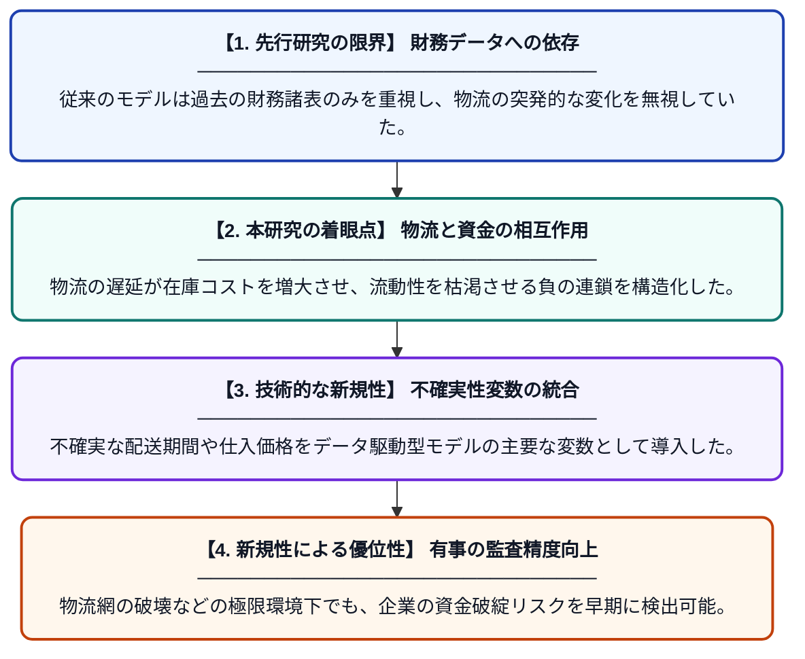

# 監査におけるデータ駆動型キャッシュフロー・モデリングと物流の不確実性要因

**Original Title**: *Logistics uncertainty factors in data-driven cash flow modelling in auditing*

> **💡 一言要約**: 物流の混乱と資金繰りの悪化を繋ぐ新しい監査モデル

| 項目 | 内容 |
|---|---|
| **著者** | M Ryndenko, J Yereshko |
| **掲載誌** | Ekonomichnyy analiz 2026 |
| **アラートキーワード** | logistics |
| **原文リンク** | [https://www.econa.org.ua/index.php/econa/article/view/6800](https://www.econa.org.ua/index.php/econa/article/view/6800) |
| **PDF版要約** | [README.pdf](./README.pdf) |

---

## 📊 新規性の図解（先行研究との違いと本研究のブレークスルー）

## 📝 要約

物流の混乱が企業の在庫管理や支払い条件、価格設定を通じて資金繰りに与える影響を分析した研究です。特にウクライナの状況を背景に、物流網の破壊が流動性リスクを増大させ、資金不足がさらに物流の信頼性を低下させる悪循環をデータに基づきモデル化しています。

## ❓ どんな問題に取り組んだか

従来の監査手法では、物流の物理的な混乱がキャッシュフローに与える動的な影響を十分に評価できていませんでした。特に紛争や災害下では、在庫の滞留や仕入価格の急騰が企業の流動性を急速に圧迫し、倒産リスクを高める重大な要因となります。

## ✨ 何が新しい？何がすごい？（新規性）

本研究は、物流の不確実性（納期、在庫回転、価格変動）をデータ駆動型の財務モデルに直接組み込んだ点が革新的です。先行研究が財務数値の分析に限定されていたのに対し、物理的な物流インフラの状態とキャッシュフローの相関を定量的かつ動的に捉えています。これにより、危機的状況下における企業の事業継続性（ゴーイング・コンサーン）をより正確に判定する監査フレームワークを構築しました。

## 🎓 大学1年生向けの解説

会社が倒産しないためには「現金の流れ」を把握することが重要ですが、実は「物の流れ（物流）」が止まると、お金の流れも止まってしまいます。この研究は、戦争などでトラックや船が動かなくなったとき、それがどのように企業の財布事情を苦しめるのかを計算する方法を考えました。数字上の記録だけでなく、現実の世界で起きている物流のトラブルをデータとして取り入れることで、より正確に会社の未来を予測できるようになります。これは、厳しい環境で働く企業を救うための新しい健康診断のようなものです。
