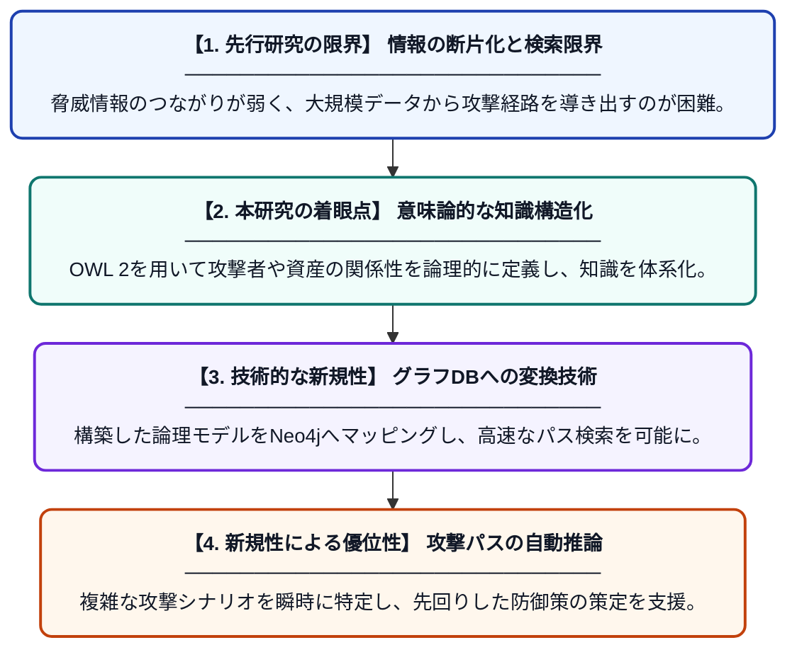

# セマンティック・サイバーセキュリティ：オントロジー駆動の攻撃パス推論とグラフベースの脅威インテリジェンス

**Original Title**: *Semantic Cybersecurity: Ontology-Driven Attack Path Reasoning and Graph-Based Threat Intelligence*

> **💡 一言要約**: グラフDBで攻撃者のルートを高速に予測する

| 項目 | 内容 |
|---|---|
| **著者** | M Elhajj |
| **掲載誌** | 22nd International Conference on Wireless and … 2026 |
| **アラートキーワード** | Ontology |
| **原文リンク** | [https://ieeexplore.ieee.org/abstract/document/11777876/](https://ieeexplore.ieee.org/abstract/document/11777876/) |
| **PDF版要約** | [README.pdf](./README.pdf) |

---

## 📊 新規性の図解（先行研究との違いと本研究のブレークスルー）

## 📝 要約

サイバー攻撃の知識をOWL 2形式のオントロジーとしてモデル化し、それをNeo4jグラフデータベースに統合する新しい手法を提案しています。これにより、攻撃者やマルウェアなどの複雑な関係性を構造化し、大規模なネットワークにおける攻撃経路を効率的に推論することが可能になります。

## ❓ どんな問題に取り組んだか

サイバー攻撃が複雑化する中で、断片的な脅威情報を統合して攻撃の全体像を把握することは非常に困難です。従来の分析手法では、データの関連性を大規模かつ柔軟に扱うことが難しく、潜在的な攻撃経路を迅速に特定する仕組みが不足していました。

## ✨ 何が新しい？何がすごい？（新規性）

本研究の大きな特徴は、厳格な知識表現である「オントロジー（OWL 2）」と、スケーラビリティに優れた「グラフデータベース（Neo4j）」を組み合わせた点にあります。先行研究では静的なモデル化に留まることが多かったのに対し、5つの主要エンティティを定義してマッピングすることで、動的な攻撃パスのクエリ実行を高速化しました。これにより、知識の再利用性と実用的な解析速度を両立させています。

## 🎓 大学1年生向けの解説

ハッカーがどうやって組織の重要なデータにたどり着くかを予測するのは、巨大な迷路を解くようなものです。この研究では、攻撃の手口やウイルスの特徴を「言葉のつながり」として整理し、それをコンピューターが得意な「網の目状の地図（グラフ）」に変換しました。これを使うと、カーナビのように「ハッカーが次にどこを通るか」を瞬時に見つけ出せるようになります。
