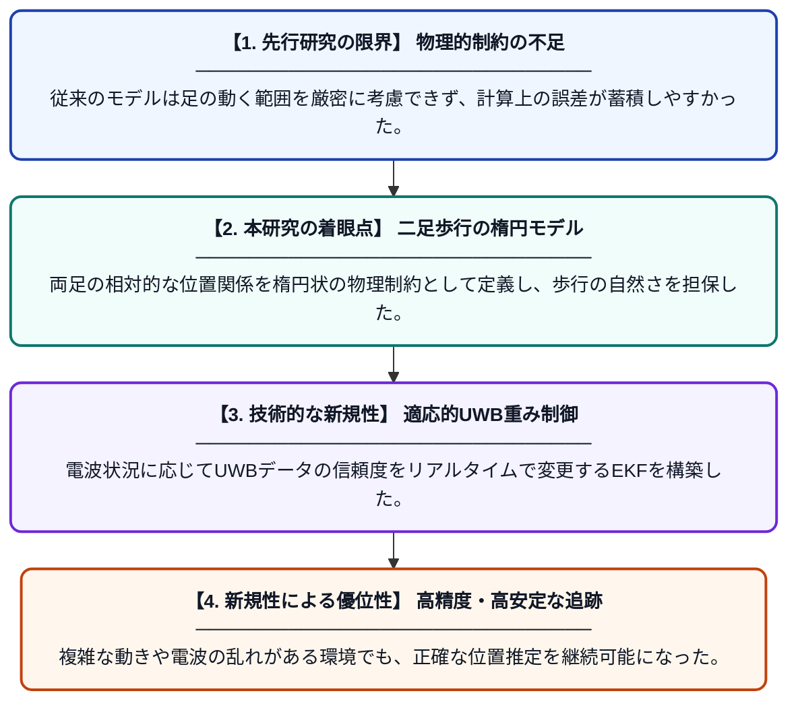

# 二足歩行楕円拘束と適応的UWB融合による歩行者自己位置推定

**Original Title**: *Pedestrian localization via bipedal ellipsoidal constraints and adaptive UWB fusion*

> **💡 一言要約**: 二足歩行の動きと電波を融合した高精度な屋内位置推定

| 項目 | 内容 |
|---|---|
| **著者** | Y Zhang, X Xu, F Shi, Y Zhu, X Wang |
| **掲載誌** | Measurement 2026 |
| **アラートキーワード** | kalman filter |
| **原文リンク** | [https://www.sciencedirect.com/science/article/pii/S0263224126035633](https://www.sciencedirect.com/science/article/pii/S0263224126035633) |
| **PDF版要約** | [README.pdf](./README.pdf) |

---

## 📊 新規性の図解（先行研究との違いと本研究のブレークスルー）

## 📝 要約

歩行者の両足の動きを楕円状の幾何学的制約としてモデル化し、UWB（超広帯域無線）の観測データを適応的に統合する新しい自己位置推定手法を提案しています。拡張カルマンフィルタ（EKF）を活用することで、UWB信号の信頼度に応じた重み付け制御を行い、屋内環境での推定精度を向上させました。

## ❓ どんな問題に取り組んだか

屋内での歩行者追跡において、足の動きの物理的な限界が考慮されにくい点や、UWB信号が障害物などで不安定になる際の精度低下が課題でした。従来の歩行モデルでは、不自然な移動経路を排除しきれず、誤差が蓄積しやすいという問題がありました。

## ✨ 何が新しい？何がすごい？（新規性）

両足の移動範囲を「二足歩行楕円拘束」として定義し、物理的に不可能な足の動きをフィルタリングする仕組みを導入した点が画期的です。また、UWBの観測状況に合わせて動的に重みを調整する適応的融合アルゴリズムをEKFに組み込んでいます。これにより、電波環境が変化しても歩行動作の物理的整合性を維持しながら、高精度な追跡を継続することが可能になりました。

## 🎓 大学1年生向けの解説

建物の中でスマホなどを使って自分の位置を特定する技術の研究です。人間が歩くとき、右足と左足が離れすぎることはありませんが、これまでの計算ではその「足の幅の限界」があまり考慮されていませんでした。この研究では、両足の動く範囲を楕円のような形で制限し、さらに電波での距離測定が不安定なときは自動で計算を調整するようにしました。これによって、建物の中でも自分の位置がズレにくくなります。
