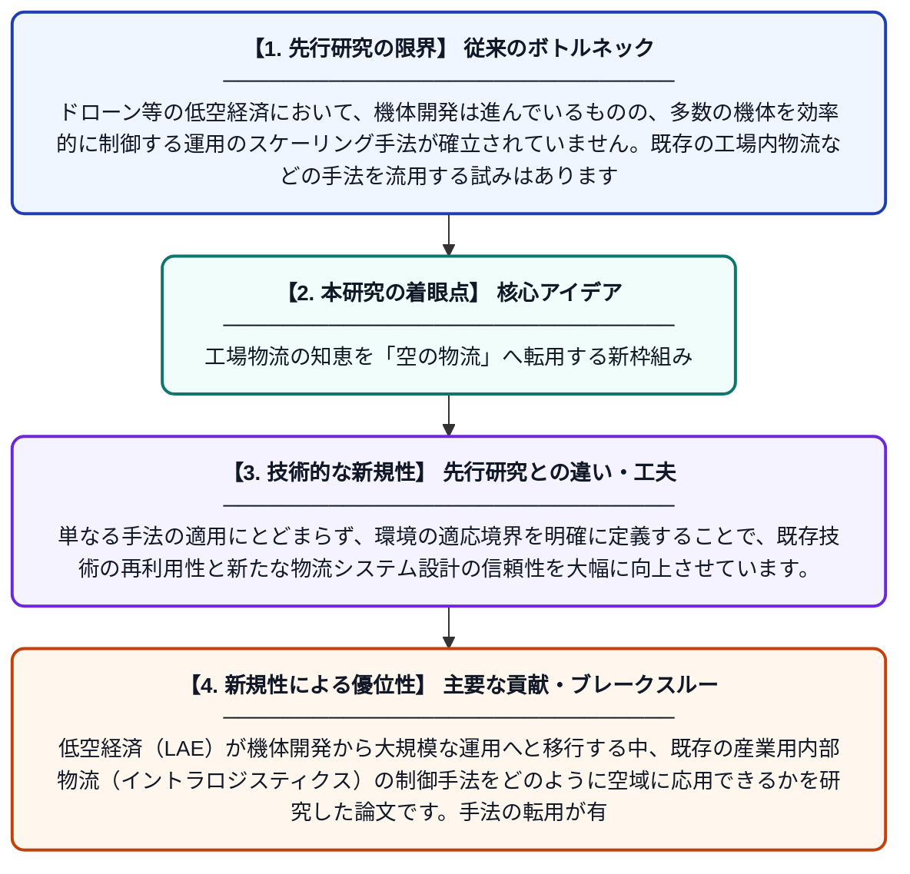

# 低空経済のための物流アーキテクチャ：内部物流制御手法を転移するための境界適応フレームワーク

**Original Title**: *Logistics architectures for the low-altitude economy: a bounded-adaptation framework for transferring intralogistics control methods*

> **💡 一言要約**: 工場物流の知恵を「空の物流」へ転用する新枠組み

| 項目 | 内容 |
|---|---|
| **著者** | J Fottner, F Top, T Huang, F Holzapfel, H Hong |
| **掲載誌** | Aerospace Systems 2026 |
| **アラートキーワード** | logistics |
| **原文リンク** | [https://link.springer.com/article/10.1007/s42401-026-00562-2](https://link.springer.com/article/10.1007/s42401-026-00562-2) |
| **PDF版要約** | [README.pdf](./README.pdf) |

---

## 📊 新規性の図解（先行研究との違いと本研究のブレークスルー）

## 📝 要約

低空経済（LAE）が機体開発から大規模な運用へと移行する中、既存の産業用内部物流（イントラロジスティクス）の制御手法をどのように空域に応用できるかを研究した論文です。手法の転用が有効となる条件を定義する「境界適応フレームワーク」を提案し、効率的な物流網の構築を目指しています。

## ❓ どんな問題に取り組んだか

ドローン等の低空経済において、機体開発は進んでいるものの、多数の機体を効率的に制御する運用のスケーリング手法が確立されていません。既存の工場内物流などの手法を流用する試みはありますが、どのような条件でそれらが有効に機能するかを判断する基準が欠けていました。

## ✨ 何が新しい？何がすごい？（新規性）

この論文の凄さは、確立された内部物流の制御理論を、物理的制約の異なる低空域へと安全かつ効率的に「移植」するための体系的なフレームワークを構築した点にあります。単なる手法の適用にとどまらず、環境の適応境界を明確に定義することで、既存技術の再利用性と新たな物流システム設計の信頼性を大幅に向上させています。

## 🎓 大学1年生向けの解説

ドローンを使った配送サービスを実現するには、何百台ものドローンをぶつからないように、かつ効率よく動かす仕組みが必要です。この研究は、すでに工場の中で自動ロボットが荷物を運ぶために使われている「頭脳」を、空のドローンにも使えるようにするためのルールブックを作りました。これにより、今ある技術を賢く使い回すことで、未来の空の物流をより早く、安全に実現できるようになります。
