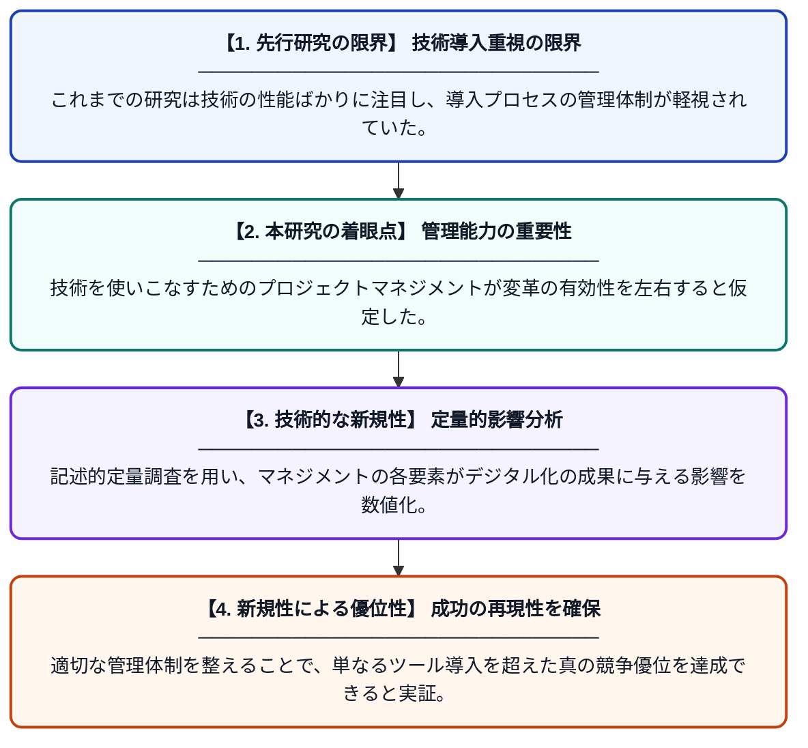

# JGAロジスティクスにおけるデジタル・サプライチェーン変革の有効性に対するプロジェクトマネジメントの役割

**Original Title**: *The Role of Project Management on The Effectiveness of Digital Supply Chain Transformation in JGA Logistics*

> **💡 一言要約**: 物流DXの成否を分けるのは、管理の質である。

| 項目 | 内容 |
|---|---|
| **著者** | A Yasmin, MF Alberyo, MI Ramadhan |
| **掲載誌** | International Seminar and Conference on … 2026 |
| **アラートキーワード** | logistics |
| **原文リンク** | [https://conference.unsil.ac.id/ismart/paper/view/220](https://conference.unsil.ac.id/ismart/paper/view/220) |
| **PDF版要約** | [README.pdf](./README.pdf) |

---

## 📊 新規性の図解（先行研究との違いと本研究のブレークスルー）

## 📝 要約

本研究は、物流企業JGAロジスティクスを対象に、サプライチェーンのデジタル化を成功させるためのプロジェクトマネジメントの影響を定量的に分析したものです。デジタル技術の導入が急速に進む中で、適切な管理体制が企業の競争力をいかに高めるかを明らかにしています。

## ❓ どんな問題に取り組んだか

多くの物流企業がデジタル技術の導入を急いでいますが、変革を主導するプロジェクトマネジメントの具体的な役割やその効果については十分に解明されていません。JGAロジスティクスにおいても、技術導入が実際の競争力向上にどう結びついているかを客観的に評価する必要がありました。

## ✨ 何が新しい？何がすごい？（新規性）

本研究の新規性は、サプライチェーンのデジタル変革（DX）における成功要因として、技術そのものよりも「プロジェクトマネジメント」の有効性に焦点を当て、実証的に分析した点にあります。先行研究では技術的なインフラ整備が重視される傾向にありましたが、本研究は組織的な管理プロセスが競争優位性を生む核心であることを定量的に示しました。これにより、物流業界におけるDXの実践的なガイドラインを提示しています。

## 🎓 大学1年生向けの解説

物流業界でも、AIやロボットなどの最新技術を使って仕事を便利にする「デジタル化」が求められています。しかし、新しいシステムをただ買っただけでは会社は強くなりません。この研究は、JGAロジスティクスという会社を例に、デジタル化の計画をしっかり立てて実行する「マネジメントの力」が、会社の強さを決める一番の鍵であることを分かりやすく証明しています。
