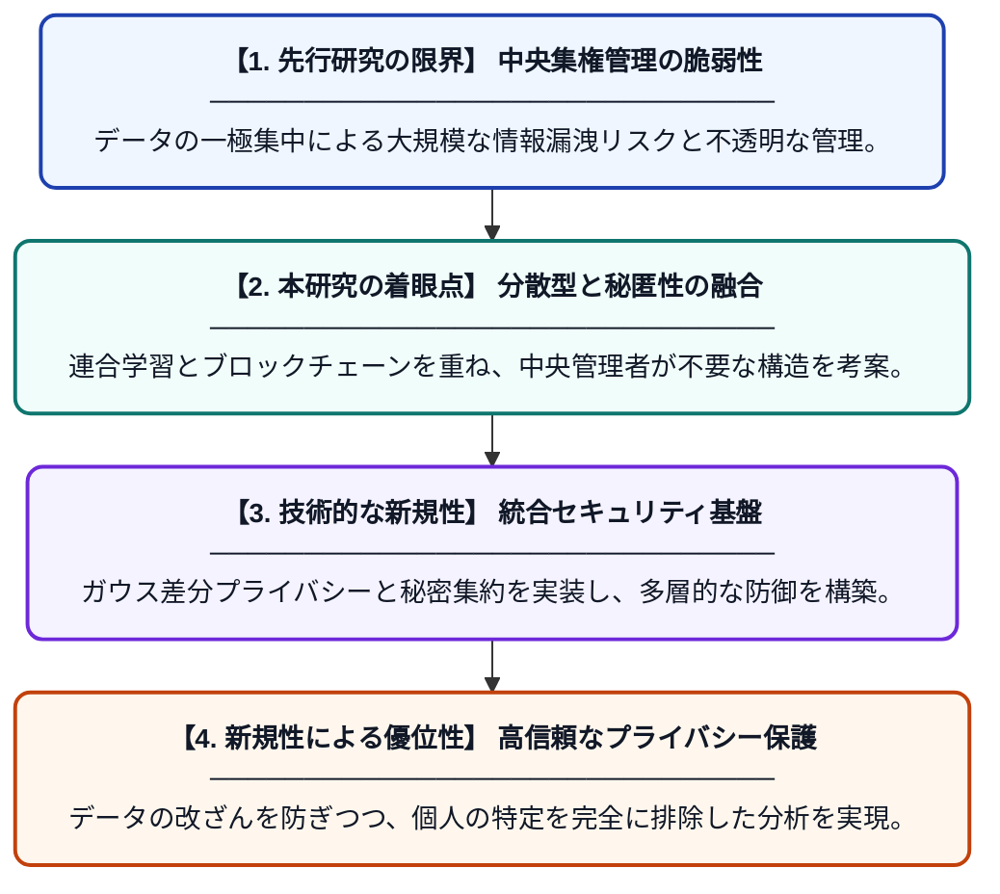

# ブロックチェーンと人工知能を用いたプライバシー保護データ分析

**Original Title**: *Privacy-Preserving Data Analytics Using Blockchain and Artificial Intelligence*

> **💡 一言要約**: 分散型技術で守る究極のデータプライバシー

| 項目 | 内容 |
|---|---|
| **著者** | S Nandhini, M Yuvarani, S Jagatheeswaran, I Ali |
| **掲載誌** | International Conference … 2026 |
| **アラートキーワード** | differential privacy |
| **原文リンク** | [https://ieeexplore.ieee.org/abstract/document/11746855/](https://ieeexplore.ieee.org/abstract/document/11746855/) |
| **PDF版要約** | [README.pdf](./README.pdf) |

---

## 📊 新規性の図解（先行研究との違いと本研究のブレークスルー）

## 📝 要約

連合学習、差分プライバシー、秘密集約、そしてブロックチェーンを統合した、新しいデータ分析の枠組みを提案しています。TensorFlow Federatedやガウスノイズを用いて、データの機密性を保ちながら高度なAIモデルを構築する手法を確立しました。

## ❓ どんな問題に取り組んだか

従来のデータ分析では、大量の個人情報を中央サーバーに集約する必要があり、情報漏洩やプライバシー侵害のリスクが避けられませんでした。また、中央集権的な管理体制ではデータの透明性や改ざん耐性の確保も困難という課題がありました。

## ✨ 何が新しい？何がすごい？（新規性）

本研究の革新性は、連合学習と差分プライバシーにブロックチェーンを組み合わせ、情報の秘匿性とシステムの透明性を同時に達成した点にあります。先行研究では各技術が個別に議論されがちでしたが、本手法はセキュアな集約プロセスにガウス分布によるノイズ注入とブロックチェーンによる記録保護を統合しました。これにより、悪意のある参加者がいてもデータの安全性を損なわずに、高精度な学習を継続できる強固なエコシステムを実現しています。

## 🎓 大学1年生向けの解説

病院や銀行のような秘密のデータを、一箇所に集めることなくみんなで賢いAIを作る方法についての研究です。自分のデータは自分の手元に置いたまま、AIが学んだ「エッセンス」だけを、改ざんできないブロックチェーンという帳簿を使って安全に交換します。さらに、そのデータにわざとわずかなノイズを加えることで、誰の情報か特定されるのを防ぎます。これにより、プライバシーを100%守りながら、世界中の知識をAIに学習させることが可能になります。
