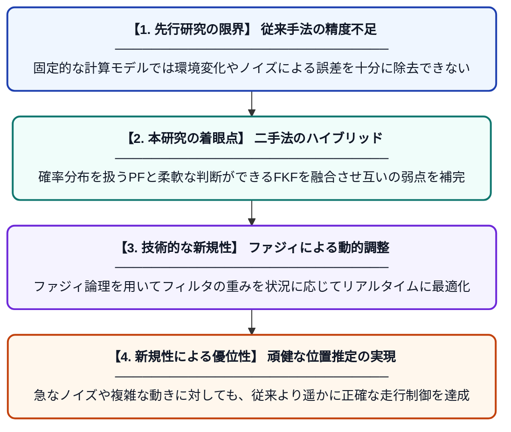

# パーティクルフィルタとファジィカルマンフィルタを用いた位置推定による無人搬送車（AGV）の航法・誘導制御システム

**Original Title**: *Navigation and Guidance Control System of Automated Guided Vehicle With Position Estimation Using Particle Filter and Fuzzy Kalman Filter*

> **💡 一言要約**: ファジィとPFの融合でAGVの精度を極める

| 項目 | 内容 |
|---|---|
| **著者** | K Oktafianto, M Miswanto, C Alfiniyah, T Herlambang… |
| **掲載誌** | Nonlinear Dynamics and … 2026 |
| **アラートキーワード** | kalman filter |
| **原文リンク** | [https://scholar.unair.ac.id/en/publications/navigation-and-guidance-control-system-of-automated-guided-vehicl/](https://scholar.unair.ac.id/en/publications/navigation-and-guidance-control-system-of-automated-guided-vehicl/) |
| **PDF版要約** | [README.pdf](./README.pdf) |

---

## 📊 新規性の図解（先行研究との違いと本研究のブレークスルー）

## 📝 要約

無人搬送車（AGV）の自己位置推定精度を向上させるため、パーティクルフィルタ（PF）とファジィカルマンフィルタ（FKF）を統合した新しい制御システムを提案しています。ファジィ論理をカルマンフィルタに組み込むことで、従来の手法では困難だったノイズや不確実性に対する堅牢性を大幅に高めました。

## ❓ どんな問題に取り組んだか

AGVが自動走行する際、センサーのノイズや環境の変化によって自己位置の推定に誤差が生じることが大きな課題です。従来のカルマンフィルタは線形的なノイズには強いものの、複雑な非線形システムや予測困難な外乱に対しては精度が低下するという限界がありました。

## ✨ 何が新しい？何がすごい？（新規性）

本研究の新規性は、確率的推定に優れたパーティクルフィルタと、人間の曖昧な判断をモデル化するファジィ論理を融合させた点にあります。ファジィ推論を導入することでカルマンフィルタのパラメータを動的に調整可能にし、従来のフィルタ単体よりも高いロバスト性を実現しました。これにより、シミュレーションにおいて既存手法を上回る推定精度と走行安定性の両立を証明しています。

## 🎓 大学1年生向けの解説

工場などで荷物を運ぶ自動ロボット（AGV）は、自分が今どこにいるかを正しく知る必要があります。しかし、センサーには必ず小さな誤差があるため、計算で正しい位置を予想しなければなりません。この研究では、2つの高度な計算方法を組み合わせ、さらに「状況に応じた柔軟な判断」ができる仕組みを取り入れることで、ロボットがより正確に、スムーズに目的地へたどり着けるようにしました。
