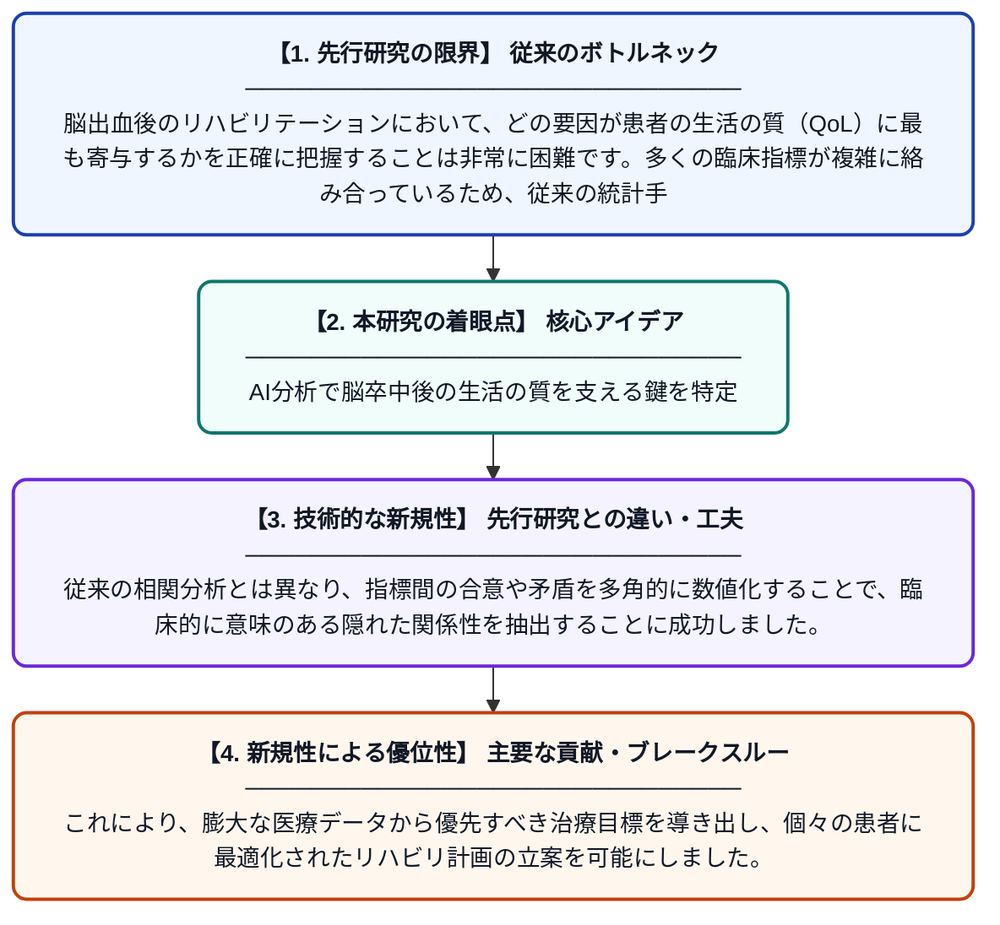

# 出血性脳卒中患者のリハビリテーション後の生活の質に影響を与える要因を評価するためのインタークリテリア分析（ICA）の適用

**Original Title**: *Application of InterCriteria Analysis for Evaluating Factors Influencing Quality of Life after Rehabilitation in Patients with Hemorrhagic Stroke*

> **💡 一言要約**: AI分析で脳卒中後の生活の質を支える鍵を特定

| 項目 | 内容 |
|---|---|
| **著者** | B Zaharieva, L Doukovska, L Encheva |
| **掲載誌** | 2026 IEEE 13th International Conference on… 2026 |
| **アラートキーワード** | ICA |
| **原文リンク** | [https://ieeexplore.ieee.org/abstract/document/11727111/](https://ieeexplore.ieee.org/abstract/document/11727111/) |
| **PDF版要約** | [README.pdf](./README.pdf) |

---

## 📊 新規性の図解（先行研究との違いと本研究のブレークスルー）

## 📝 要約

出血性脳卒中患者のリハビリテーション成果と生活の質（QoL）の関連性を、高度な分析手法であるインタークリテリア分析（ICA）を用いて調査した研究です。臨床的な指標間の相互関係を特定し、精密医療におけるICAの有用性とリハビリ計画への適用可能性を実証しています。

## ❓ どんな問題に取り組んだか

脳出血後のリハビリテーションにおいて、どの要因が患者の生活の質（QoL）に最も寄与するかを正確に把握することは非常に困難です。多くの臨床指標が複雑に絡み合っているため、従来の統計手法だけでは臨床的に重要な指標間の依存関係を完全には解明できていませんでした。

## ✨ 何が新しい？何がすごい？（新規性）

本研究の新規性は、直感的かつ数学的なアプローチである「インタークリテリア分析（ICA）」をリハビリ評価に導入した点にあります。従来の相関分析とは異なり、指標間の合意や矛盾を多角的に数値化することで、臨床的に意味のある隠れた関係性を抽出することに成功しました。これにより、膨大な医療データから優先すべき治療目標を導き出し、個々の患者に最適化されたリハビリ計画の立案を可能にしました。

## 🎓 大学1年生向けの解説

脳の血管が破れる「脳出血」を経験した人が、退院後にどれだけ自分らしい生活を送れるかは非常に重要です。この研究では、最新の数学的な分析方法を使って、リハビリの結果と生活の質の間にどのようなつながりがあるかを調べました。複雑なデータから「どのリハビリが生活の質を高めるのに最も効果的か」を見つけ出すことで、より効率的な治療ができるようになります。この技術を使えば、将来的に患者さん一人ひとりに合わせた「オーダーメイドのリハビリ」が実現しやすくなります。
