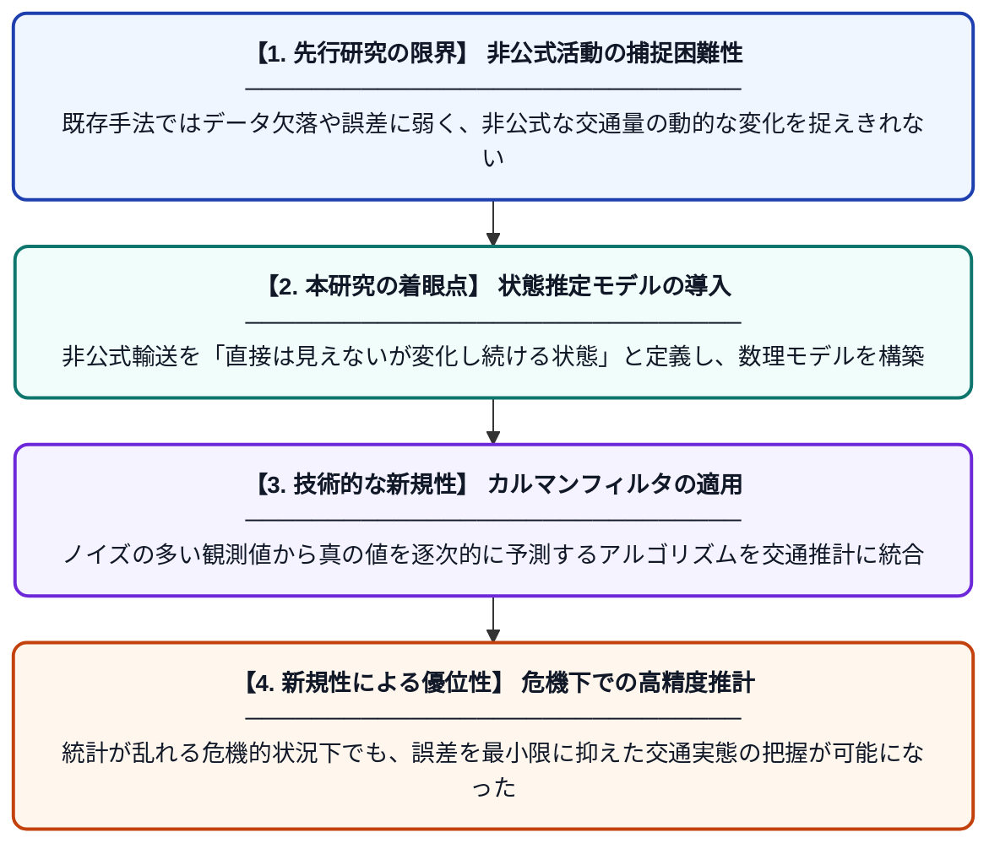

# チュニジアにおける非公式道路旅客輸送の測定をめぐる統計的課題：危機的状況下でのカルマンフィルタ解析からの知見

**Original Title**: *Statistical Issues in Measuring Informal Road Passenger Transport in Tunisia: Insights from Kalman Filter Analysis in Crisis Contexts*

> **💡 一言要約**: カルマンフィルタで非公式輸送の「実態」を可視化

| 項目 | 内容 |
|---|---|
| **著者** | K Ben Abdallah, A Ghédira |
| **掲載誌** | … Statistical Methods for Transportation Economics and … 2027 |
| **アラートキーワード** | kalman filter |
| **原文リンク** | [https://www.worldscientific.com/doi/abs/10.1142/9781800619647_0008](https://www.worldscientific.com/doi/abs/10.1142/9781800619647_0008) |
| **PDF版要約** | [README.pdf](./README.pdf) |

---

## 📊 新規性の図解（先行研究との違いと本研究のブレークスルー）

## 📝 要約

チュニジアにおける把握が困難な非公式な公共交通機関の実態を、統計的に推計するための新しい手法を提案しています。特に社会的な危機下での不完全なデータを扱うため、制御工学の手法であるカルマンフィルタを適用し、精度の高い推定を実現しました。

## ❓ どんな問題に取り組んだか

非公式な交通セクターは公的な統計に現れにくく、正確な需要や供給の把握が極めて困難です。特に経済的・社会的な危機の最中では、既存の静的な統計調査ではデータのノイズや欠落に対応できず、有効な政策立案が妨げられていました。

## ✨ 何が新しい？何がすごい？（新規性）

従来、経済学では静的な推計モデルが一般的でしたが、本研究は制御理論で用いられる「カルマンフィルタ」を交通経済学に応用しました。これにより、非公式輸送という「観測不可能な状態」を、他の観測可能な指標から動的に追跡・予測できるようにした点が、これまでの先行研究にはない独自の貢献です。

## 🎓 大学1年生向けの解説

チュニジアでは、国の許可を得ずに営業しているタクシーやバスが重要な移動手段になっていますが、正確な数は誰にもわかっていません。この研究は、ロボットの姿勢制御などに使われる数学的なテクニック（カルマンフィルタ）を使い、不正確なデータから「本当の交通量」を割り出す方法を開発しました。これによって、社会が混乱している時期でも、人々の移動の実態を科学的に捉えることが可能になります。
