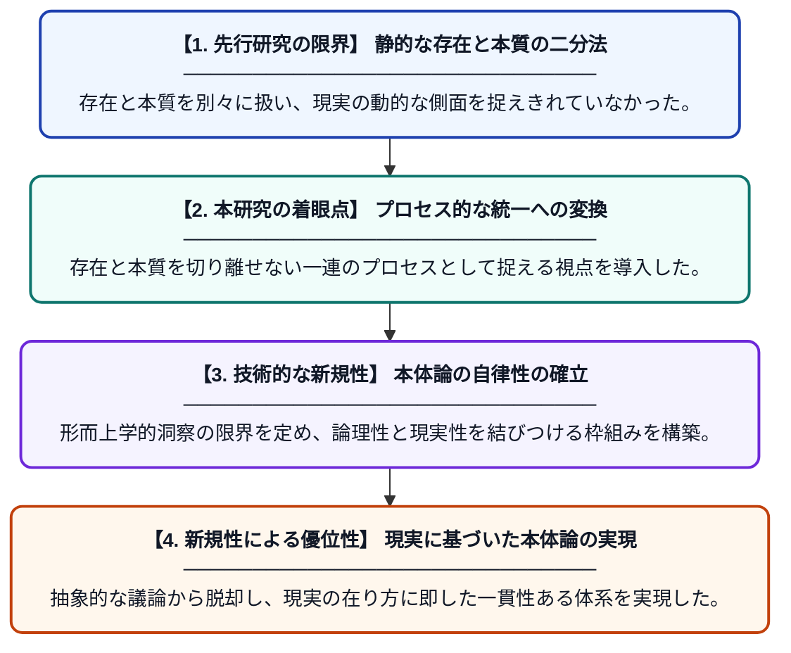

# 本体論、存在、そして形而上学的洞察の限界：現実の哲学の視点からのガルシア＝ゴンサレス批判的検討

**Original Title**: *Ontology, Existence, and the Limits of Metaphysical Insight: A Critical Review of García-González from the Perspective of the Philosophy of Reality*

> **💡 一言要約**: 存在と本質の動的統一で本体論を再構築する

| 項目 | 内容 |
|---|---|
| **著者** | AE Zhalnin |
| **アラートキーワード** | Ontology |
| **PDF** | [https://philpapers.org/archive/ZHAOEA-2.pdf](https://philpapers.org/archive/ZHAOEA-2.pdf) |
| **原文リンク** | [https://philpapers.org/archive/ZHAOEA-2.pdf](https://philpapers.org/archive/ZHAOEA-2.pdf) |
| **PDF版要約** | [README.pdf](./README.pdf) |

---

## 📊 新規性の図解（先行研究との違いと本研究のブレークスルー）

## 📝 要約

ガルシア＝ゴンサレスの思想を「現実の哲学」という独自の視点から批判的に再評価し、本体論を存在と本質のプロセス的統一として再構築することを試みた論文です。存在概念の明確化を通じて、形而上学的洞察に依存しすぎない本体論の自律性を確立することを目指しています。

## ❓ どんな問題に取り組んだか

従来の本体論においては、存在と本質の関係が固定的に捉えられがちであり、存在の概念定義が曖昧なまま議論が進む傾向がありました。特に形而上学的洞察に過度に依存することで、本体論が論理的・現実的な自律性を欠いているという課題がありました。

## ✨ 何が新しい？何がすごい？（新規性）

本研究の新規性は、存在と本質を静的な属性ではなく「プロセスとしての統一」として捉え直した点にあります。ガルシア＝ゴンサレスの議論を批判的に乗り越えることで、形而上学的洞察の限界を定義し、存在の自律性を論理的に導出する新しい枠組みを提示しました。これにより、主観的な直感に頼らない「現実」に基づいた新しい本体論の体系化に貢献しています。

## 🎓 大学1年生向けの解説

「そもそも存在するとはどういうことか」という哲学の根本的な問いについて考える論文です。これまでは「物の性質」と「そこにあること」を別々に考えがちでしたが、この論文はそれを一つの動くプロセスとして捉えるべきだと提案しています。難しい言葉だけで考えるのではなく、現実の動きに注目することで、より確かな哲学のルールを作ろうとしています。哲学の深遠な議論を、現代的な視点で整理し直した一冊です。
