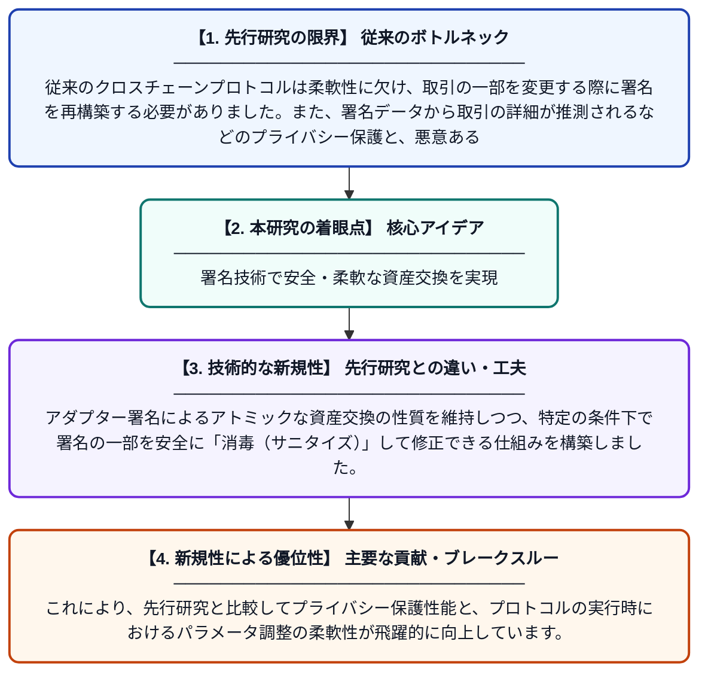

# SanCross: サニタイザブル・アダプター署名による安全なクロスチェーン取引プロトコル

**Original Title**: *SanCross: Secure Cross-Chain Transaction Protocol Via Sanitizable Adaptor Signature*

> **💡 一言要約**: 署名技術で安全・柔軟な資産交換を実現

| 項目 | 内容 |
|---|---|
| **著者** | Y Yao, P Jiang, L Zhu |
| **掲載誌** | … Transactions on Dependable and Secure Computing 2026 |
| **アラートキーワード** | Secure Computing |
| **原文リンク** | [https://ieeexplore.ieee.org/abstract/document/11749611/](https://ieeexplore.ieee.org/abstract/document/11749611/) |
| **PDF版要約** | [README.pdf](./README.pdf) |

---

## 📊 新規性の図解（先行研究との違いと本研究のブレークスルー）

## 📝 要約

異なるブロックチェーン間での資産交換を安全かつ柔軟に行うための新プロトコル「SanCross」を提案しています。サニタイザブル・アダプター署名を導入することで、取引の安全性とプライバシーを保ちつつ、署名の事後改変を可能にしました。

## ❓ どんな問題に取り組んだか

従来のクロスチェーンプロトコルは柔軟性に欠け、取引の一部を変更する際に署名を再構築する必要がありました。また、署名データから取引の詳細が推測されるなどのプライバシー保護と、悪意ある操作に対する強固な安全性の両立が課題となっていました。

## ✨ 何が新しい？何がすごい？（新規性）

本研究は「サニタイザブル・アダプター署名（SAS）」をクロスチェーン取引に初めて適用した点が革新的です。アダプター署名によるアトミックな資産交換の性質を維持しつつ、特定の条件下で署名の一部を安全に「消毒（サニタイズ）」して修正できる仕組みを構築しました。これにより、先行研究と比較してプライバシー保護性能と、プロトコルの実行時におけるパラメータ調整の柔軟性が飛躍的に向上しています。

## 🎓 大学1年生向けの解説

種類の違うブロックチェーン間でコインを交換するのは、実はとても難しい技術が必要です。これまでは一度決めた条件を少しでも変えようとすると、最初からやり直す必要がありました。この研究では「後から安全に一部だけ書き換えられる特別な電子印鑑」を開発することで、途中で条件を微調整しても安全に、かつ誰にも内容を盗み見られずに資産を交換できるようにしました。
