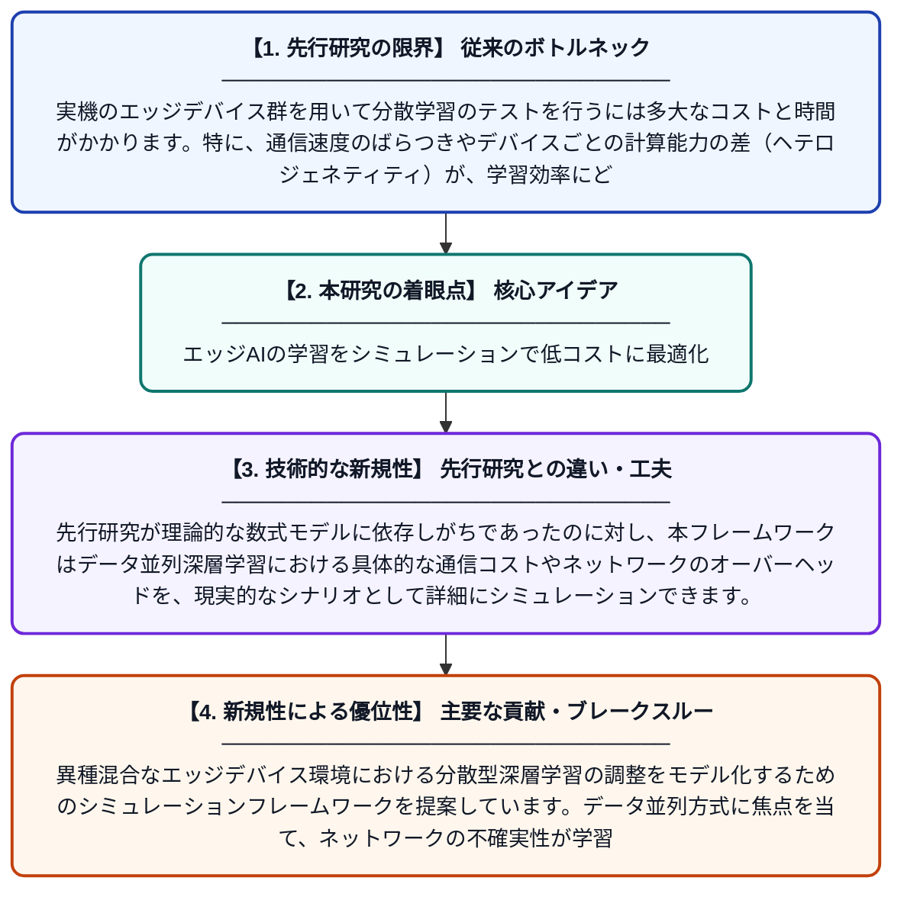

# 深層学習の分散型エッジ学習に向けたエージェントベースのシミュレーション

**Original Title**: *Agent-based simulation of distributed edge learning for deep neural networks*

> **💡 一言要約**: エッジAIの学習をシミュレーションで低コストに最適化

| 項目 | 内容 |
|---|---|
| **著者** | J López, A Abhari |
| **掲載誌** | SIMULATION 2026 |
| **アラートキーワード** | distributed deep learning ... |
| **PDF** | [https://journals.sagepub.com/doi/pdf/10.1177/00375497261496451](https://journals.sagepub.com/doi/pdf/10.1177/00375497261496451) |
| **原文リンク** | [https://journals.sagepub.com/doi/pdf/10.1177/00375497261496451](https://journals.sagepub.com/doi/pdf/10.1177/00375497261496451) |
| **PDF版要約** | [README.pdf](./README.pdf) |

---

## 📊 新規性の図解（先行研究との違いと本研究のブレークスルー）

## 📝 要約

異種混合なエッジデバイス環境における分散型深層学習の調整をモデル化するためのシミュレーションフレームワークを提案しています。データ並列方式に焦点を当て、ネットワークの不確実性が学習プロセスに与える影響を、低コストかつ詳細に評価できる手法を確立しました。

## ❓ どんな問題に取り組んだか

実機のエッジデバイス群を用いて分散学習のテストを行うには多大なコストと時間がかかります。特に、通信速度のばらつきやデバイスごとの計算能力の差（ヘテロジェネティティ）が、学習効率にどのように影響するかを動的に把握することが困難でした。

## ✨ 何が新しい？何がすごい？（新規性）

本研究は、エージェントベースモデルを採用することで、個々のデバイスの振る舞いやネットワークの複雑性をシミュレーション上で再現可能にした点が革新的です。先行研究が理論的な数式モデルに依存しがちであったのに対し、本フレームワークはデータ並列深層学習における具体的な通信コストやネットワークのオーバーヘッドを、現実的なシナリオとして詳細にシミュレーションできます。

## 🎓 大学1年生向けの解説

たくさんのスマートフォンなどの小さな端末（エッジ端末）を協力させて、みんなで賢いAI（深層学習）を作るための研究です。本物の端末を何百台も用意して実験するのは大変なので、コンピューターの中に「仮想の端末たち」を再現する仕組みを作りました。これを使うと、通信が遅いときや性能がバラバラな端末が混ざっているときに、どうすれば一番うまく学習が進むかを簡単に試すことができます。
