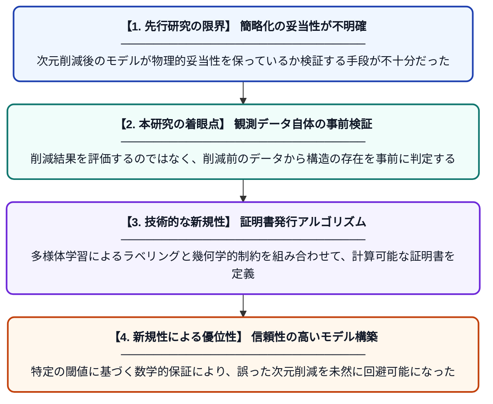

# 反応拡散格子におけるデータ駆動型次元削減のための計算可能な証明書

**Original Title**: *Computable certificates for data-driven dimension reduction on reaction-diffusion lattices*

> **💡 一言要約**: 次元削減の信頼性を数学的に保証する新技術

| 項目 | 内容 |
|---|---|
| **著者** | Y Li |
| **掲載誌** | arXiv preprint arXiv:2611.29984 2026 |
| **アラートキーワード** | manifold learning |
| **PDF** | [https://arxiv.org/pdf/2611.29984](https://arxiv.org/pdf/2611.29984) |
| **原文リンク** | [https://arxiv.org/pdf/2611.29984](https://arxiv.org/pdf/2611.29984) |
| **PDF版要約** | [README.pdf](./README.pdf) |

---

## 📊 新規性の図解（先行研究との違いと本研究のブレークスルー）

## 📝 要約

複雑な反応拡散系の格子モデルにおいて、データから次元削減を行う際の信頼性を保証する「計算可能な証明書」という枠組みを提案しています。多様体学習を用いて訓練データのラベル付けを行い、低次元構造が物理的に妥当かどうかを事前に検証する手法を確立しました。

## ❓ どんな問題に取り組んだか

反応拡散系のような複雑な物理現象を簡略化（次元削減）する際、得られた低次元モデルが元の現象を正しく反映しているかを確認する客観的な基準が不足していました。特に、観測データから直接、モデルの正当性を証明する具体的な計算手法が求められていました。

## ✨ 何が新しい？何がすごい？（新規性）

本研究は、低次元構造が存在することを前提とするのではなく、観測データの段階で「計算可能な証明書」を発行して構造を事前チェックする点が斬新です。多様体学習のステップを条件付けラベルとして利用し、特定の閾値を超えた際に低次元構造が確実に存在することを理論的に保証する仕組みを構築しました。これにより、ブラックボックスになりがちな次元削減に幾何学的な裏付けを与えています。

## 🎓 大学1年生向けの解説

化学反応や生き物の模様が広がる様子（反応拡散）をシミュレーションするのは大変なので、重要なポイントだけを抜き出して計算を楽にする工夫が必要です。しかし、抜き出しすぎると元の形が崩れてしまうかもしれません。この研究は、計算を始める前に「この抜き出し方は正しいですよ」というお墨付き（証明書）をデータから自動で作る方法を開発しました。これにより、間違った簡略化を防ぎ、より正確に未来を予測できるようになります。
