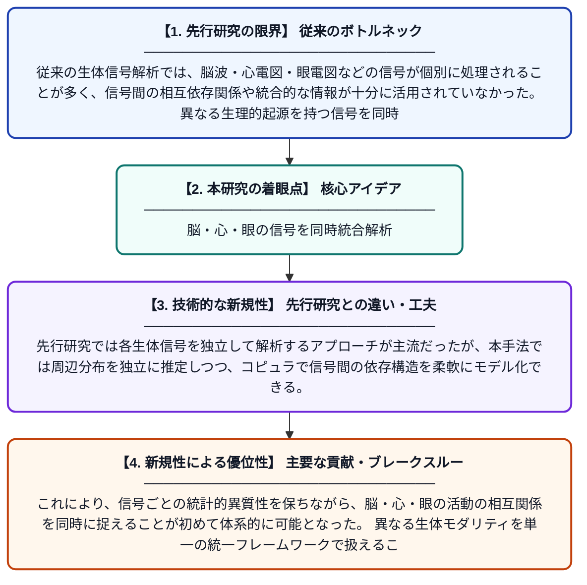

# 結合密度解析法による複合分析：脳波（EEG）・心電図（ECG）・眼電図（EOG）生体信号の同時統合

**Original Title**: *Combined Analysis Using the Joint Density Analysis Method: Simultaneous Integration of Brain (EEG), Heart (ECG), and Eye (EOG) Biosignals*

> **💡 一言要約**: 脳・心・眼の信号を同時統合解析

| 項目 | 内容 |
|---|---|
| **著者** | I Domuschiev |
| **アラートキーワード** | kernel density estimation |
| **PDF** | [https://www.researchgate.net/profile/Ivan-Domuschiev/publication/410793067_Combined_Analysis_Using_the_Joint_Density_Analysis_Method_Simultaneous_Integration_of_Brain_EEG_Heart_ECG_and_Eye_EOG_Biosignals_A_Copula-Based_Framework_for_Multimodal_Neuro-Cardio-Ocular_Psychophysi/links/6a63cda7ef3d290979983c1b/Combined-Analysis-Using-the-Joint-Density-Analysis-Method-Simultaneous-Integration-of-Brain-EEG-Heart-ECG-and-Eye-EOG-Biosignals-A-Copula-Based-Framework-for-Multimodal-Neuro-Cardio-Ocular-Psychophy.pdf](https://www.researchgate.net/profile/Ivan-Domuschiev/publication/410793067_Combined_Analysis_Using_the_Joint_Density_Analysis_Method_Simultaneous_Integration_of_Brain_EEG_Heart_ECG_and_Eye_EOG_Biosignals_A_Copula-Based_Framework_for_Multimodal_Neuro-Cardio-Ocular_Psychophysi/links/6a63cda7ef3d290979983c1b/Combined-Analysis-Using-the-Joint-Density-Analysis-Method-Simultaneous-Integration-of-Brain-EEG-Heart-ECG-and-Eye-EOG-Biosignals-A-Copula-Based-Framework-for-Multimodal-Neuro-Cardio-Ocular-Psychophy.pdf) |
| **原文リンク** | [https://www.researchgate.net/profile/Ivan-Domuschiev/publication/410793067_Combined_Analysis_Using_the_Joint_Density_Analysis_Method_Simultaneous_Integration_of_Brain_EEG_Heart_ECG_and_Eye_EOG_Biosignals_A_Copula-Based_Framework_for_Multimodal_Neuro-Cardio-Ocular_Psychophysi/links/6a63cda7ef3d290979983c1b/Combined-Analysis-Using-the-Joint-Density-Analysis-Method-Simultaneous-Integration-of-Brain-EEG-Heart-ECG-and-Eye-EOG-Biosignals-A-Copula-Based-Framework-for-Multimodal-Neuro-Cardio-Ocular-Psychophy.pdf](https://www.researchgate.net/profile/Ivan-Domuschiev/publication/410793067_Combined_Analysis_Using_the_Joint_Density_Analysis_Method_Simultaneous_Integration_of_Brain_EEG_Heart_ECG_and_Eye_EOG_Biosignals_A_Copula-Based_Framework_for_Multimodal_Neuro-Cardio-Ocular_Psychophysi/links/6a63cda7ef3d290979983c1b/Combined-Analysis-Using-the-Joint-Density-Analysis-Method-Simultaneous-Integration-of-Brain-EEG-Heart-ECG-and-Eye-EOG-Biosignals-A-Copula-Based-Framework-for-Multimodal-Neuro-Cardio-Ocular-Psychophy.pdf) |
| **PDF版要約** | [README.pdf](./README.pdf) |

---

## 📊 新規性の図解（先行研究との違いと本研究のブレークスルー）

## 📝 要約

本論文では、脳波・心電図・眼電図という異なる生体信号を同時に統合するコピュラベースのアーキテクチャを提案している。各信号の周辺分布をカーネル密度推定またはパラメトリックフィッティングで個別に推定した後、コピュラによって信号間の依存構造を再結合する手法を採用している。この結合密度解析法により、複数の生体信号に含まれる相互依存情報を効率的に活用することが可能となる。

## ❓ どんな問題に取り組んだか

従来の生体信号解析では、脳波・心電図・眼電図などの信号が個別に処理されることが多く、信号間の相互依存関係や統合的な情報が十分に活用されていなかった。異なる生理的起源を持つ信号を同時に扱う際、各信号の統計的特性の違いが統合解析の大きな障壁となっていた。

## ✨ 何が新しい？何がすごい？（新規性）

本研究の新規性は、コピュラ理論を生体信号統合に適用した点にある。先行研究では各生体信号を独立して解析するアプローチが主流だったが、本手法では周辺分布を独立に推定しつつ、コピュラで信号間の依存構造を柔軟にモデル化できる。これにより、信号ごとの統計的異質性を保ちながら、脳・心・眼の活動の相互関係を同時に捉えることが初めて体系的に可能となった。異なる生体モダリティを単一の統一フレームワークで扱えることが主要な貢献である。

## 🎓 大学1年生向けの解説

私たちの体は、脳・心臓・目など様々な臓器から電気信号を出しています。これらの信号をバラバラに調べるのではなく、同時にまとめて解析しようというのがこの研究のアイデアです。コピュラという数学的な道具を使って、それぞれの信号の個性を保ちながら信号同士の関係性を捉えます。例えば、目の動きと脳波の変化がどう連動しているかを一度に分析できます。これにより、健康状態の把握や医療診断がより精度よくできるようになることが期待されます。
