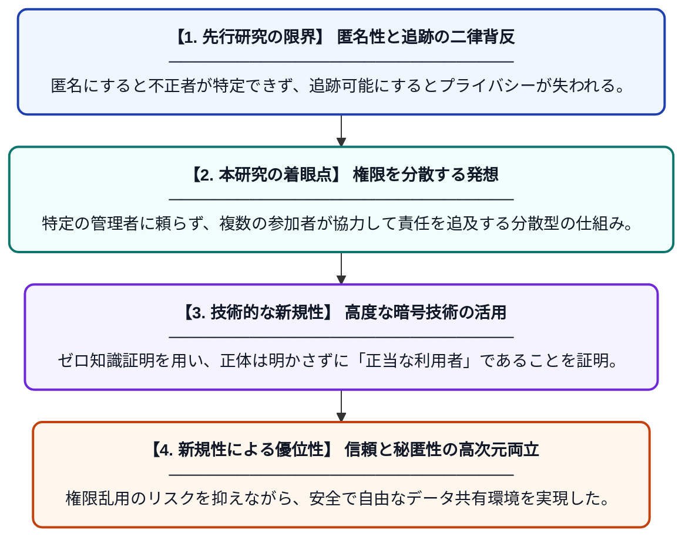

# 匿名性と分散型責任追及を両立したオープンデータ共有

**Original Title**: *Open Data Sharing with Anonymity and Decentralized Accountability*

> **💡 一言要約**: 匿名性を守りつつ、不正は見逃さない分散型データ共有

| 項目 | 内容 |
|---|---|
| **著者** | M Jia, J Chen, K He, R Du, L Luo, M Shi, E Zhou, L Su |
| **掲載誌** | … and Secure Computing 2026 |
| **アラートキーワード** | Secure Computing |
| **原文リンク** | [https://ieeexplore.ieee.org/abstract/document/11782858/](https://ieeexplore.ieee.org/abstract/document/11782858/) |
| **PDF版要約** | [README.pdf](./README.pdf) |

---

## 📊 新規性の図解（先行研究との違いと本研究のブレークスルー）

## 📝 要約

データ提供者の匿名性を保護しながら、不正行為が発生した際には特定の管理者に依存せず分散的に責任を追及できる新しいデータ共有フレームワークを提案しています。暗号技術を駆使することで、プライバシーの確保と信頼性の維持を高度に両立させています。

## ❓ どんな問題に取り組んだか

従来のデータ共有では、匿名性を高めると悪意のあるデータが投稿された際の犯人特定が困難になり、逆に追跡を可能にすると特定の管理機関に権限が集中しプライバシーが侵害されるというジレンマがありました。中央集権的な信頼に頼らずに、いかに安全な共有環境を作るかが課題でした。

## ✨ 何が新しい？何がすごい？（新規性）

本論文の核心は、単一の権力者に依存しない「分散型責任追及メカニズム」を構築した点にあります。高度な暗号技術（ゼロ知識証明など）を応用し、通常時はユーザーの身元を完全に秘匿しつつ、不正検知時のみ複数の参加者の合意によって身元を特定できる仕組みを実現しました。これにより、先行研究で課題だった「管理者の権限乱用」と「不正者の逃げ得」を同時に解決しています。

## 🎓 大学1年生向けの解説

インターネットでデータを共有する際、「名前を隠したい（匿名性）」という願いと、「嘘の情報を流した人を特定したい（責任追及）」という願いを同時に叶えるのは非常に難しい課題です。これまでは一人の「超強力な管理者」が全員を見張ることで解決していましたが、その管理者が勝手に個人情報を覗き見るリスクがありました。この研究は、魔法のような数学（暗号）を使って、一人の管理者に頼らなくても、みんなでルールを守りながら匿名で安全にデータを共有できる仕組みを作りました。
