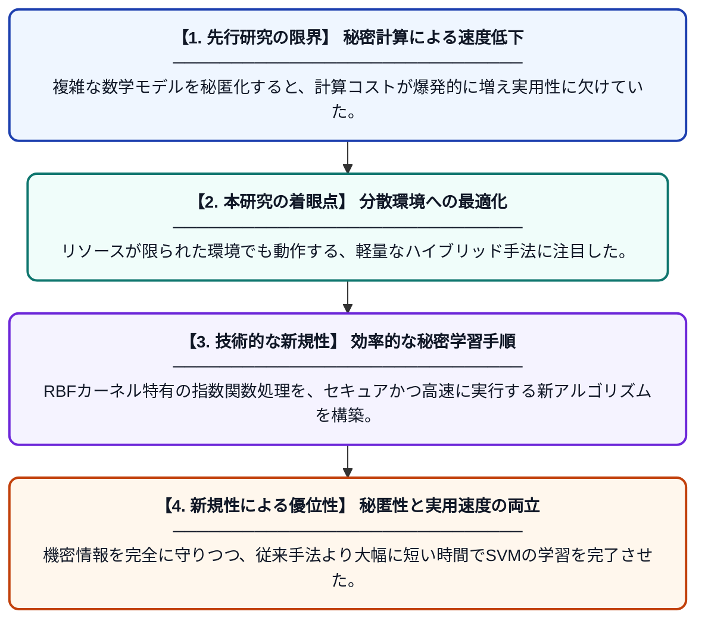

# RBFカーネルを用いたSVMの効率的な秘密計算による2者間学習に向けて

**Original Title**: *Toward efficient privacy-preserving two-party training for RBF kernel SVMs*

> **💡 一言要約**: データの秘匿性とSVM学習の効率化を両立する新技術

| 項目 | 内容 |
|---|---|
| **著者** | Q Mo, W Wu, J Chen |
| **掲載誌** | Cybersecurity 2026 |
| **アラートキーワード** | Secure Computing |
| **原文リンク** | [https://link.springer.com/article/10.1186/s42400-026-00642-y](https://link.springer.com/article/10.1186/s42400-026-00642-y) |
| **PDF版要約** | [README.pdf](./README.pdf) |

---

## 📊 新規性の図解（先行研究との違いと本研究のブレークスルー）

## 📝 要約

プライバシーを保護した状態で、RBFカーネルを用いたサポートベクターマシン（SVM）を2者間で効率的に学習させる手法を提案しています。計算資源が限られた分散環境でも動作するよう、計算コストの高い非線形処理を最適化したハイブリッドなアプローチを採用しています。

## ❓ どんな問題に取り組んだか

RBFカーネルSVMは高度な分類が可能ですが、複雑な指数関数計算を含むため、データを隠したまま計算する「秘密計算」では処理が非常に重くなる課題がありました。特に、リソースが限られたデバイスや分散環境では、実用的な速度で学習を行うことが困難でした。

## ✨ 何が新しい？何がすごい？（新規性）

本研究は、非線形演算をセキュアに処理するためのハイブリッドな計算プロトコルを開発し、通信量と計算負荷を大幅に削減した点が画期的です。従来の秘密計算手法では扱いきれなかった複雑なアルゴリズムを、分散環境向けに最適化して再構築しています。これにより、精度の高いモデルをプライバシーを保ちつつ現実的な時間で学習させることに成功しました。

## 🎓 大学1年生向けの解説

例えば、2つの病院が患者のデータを互いに隠したまま、協力して強力な診断AIを作りたいとします。しかし、データを隠したまま高度な計算をしようとすると、これまでは膨大な時間がかかっていました。この論文は、その計算方法を工夫して「データを隠す安全さ」はそのままに、驚くほど速くAIの学習を終わらせる方法を編み出したというものです。
