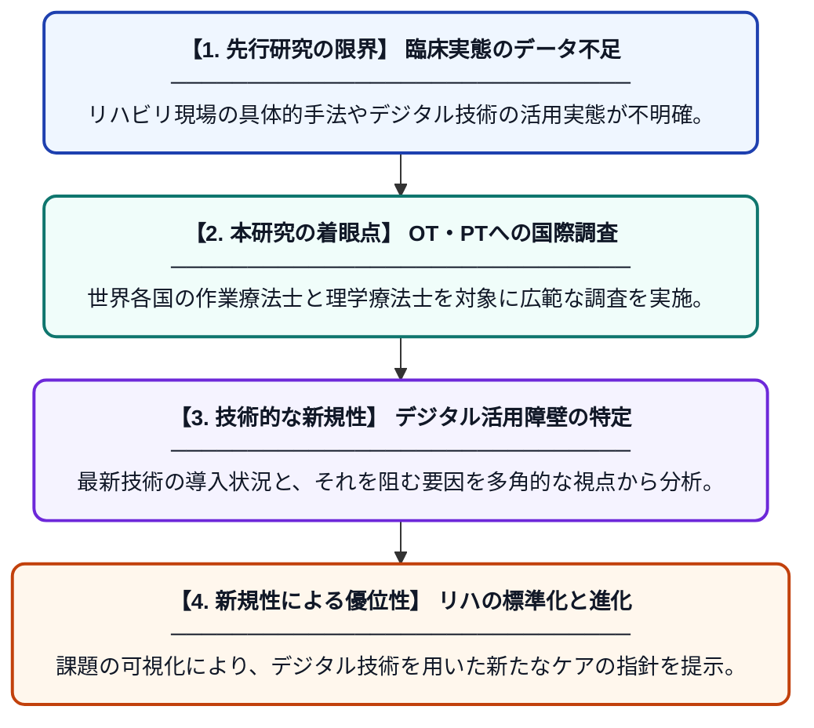

# ALS/MNDにおける現在のリハビリテーションアプローチとデジタルヘルス技術の活用；作業療法士と理学療法士を対象とした国際調査

**Original Title**: *Current rehabilitation approaches in ALS/MND and use of digital health technology; an international survey of occupational therapists and physiotherapists*

> **💡 一言要約**: ALSリハの実態とデジタル技術の活用を世界規模で調査

| 項目 | 内容 |
|---|---|
| **著者** | A Mc Tague, L Doyle, M Walls, D Murray, M Galvin… |
| **掲載誌** | Amyotrophic Lateral … 2026 |
| **アラートキーワード** | ALS |
| **原文リンク** | [https://www.tandfonline.com/doi/full/10.1080/21678421.2026.2752343](https://www.tandfonline.com/doi/full/10.1080/21678421.2026.2752343) |
| **PDF版要約** | [README.pdf](./README.pdf) |

---

## 📊 新規性の図解（先行研究との違いと本研究のブレークスルー）

## 📝 要約

この研究は、ALS/MNDのリハビリテーションにおける作業療法士（OT）と理学療法士（PT）の現状のアプローチと、デジタルヘルス技術の利用実態を国際調査によって明らかにしました。専門家がどの段階でどのような介入を行い、最新技術をどのように取り入れているかという実態を詳細に分析しています。

## ❓ どんな問題に取り組んだか

ALS/MND患者へのリハビリは全ての進行段階で不可欠ですが、実際の臨床現場でOTやPTがどのような手法を用いているかについての体系的な研究は不足していました。特に、デジタルヘルス技術がリハビリの現場でどの程度、どのような目的で活用されているかが不明確であるという課題がありました。

## ✨ 何が新しい？何がすごい？（新規性）

本研究は、ALS/MNDのリハビリテーション実態を国際的な規模で、かつOTとPTという二つの主要な専門職を横断して調査した点に大きな新規性があります。先行研究では限定的だったデジタルヘルス技術の具体的な導入状況や活用障壁をデータとして可視化したことが主要な貢献です。これにより、各国の専門家が直面している共通の課題と、今後のデジタル化推進に向けた具体的なニーズを特定しました。

## 🎓 大学1年生向けの解説

ALSという体の機能が徐々に失われる難病では、生活の質を保つためのリハビリが非常に重要です。この論文は、世界中のリハビリの専門家たちが普段どのような工夫をして患者さんを支えているか、またスマホやセンサーなどの新しい技術をどう使っているかを調べたものです。専門家が何に困っているかを知ることで、将来もっと良いサポートや新しい技術を開発するためのヒントになります。難病ケアをテクノロジーで進化させるための重要な第一歩となる研究です。
