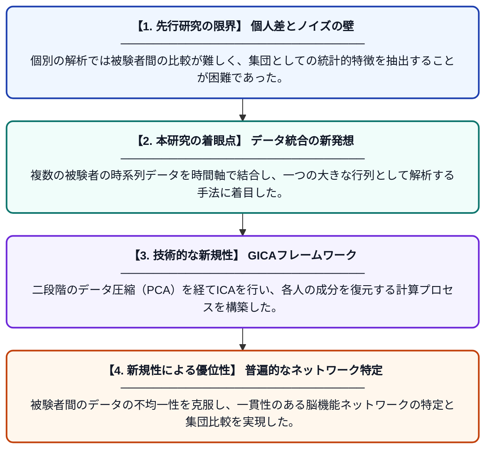

# 集団独立成分分析（GICA）を用いた機能的MRIデータの解析手法

**Original Title**: *2050-084X*

> **💡 一言要約**: 脳活動データから共通のネットワークを抽出するGICA

| 項目 | 内容 |
|---|---|
| **著者** | D Vince |
| **掲載誌** | eLife |
| **アラートキーワード** | independent component ... |
| **原文リンク** | [https://elifesciences.org/reviewed-preprints/113069.xml](https://elifesciences.org/reviewed-preprints/113069.xml) |
| **PDF版要約** | [README.pdf](./README.pdf) |

---

## 📊 新規性の図解（先行研究との違いと本研究のブレークスルー）

## 📝 要約

この論文は、複数の被験者から得られた機能的MRI（fMRI）データから、集団全体に共通する脳活動ネットワークを抽出する「集団独立成分分析（GICA）」について論じています。独立成分分析をグループ推論に拡張することで、個々人の差異を考慮しながら統計的に意味のある脳の機能的つながりを特定する枠組みを提供します。

## ❓ どんな問題に取り組んだか

脳の活動を記録するfMRIデータは非常に複雑でノイズが多く、さらに個人ごとに活動パターンが微妙に異なります。そのため、複数の被験者のデータを統合して、集団全体に共通する脳の機能的ネットワークを精度良く、かつ効率的に見つけ出すための標準的な手法が求められていました。

## ✨ 何が新しい？何がすごい？（新規性）

本研究の核心は、個別の被験者に対して行われていた独立成分分析（ICA）を、複数人のデータセットを統合して扱う「GICA（Group ICA）」へと発展させた点にあります。各被験者のデータを主成分分析（PCA）で圧縮した後に結合し、再び個別の成分に復元するプロセスを確立することで、集団の共通性と個人の特性を同時に評価できるようにしました。これにより、脳の機能的結合に関する大規模な比較研究が可能になりました。

## 🎓 大学1年生向けの解説

脳の活動を測るMRIでは、たくさんの人のデータから「みんなに共通する活動ルール」を見つけるのが大変です。この研究は、たくさんの人の脳のデータをパズルのように組み合わせて、全員に共通する『脳の動かし方の地図』を自動で作る魔法のような計算方法を説明しています。この方法を使うと、健康な人と病気の人で脳のネットワークがどう違うのかを、数学的に正しく比べることができるようになります。
