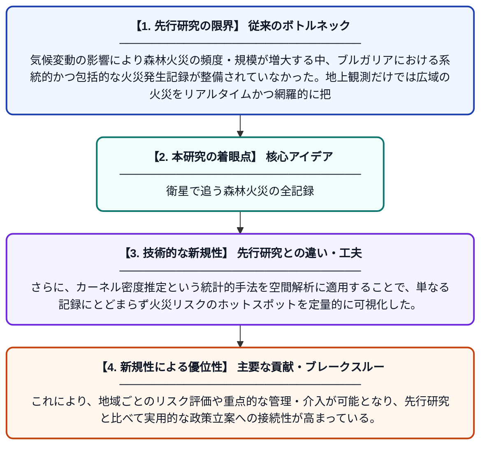

# 衛星データに基づくブルガリア領土における森林火災データベース（2020〜2024年）

**Original Title**: *FOREST FIRE DATABASE ON THE TERRITORY OF BULGARIA FOR THE PERIOD 2020–2024 BASED ON SATELLITE DATA*

> **💡 一言要約**: 衛星で追う森林火災の全記録

| 項目 | 内容 |
|---|---|
| **著者** | N Stankova, D Avetisyan |
| **掲載誌** | Aerospace Research |
| **アラートキーワード** | kernel density estimation |
| **PDF** | [http://journal.space.bas.bg/arhiv/n%2538/Articles/11_Stankova.pdf](http://journal.space.bas.bg/arhiv/n%2538/Articles/11_Stankova.pdf) |
| **原文リンク** | [http://journal.space.bas.bg/arhiv/n%2538/Articles/11_Stankova.pdf](http://journal.space.bas.bg/arhiv/n%2538/Articles/11_Stankova.pdf) |
| **PDF版要約** | [README.pdf](./README.pdf) |

---

## 📊 新規性の図解（先行研究との違いと本研究のブレークスルー）

## 📝 要約

本研究は、2020年から2024年にかけてブルガリア国内で発生した森林火災を衛星データにより記録・整備したデータベースを構築した。カーネル密度推定法を用いて火災発生の高密度クラスターを特定し、空間的パターンや潜在的なホットスポットを明らかにした。このデータセットはリスク評価や的を絞った森林火災管理・防止策の立案に活用できる基盤を提供する。

## ❓ どんな問題に取り組んだか

気候変動の影響により森林火災の頻度・規模が増大する中、ブルガリアにおける系統的かつ包括的な火災発生記録が整備されていなかった。地上観測だけでは広域の火災をリアルタイムかつ網羅的に把握することが困難であり、効果的な防火・管理政策の立案に必要なデータが不足していた。

## ✨ 何が新しい？何がすごい？（新規性）

本研究は衛星リモートセンシングデータを活用してブルガリア全土の森林火災を体系的に記録した初期段階の本格的データベースを構築した点が新しい。さらに、カーネル密度推定という統計的手法を空間解析に適用することで、単なる記録にとどまらず火災リスクのホットスポットを定量的に可視化した。これにより、地域ごとのリスク評価や重点的な管理・介入が可能となり、先行研究と比べて実用的な政策立案への接続性が高まっている。

## 🎓 大学1年生向けの解説

森林火災は毎年世界中で大きな被害をもたらしていますが、どこで火災が多く起きているかを正確に把握することが防災の第一歩です。この研究では、人工衛星から撮影した画像を使って、ブルガリアという国で2020〜2024年に起きた森林火災をすべてデータベースにまとめました。そして「カーネル密度推定」という統計の方法を使って、火災が特に集中して起きやすい危険な場所を地図上で特定しました。衛星を使うと、山の奥地など人が直接見に行けない場所の火災も漏らさず記録できるのが大きな利点です。このデータベースは、将来の火災を予防したり、消火活動を効率よく行ったりするための重要な情報源になります。
