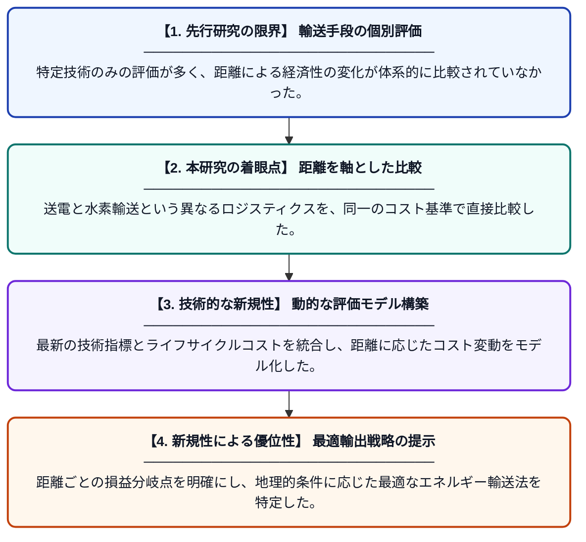

# 再生可能エネルギー輸出のロジスティクス：グリーン水素輸送とHVDC送電の評価

**Original Title**: *Renewable energy exports logistics: Evaluating green hydrogen delivery and HVDC power transmission*

> **💡 一言要約**: 水素か送電か？距離で決まる再エネ輸出の最適解

| 項目 | 内容 |
|---|---|
| **著者** | M Hajihosseini, Z Khajehsaeidi, M Yazdani, SA Gorji |
| **掲載誌** | Energy Reports 2026 |
| **アラートキーワード** | logistics |
| **原文リンク** | [https://www.sciencedirect.com/science/article/pii/S2352484726008309](https://www.sciencedirect.com/science/article/pii/S2352484726008309) |
| **PDF版要約** | [README.pdf](./README.pdf) |

---

## 📊 新規性の図解（先行研究との違いと本研究のブレークスルー）

## 📝 要約

オーストラリアの豊富な再生可能エネルギーを輸出する際、水素船輸送と高圧直流送電（HVDC）のどちらが有利かを距離に応じて比較評価した研究です。輸送距離によって最適な手段が変化し、経済的な損益分岐点が存在することを明らかにしました。

## ❓ どんな問題に取り組んだか

再生可能エネルギーの輸出において、グリーン水素としての船舶輸送とHVDCを用いた直接送電のどちらが経済的・効率的かという議論がありますが、距離が及ぼす具体的な影響や損益分岐点は十分に明確にされていませんでした。

## ✨ 何が新しい？何がすごい？（新規性）

本研究は、最新のコストデータと技術パラメータを用い、オーストラリアからの輸出を想定した動的な評価モデルを構築しました。従来の単一技術の評価とは異なり、輸送距離を主要な変数として扱うことで、どの距離でどちらの技術が優位になるかという明確な閾値を導き出した点が画期的です。これにより、長期的なインフラ投資における意思決定を支援する具体的な指標を提示しました。

## 🎓 大学1年生向けの解説

再生可能エネルギーを遠くの国へ運ぶには、電気をそのまま長いケーブルで送る方法と、一度水素に変えて船で運ぶ方法の2つがあります。この研究は、「どのくらいの距離までならケーブルが安く、どこからは船の方がお得か」を計算で突き止めました。オーストラリアのようなエネルギー大国が他国へ電気を効率よく売るための、最も賢い方法を教えてくれる研究です。
