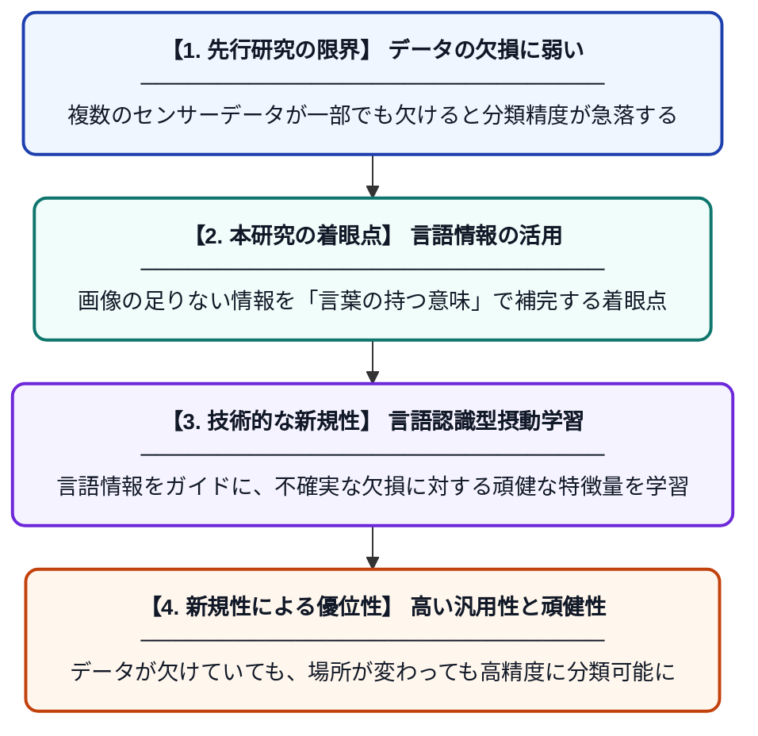

# 不確実な欠損モダリティを伴うクロスシーン・リモートセンシング画像分類のための言語認識型統合表現学習

**Original Title**: *Language-Aware Modal-Integrated Representation Learning for Cross-Scene Remote Sensing Image Classification With Uncertain Missing Modalities*

> **💡 一言要約**: 言葉の力でデータの欠損を補う、最新のリモセン画像分類法

| 項目 | 内容 |
|---|---|
| **著者** | L Huang, J Qu, W Dong, Y Yang, Y Li |
| **掲載誌** | IEEE Transactions on Multimedia 2026 |
| **アラートキーワード** | representation learning |
| **原文リンク** | [https://ieeexplore.ieee.org/abstract/document/11794946/](https://ieeexplore.ieee.org/abstract/document/11794946/) |
| **PDF版要約** | [README.pdf](./README.pdf) |

---

## 📊 新規性の図解（先行研究との違いと本研究のブレークスルー）

## 📝 要約

リモートセンシング画像分類において、複数のセンサーデータが不規則に欠損したり、撮影場所が異なったりする状況でも高精度な分類を実現する「LAMIRL」という手法を提案しました。自然言語の情報をガイドとして活用することで、欠損したデータのセマンティックな情報を補い、環境変化に強い特徴表現を獲得します。

## ❓ どんな問題に取り組んだか

異なる地域や環境で撮影されたリモートセンシング画像は見た目の特徴が大きく変わるため、分類が困難になる「クロスシーン問題」があります。さらに、光学やレーダーといった複数のセンサー（モダリティ）の一部が欠損することが多く、従来のモデルではデータの不完全性によって精度が著しく低下するという課題がありました。

## ✨ 何が新しい？何がすごい？（新規性）

本研究の核心は、自然言語処理の知見を画像認識に統合した「言語認識型摂動表現学習」を導入した点にあります。画像データだけでは不十分な場合でも、テキスト記述との関連付けを通じてモダリティ間のギャップを埋め、不確実な欠損に対して頑健な「意味レベルの表現」を抽出することが可能です。これにより、特定のセンサーデータが欠落していても、言語情報が持つ概念を頼りに高精度な分類を維持できる汎用的なモデルを構築しました。

## 🎓 大学1年生向けの解説

人工衛星などで地球を撮影する際、雲の影響や機器の都合でデータの一部が消えてしまうことがあります。この研究では、足りない画像情報を「言葉の意味」を使って補うAIを開発しました。例えば「森」という言葉の概念を知っているAIが、一部が欠けた画像を見ても、言葉の知識をヒントにして正しく判断できるようにしたのです。これにより、世界中のどんな場所の画像でも、データが不完全な状態から正確に分類できるようになりました。
