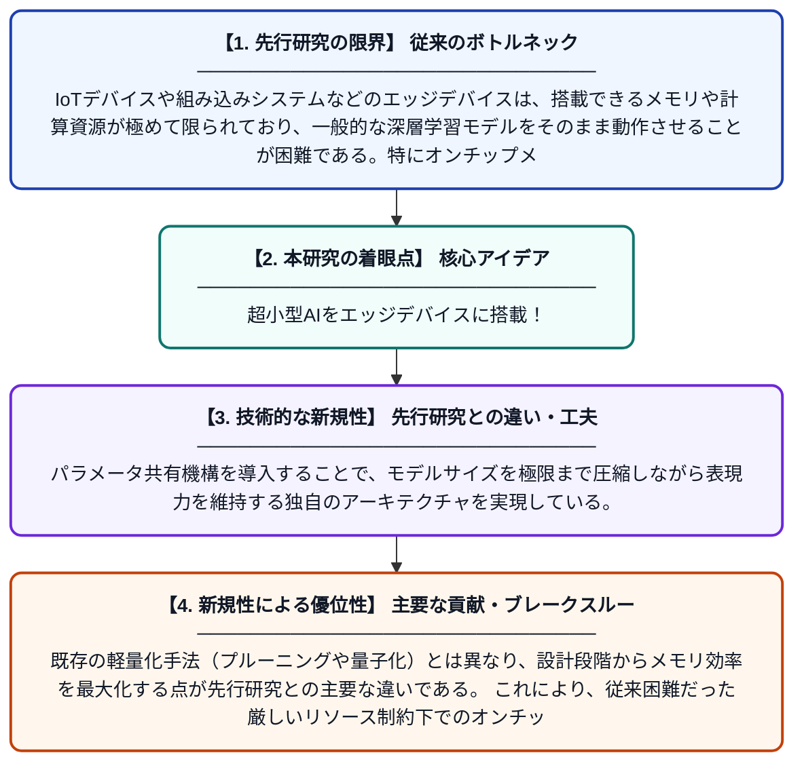

# TinyShareNet：エッジデバイスでのメモリ効率的なオンチップ推論に向けた超小型ネットワーク

**Original Title**: *TinyShareNet: Towards Extremely Tiny Network for Memory Efficient On-Chip Inference at the Edge*

> **💡 一言要約**: 超小型AIをエッジデバイスに搭載！

| 項目 | 内容 |
|---|---|
| **著者** | T Wu, J Guan, R Lai, C Chai, Z Zhu |
| **掲載誌** | IEEE Transactions on Circuits and Systems 2026 |
| **アラートキーワード** | sparse coding |
| **原文リンク** | [https://ieeexplore.ieee.org/abstract/document/11622516/](https://ieeexplore.ieee.org/abstract/document/11622516/) |
| **PDF版要約** | [README.pdf](./README.pdf) |

---

## 📊 新規性の図解（先行研究との違いと本研究のブレークスルー）

## 📝 要約

本論文は、エッジデバイス上での深層学習推論を実現するために、極めて小さなメモリフットプリントで動作可能な超軽量ニューラルネットワーク「TinyShareNet」を提案する。CNNの順伝播がスパースコーディングプロセスと本質的に対応するという理論的洞察に基づき、パラメータ共有と効率的な演算設計を組み合わせている。これにより、性能を維持しながらオンチップメモリ消費を大幅に削減することを目指している。

## ❓ どんな問題に取り組んだか

IoTデバイスや組み込みシステムなどのエッジデバイスは、搭載できるメモリや計算資源が極めて限られており、一般的な深層学習モデルをそのまま動作させることが困難である。特にオンチップメモリの容量制約は深刻で、モデルの軽量化と精度維持の両立が大きな課題となっている。

## ✨ 何が新しい？何がすごい？（新規性）

本研究は、CNNの順伝播処理がスパースコーディングと数学的に等価であるという理論的視点を活用し、ネットワーク設計に新たなアプローチをもたらしている。パラメータ共有機構を導入することで、モデルサイズを極限まで圧縮しながら表現力を維持する独自のアーキテクチャを実現している。既存の軽量化手法（プルーニングや量子化）とは異なり、設計段階からメモリ効率を最大化する点が先行研究との主要な違いである。これにより、従来困難だった厳しいリソース制約下でのオンチップ推論を実用レベルで可能にしている。

## 🎓 大学1年生向けの解説

スマートフォンより小さなマイコンやセンサーデバイスでも、AIを動かしたいというニーズがあります。しかし、AIモデルは通常とても大きく、小さなデバイスのメモリには収まりません。この研究では、AIの計算が数学的に『必要な情報だけを抽出する処理（スパースコーディング）』と同じだという発見を活かし、同じパラメータを賢く使い回す超小型のAIネットワークを作りました。これにより、非常に限られたメモリしか持たない小型デバイスでも高性能なAI推論ができるようになります。
