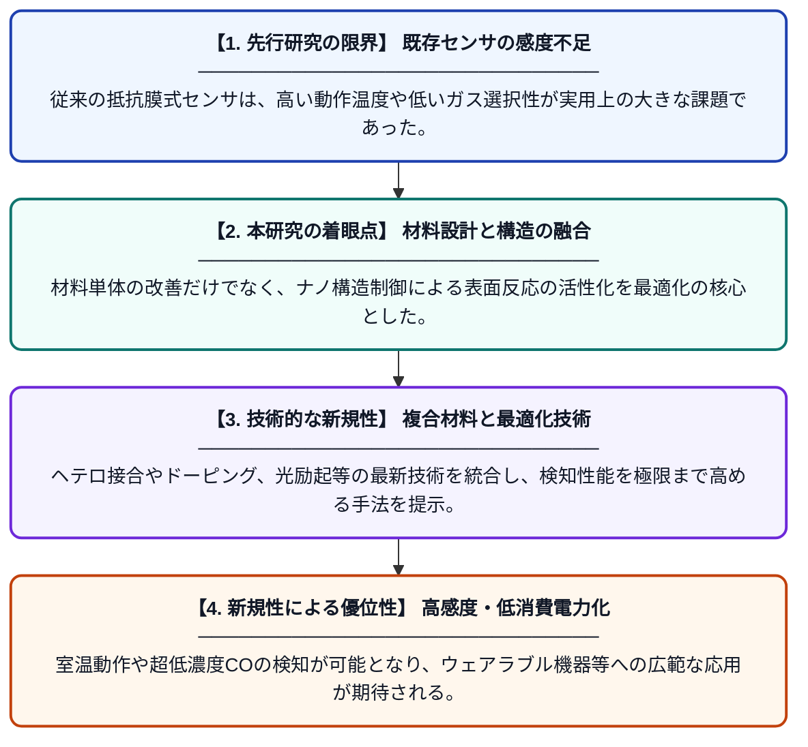

# 抵抗膜式一酸化炭素センサ：検知材料から性能最適化までのレビュー

**Original Title**: *Resistive carbon monoxide sensors: A review from sensing materials to performance optimization*

> **💡 一言要約**: 進化するCOセンサ：材料と最適化の最前線

| 項目 | 内容 |
|---|---|
| **著者** | J Gu, C Luo, H Zhang, X Zhang, C Wang |
| **掲載誌** | Microchemical Journal 2026 |
| **アラートキーワード** | optimization |
| **原文リンク** | [https://www.sciencedirect.com/science/article/pii/S0026265X26035095](https://www.sciencedirect.com/science/article/pii/S0026265X26035095) |
| **PDF版要約** | [README.pdf](./README.pdf) |

---

## 📊 新規性の図解（先行研究との違いと本研究のブレークスルー）

## 📝 要約

一酸化炭素（CO）は環境と人体に有害なガスであり、リアルタイムでの高感度な検出が不可欠です。本論文は、低コストでシンプルな構造を持つ抵抗膜式COセンサについて、使用される材料から性能向上のための最適化戦略までを網羅的に解説しています。

## ❓ どんな問題に取り組んだか

一酸化炭素は無色無臭で毒性が極めて高いものの、従来のセンサは感度やガス選択性が不十分であったり、動作に高い温度を必要としたりする課題がありました。特に産業現場でのリアルタイム監視において、より安価で信頼性の高い検知デバイスの確立が求められています。

## ✨ 何が新しい？何がすごい？（新規性）

本論文は、単なる材料の羅列に留まらず、ナノ構造の設計から性能最適化のメカニズムまでを体系的に整理した点が画期的です。金属酸化物半導体や炭素材料、導電性高分子を比較し、ドーピングやヘテロ接合形成、光励起といった手法が検知性能にどう寄与するかを具体的に示しています。これにより、次世代の高性能COセンサ開発に向けた実用的な設計指針を提示しました。

## 🎓 大学1年生向けの解説

目に見えず匂いもしない毒ガス「一酸化炭素」を素早く見つけるための、新しいセンサーの仕組みをまとめた研究です。電気の通りやすさが変わる特殊な材料を使い、わずかなガスにも反応する工夫がたくさん紹介されています。将来、スマホや家庭の警報器をもっと高性能で安くするためのヒントが詰まっています。
