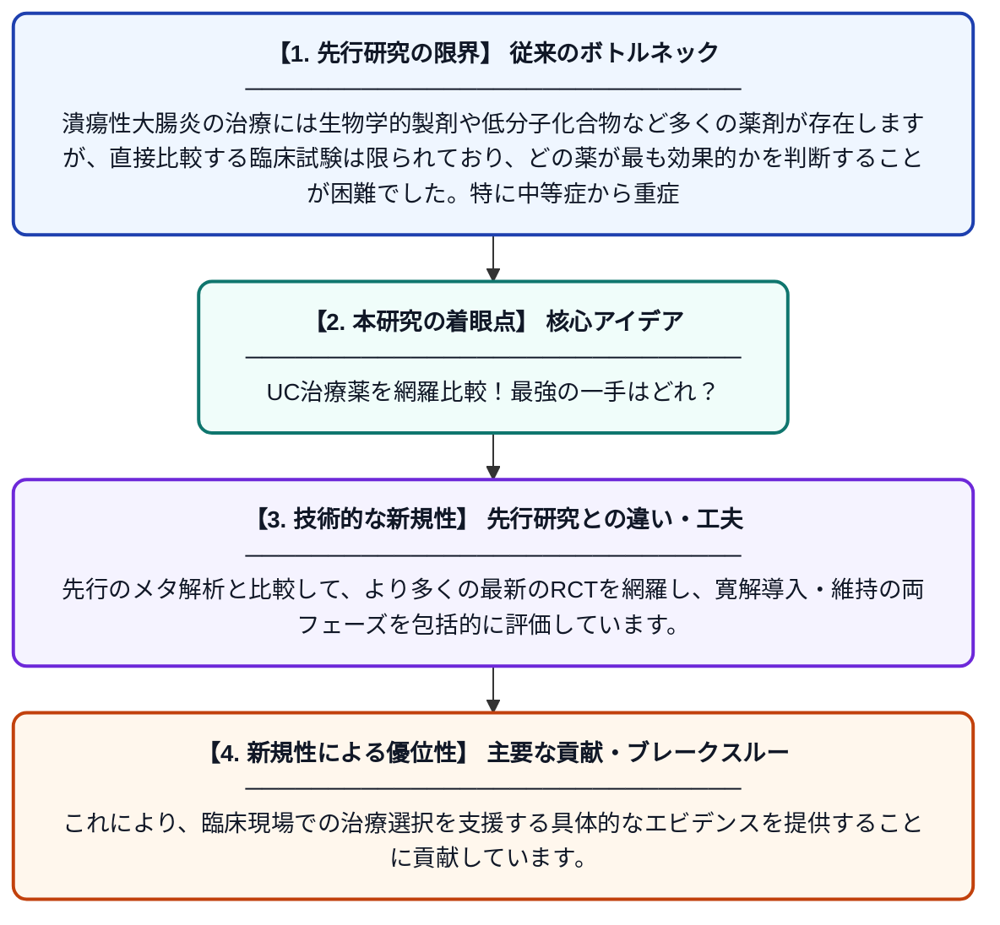

# 中等症から重症の潰瘍性大腸炎に対する薬物療法：系統的レビューとベイズ流ネットワークメタ解析

**Original Title**: *Pharmacological treatments for moderate-to-severe ulcerative colitis: a systematic review and Bayesian network meta-analysis*

> **💡 一言要約**: UC治療薬を網羅比較！最強の一手はどれ？

| 項目 | 内容 |
|---|---|
| **著者** | J Qi, Q Tian, G Yang, Z Chen |
| **掲載誌** | Scandinavian Journal of Gastroenterology 2026 |
| **アラートキーワード** | bayesian network |
| **原文リンク** | [https://www.tandfonline.com/doi/abs/10.1080/00365521.2026.2698847](https://www.tandfonline.com/doi/abs/10.1080/00365521.2026.2698847) |
| **PDF版要約** | [README.pdf](./README.pdf) |

---

## 📊 新規性の図解（先行研究との違いと本研究のブレークスルー）

## 📝 要約

本研究は、中等症から重症の活動性潰瘍性大腸炎（UC）の成人患者に対して、複数の治療薬の寛解導入・維持における相対的な有効性を系統的に比較したものです。PubMedなどのデータベースからランダム化比較試験（RCT）を収集し、ベイズ流ネットワークメタ解析を用いて複数の薬剤を間接的に比較しました。その結果、各薬剤の有効性に関する包括的なランキングと推奨情報が得られました。

## ❓ どんな問題に取り組んだか

潰瘍性大腸炎の治療には生物学的製剤や低分子化合物など多くの薬剤が存在しますが、直接比較する臨床試験は限られており、どの薬が最も効果的かを判断することが困難でした。特に中等症から重症の患者に対して、寛解導入と維持の両面で最適な治療選択肢を特定するエビデンスが不足していました。

## ✨ 何が新しい？何がすごい？（新規性）

本研究はベイズ流ネットワークメタ解析という手法を用いることで、直接比較試験が存在しない薬剤同士も間接的に比較し、有効性のランキングを算出した点が新しいアプローチです。先行のメタ解析と比較して、より多くの最新のRCTを網羅し、寛解導入・維持の両フェーズを包括的に評価しています。これにより、臨床現場での治療選択を支援する具体的なエビデンスを提供することに貢献しています。

## 🎓 大学1年生向けの解説

潰瘍性大腸炎とは、腸に炎症が起きて下痢や血便が続く病気です。今は治療薬がたくさんありますが、「どの薬が一番効くか」を直接比べた研究は多くありません。そこでこの論文では、過去のたくさんの臨床試験データを集めて、コンピューターを使った統計手法で間接的に薬同士を比べました。まるでトーナメント表を作るように、直接対戦していない薬でも強さのランキングを計算できる方法です。その結果、医師が患者さんに最適な薬を選ぶための参考情報が得られました。
