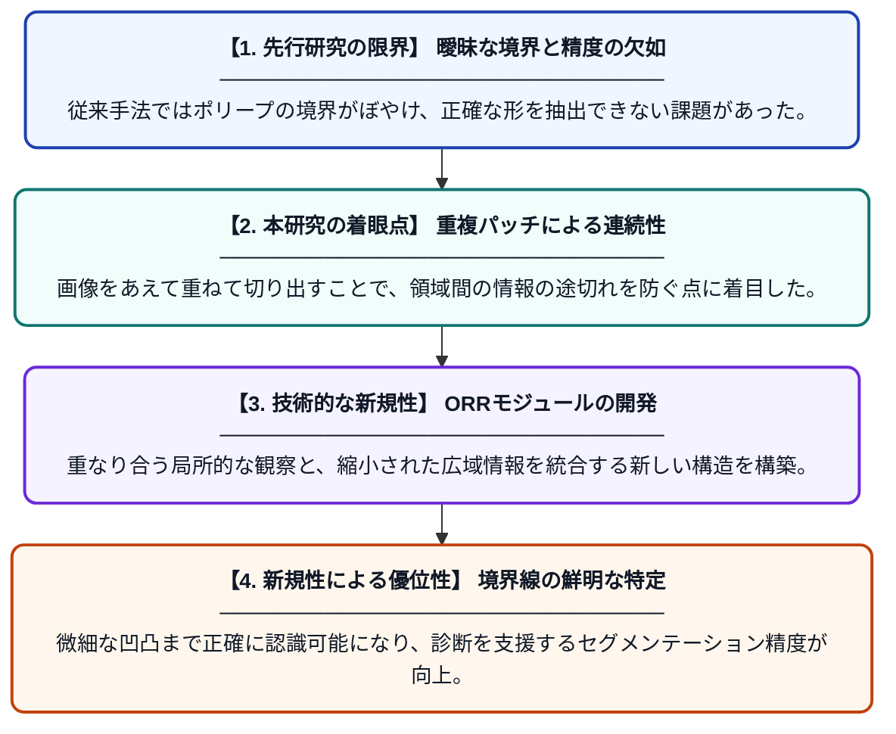

# ORR-Net：境界を意識したポリープ分割のための重複考慮型地域表現学習

**Original Title**: *ORR-Net: Overlap-Aware Regional Representation Learning for Boundary-Aware Polyp Segmentation*

> **💡 一言要約**: 重複する領域情報でポリープの境界を鮮明に捉える

| 項目 | 内容 |
|---|---|
| **著者** | Z Yin, X Qiao, J Tian, C Sun, J Peng, J Cui, J Xu |
| **掲載誌** | IEEE Journal of Biomedical and … 2026 |
| **アラートキーワード** | representation learning |
| **原文リンク** | [https://ieeexplore.ieee.org/abstract/document/11755319/](https://ieeexplore.ieee.org/abstract/document/11755319/) |
| **PDF版要約** | [README.pdf](./README.pdf) |

---

## 📊 新規性の図解（先行研究との違いと本研究のブレークスルー）

## 📝 要約

大腸がん検診等で重要なポリープの領域抽出において、境界の精度を向上させる新手法「ORR-Net」を提案しました。高解像度な重複領域の観察と広域情報を組み合わせることで、曖昧な境界を正確に特定します。

## ❓ どんな問題に取り組んだか

ポリープの画像診断では、周囲の正常な組織と境界が非常に曖昧であり、従来のAI手法では正確な領域の特定が困難でした。特に局所的な細かい特徴と、画像全体の構造を同時にバランス良く学習することが難しいという課題がありました。

## ✨ 何が新しい？何がすごい？（新規性）

本研究の核心は、画像を重なり合う小さな領域として密に捉える「重複考慮型地域表現学習」を導入した点にあります。先行研究では領域間の連続性が失われがちでしたが、本手法はパッチを重ねて観察することで、隣接部分の情報を補完しつつ細部を抽出します。これにより、境界付近の解像度を維持しながら、グローバルな文脈も統合した高精度なセグメンテーションを実現しました。

## 🎓 大学1年生向けの解説

お医者さんが内視鏡でポリープを見つける際、ポリープと周りの粘膜の境界線はとても見分けにくいことがあります。この研究では、画像を小さな「重なり合うピース」に分けて詳しく分析するAIを開発しました。パズルのピースを少しずつ重ねて見るように分析することで、つなぎ目が滑らかになり、ポリープの形を正確に捉えられます。これにより、これまで難しかった境界線の判別が非常に正確になりました。
