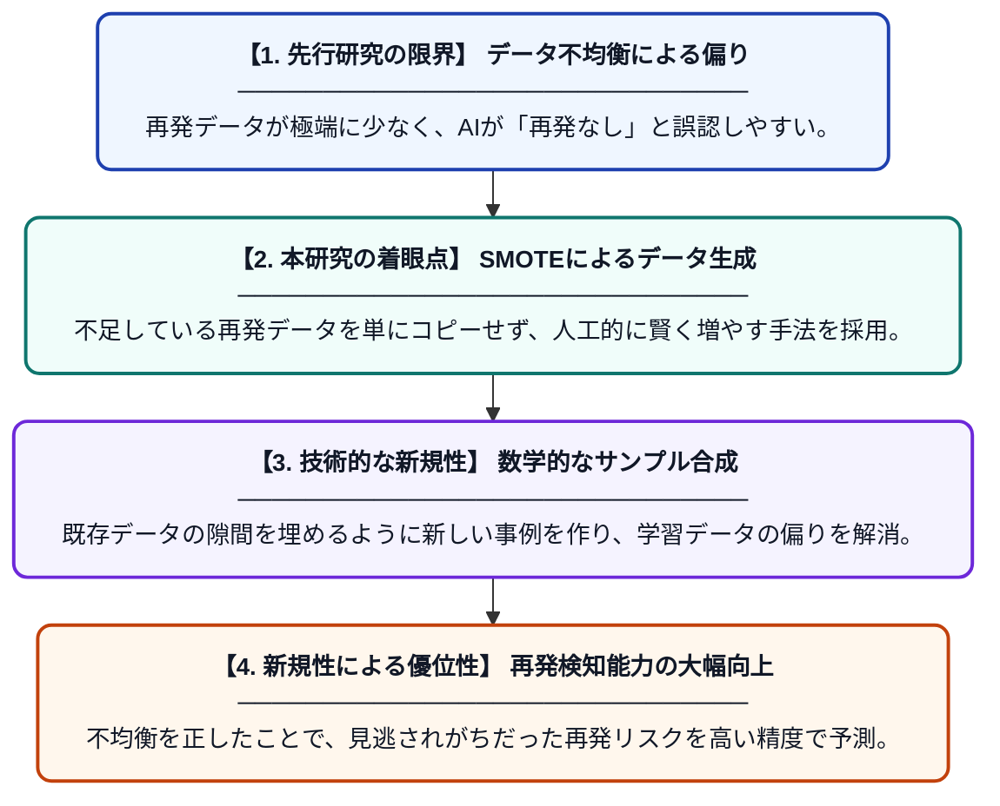

# 乳がん再発予測のための機械学習アプローチ

**Original Title**: *Machine Learning Approaches for Breast Cancer Recurrence*

> **💡 一言要約**: データ増強で乳がん再発をより正確に予測する

| 項目 | 内容 |
|---|---|
| **著者** | M Hingnikar, J Sarode, M Daware, M Wasu, A Patil… |
| **掲載誌** | Advancements in Intelligent … 2027 |
| **アラートキーワード** | SMOTE |
| **原文リンク** | [https://api.taylorfrancis.com/content/chapters/edit/download?identifierName=doi&identifierValue=10.1201/9781042040476-54&type=chapterpdf](https://api.taylorfrancis.com/content/chapters/edit/download?identifierName=doi&identifierValue=10.1201/9781042040476-54&type=chapterpdf) |
| **PDF版要約** | [README.pdf](./README.pdf) |

---

## 📊 新規性の図解（先行研究との違いと本研究のブレークスルー）

## 📝 要約

この研究は、機械学習を用いて乳がんの再発をより正確に予測する手法を提案しています。特に、データセット内の「再発事例」が少ないという不均衡を解消するため、SMOTE（合成少数派オーバーサンプリング技術）を活用して予測精度を向上させました。

## ❓ どんな問題に取り組んだか

医療データにおいて、がんの再発事例は非再発事例に比べて圧倒的に少ないため、AIが「再発なし」と偏った判断をしやすくなる課題がありました。このデータの不均衡は、重要な再発リスクを見落とす原因となっていました。

## ✨ 何が新しい？何がすごい？（新規性）

本研究の大きな貢献は、不均衡な医療データに対してSMOTE技術を効果的に適用し、少数派である「再発クラス」の合成データを生成した点にあります。従来の単純なデータ複製とは異なり、既存データの周辺を補間して新しいサンプルを作ることで、過学習を防ぎつつモデルの汎用性を高めました。これにより、限られたデータ数でも再発の兆候を捉える分類能力を飛躍的に高めています。

## 🎓 大学1年生向けの解説

乳がんが将来再発するかどうかをAIに予測させようとすると、実際には再発する人が少ないため、AIが「再発しない」という結果ばかり学習してしまいます。この研究では、足りない「再発データ」をコンピューターで数学的に作り出し、データのバランスを整える工夫（SMOTE）をしました。これによって、AIは珍しい再発のサインもしっかりと見つけられるようになり、診断の助けになる精度の高い予測が可能になりました。
