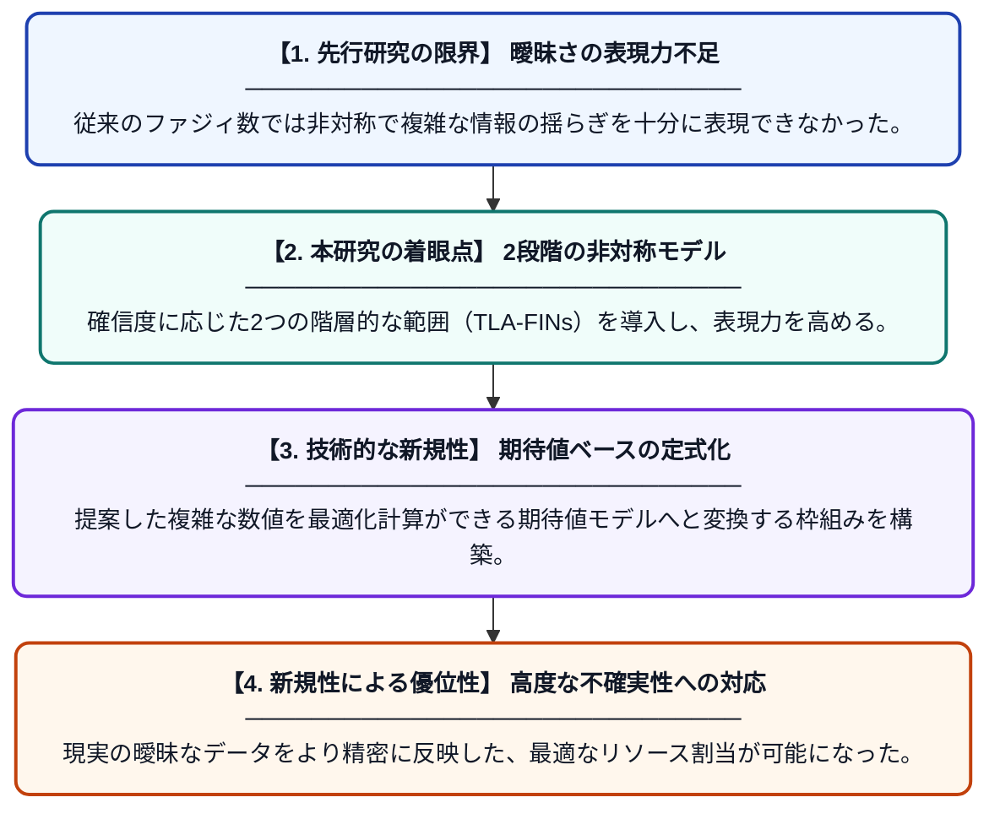

# 2段階非対称ファジィ区間数を用いた期待値に基づく最適化：ファジィ広義割当問題への応用

**Original Title**: *Expected-Value-Based Optimization with Two-Level Asymmetric Fuzzy Interval Numbers: Application to the Fuzzy Generalized Assignment Problem*

> **💡 一言要約**: 複雑な曖昧さを2段階で捉え、最適な割当を実現

| 項目 | 内容 |
|---|---|
| **著者** | HG Akdemir, M Moran |
| **掲載誌** | 10th International Artificial Intelligence and Data … 2026 |
| **アラートキーワード** | generalized assignment ... |
| **原文リンク** | [https://ieeexplore.ieee.org/abstract/document/11728030/](https://ieeexplore.ieee.org/abstract/document/11728030/) |
| **PDF版要約** | [README.pdf](./README.pdf) |

---

## 📊 新規性の図解（先行研究との違いと本研究のブレークスルー）

## 📝 要約

不確実な情報を扱うための新しい枠組み「2段階非対称ファジィ区間数（TLA-FINs）」を提案し、それを広義割当問題（GAP）に適用した研究です。期待値ベースの最適化モデルを構築することで、現実の複雑で非対称な情報の揺らぎを考慮したリソース配分を可能にしています。

## ❓ どんな問題に取り組んだか

現実世界の割当問題では、コストや作業時間が「だいたいこれくらい」という曖昧さを持ちますが、従来のモデルではその非対称性や複雑な変動を正確に表現できませんでした。特に、最も起こりそうな範囲と、極端なケースを含む範囲を区別して扱う数学的手法が不足していました。

## ✨ 何が新しい？何がすごい？（新規性）

本研究の新規性は、2つのレベルで非対称な境界を持つファジィ区間数（TLA-FINs）を新たに定義し、最適化理論に組み込んだ点にあります。従来の単純な台形や三角形のファジィ数よりも表現力が高く、専門家の主観的な見積もりをより詳細に反映できます。また、この複雑な数値を期待値を用いて処理可能な形式に変換する手法を確立したことが大きな貢献です。

## 🎓 大学1年生向けの解説

「誰にどの仕事を割り振るか」を考えるとき、実際にかかる時間はやってみるまで分かりません。この論文では、その「分からない具合（曖昧さ）」を、2段階の幅を使ってより正確に表す数学的なテクニックを開発しました。例えば「基本は10分だけど、幅を持たせると8〜15分、最悪の想定なら5〜20分」といった複雑な予測を数式にできます。これを使うことで、不確実な状況でもミスが少なく、最も効率的なスケジュールの立て方が見つかるようになります。
