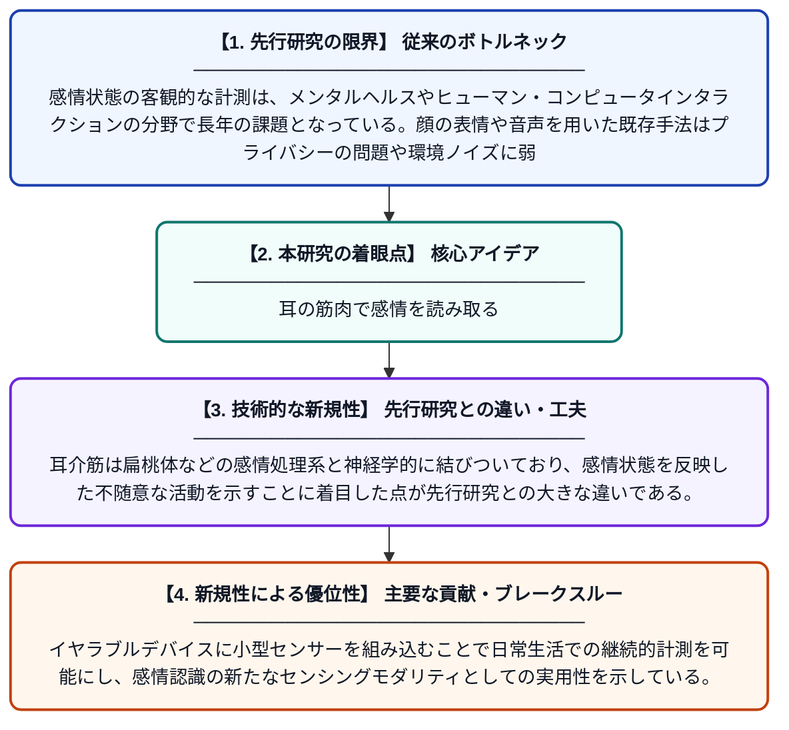

# 耳介筋系から感情状態を解読する

**Original Title**: *Unraveling Affective States From the Auriculomotor System*

> **💡 一言要約**: 耳の筋肉で感情を読み取る

| 項目 | 内容 |
|---|---|
| **著者** | S Bonnaire, MJ Bhamborae, DJ Strauss |
| **掲載誌** | IEEE Transactions on Affective Computing 2026 |
| **アラートキーワード** | affective computing |
| **PDF** | [https://ieeexplore.ieee.org/iel8/5165369/5520654/11625977.pdf](https://ieeexplore.ieee.org/iel8/5165369/5520654/11625977.pdf) |
| **原文リンク** | [https://ieeexplore.ieee.org/iel8/5165369/5520654/11625977.pdf](https://ieeexplore.ieee.org/iel8/5165369/5520654/11625977.pdf) |
| **PDF版要約** | [README.pdf](./README.pdf) |

---

## 📊 新規性の図解（先行研究との違いと本研究のブレークスルー）

## 📝 要約

本論文は、人間の耳を動かす筋肉（耳介筋）の活動信号から感情状態を推定する新しいアプローチを提案している。耳介筋は感情や注意状態に連動して無意識に活動することが知られており、この生理信号を感情認識に活用する可能性を探っている。ウェアラブルセンシング技術と機械学習を組み合わせることで、非侵襲的な感情モニタリングシステムの実現を目指している。

## ❓ どんな問題に取り組んだか

感情状態の客観的な計測は、メンタルヘルスやヒューマン・コンピュータインタラクションの分野で長年の課題となっている。顔の表情や音声を用いた既存手法はプライバシーの問題や環境ノイズに弱く、脳波（EEG）などの生理信号計測は装置が大掛かりで日常使用には不向きである。より自然で目立たない方法で感情を継続的に計測できるセンシング手段が求められていた。

## ✨ 何が新しい？何がすごい？（新規性）

本研究は、従来ほとんど注目されてこなかった耳介筋（耳を動かす筋肉）の筋電図（EMG）信号を感情認識に応用するという独自のアプローチを提案している。耳介筋は扁桃体などの感情処理系と神経学的に結びついており、感情状態を反映した不随意な活動を示すことに着目した点が先行研究との大きな違いである。イヤラブルデバイスに小型センサーを組み込むことで日常生活での継続的計測を可能にし、感情認識の新たなセンシングモダリティとしての実用性を示している。

## 🎓 大学1年生向けの解説

人間の耳の周りには小さな筋肉があり、私たちが感情を感じるときに無意識に少し動いています。この研究では、その微細な筋肉の動き（電気信号）をイヤホンのようなデバイスで測ることで、その人が今どんな感情を持っているかをコンピュータが判断できるかを調べています。顔カメラやマイクと違って、耳の中のセンサーなら周囲に気づかれにくく、プライバシーも守られます。機械学習（AIの一種）を使って、計測した信号のパターンから「喜び」「ストレス」などの感情を分類することを目指しています。将来的には、スマートイヤホンが心の状態をモニタリングし、メンタルヘルスの管理などに役立てられる可能性があります。
