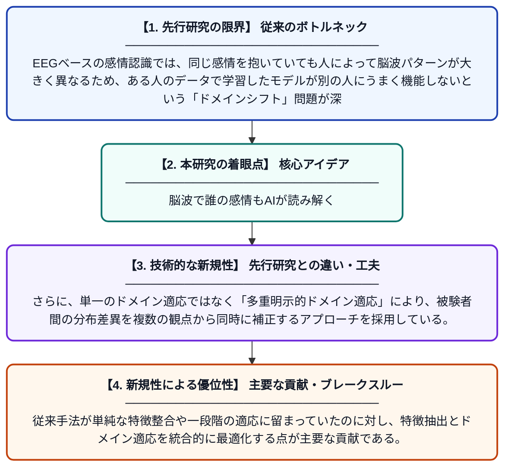

# 階層的マスクグラフトランスフォーマーと多重明示的ドメイン適応フレームワークによる被験者間EEG感情認識

**Original Title**: *HMGT-MEDA: A Hierarchical Mask Graph Transformer and Multi-Explicit Domain Adaptation Framework for Cross-Subject EEG Emotion Recognition*

> **💡 一言要約**: 脳波で誰の感情もAIが読み解く

| 項目 | 内容 |
|---|---|
| **著者** | W Yuan, L Li, Y Huang, J Pan |
| **掲載誌** | International Conference on Intelligent Computing 2026 |
| **アラートキーワード** | affective computing |
| **原文リンク** | [https://dl.acm.org/doi/abs/10.1007/978-981-92-3495-0_32](https://dl.acm.org/doi/abs/10.1007/978-981-92-3495-0_32) |
| **PDF版要約** | [README.pdf](./README.pdf) |

---

## 📊 新規性の図解（先行研究との違いと本研究のブレークスルー）

## 📝 要約

本論文は、脳波（EEG）を用いた感情認識において、異なる被験者間での性能低下という課題に取り組んでいる。階層的マスクグラフトランスフォーマー（HMGT）と多重明示的ドメイン適応（MEDA）を組み合わせた新しいフレームワークを提案し、被験者間の脳波データの分布ギャップを効果的に解消する。これにより、既存手法を上回る被験者横断型の感情認識精度を実現している。

## ❓ どんな問題に取り組んだか

EEGベースの感情認識では、同じ感情を抱いていても人によって脳波パターンが大きく異なるため、ある人のデータで学習したモデルが別の人にうまく機能しないという「ドメインシフト」問題が深刻である。また、EEG信号から感情に関連する重要な空間的・時系列的特徴をいかに効果的に抽出するかも未解決の課題として残っていた。

## ✨ 何が新しい？何がすごい？（新規性）

本研究は、グラフ構造にマスク機構を組み込んだ階層的トランスフォーマーにより、脳内チャンネル間の複雑な依存関係を多スケールで捉える点が新しい。さらに、単一のドメイン適応ではなく「多重明示的ドメイン適応」により、被験者間の分布差異を複数の観点から同時に補正するアプローチを採用している。従来手法が単純な特徴整合や一段階の適応に留まっていたのに対し、特徴抽出とドメイン適応を統合的に最適化する点が主要な貢献である。

## 🎓 大学1年生向けの解説

人間は喜んだり悲しんだりするとき、脳の電気的な活動パターンが変化します。この脳波（EEG）をセンサーで計測すれば、AIが感情を読み取れる可能性があります。しかし問題は、同じ「嬉しい」という感情でも人によって脳波の波形が全然違うため、Aさんのデータで学習したAIがBさんには使えないことです。この論文では、グラフ構造で脳内のつながりを表現する賢いAIモデルと、人ごとの違いを自動的に補正する技術を組み合わせることで、誰にでも使える感情認識システムを作ることに成功しました。
