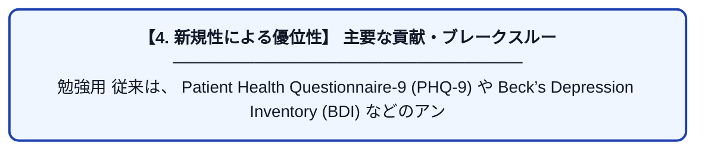

# PupilSense: Detection of Depressive Episodes Through Pupillary Response in the Wild

| 項目 | 内容 |
|---|---|
| **PDF版要約** | [README.pdf](./README.pdf) |

---

## 📊 新規性の図解（先行研究との違いと本研究のブレークスルー）

## 📝 要約

勉強用

従来は、 Patient Health Questionnaire-9 (PHQ-9) や Beck’s Depression Inventory
(BDI) などのアンケートベースの手法がよく用いられていました。

しかし、それは想起バイアスなどがより、正確な自己評価が困難になります。

それを克服する手段として、スマートホンを利用した方法が出現しました。

スマートホンではGPSデータ、通話/メッセージログ、アプリの利用状況、睡眠パターン、身体活動などのさまざまなパラメータを追跡することができます。

しかし、データ収集が必要であったり、プライバシー侵害など多くの課題があります。

この課題に対する進展として、Globem datasetのリリースやAWAREというツールのリリースがあります。

その他のアプローチは、肉体的な変化を測定することです。それはうつ症状のより客観的な兆候を検知できます。

しかし、それはさまざまな装置を身につける必要などがあり、被験者に負担をかけます。

そこで、この論文では負担をかけない方法を提案します。

瞳孔の反応という観点からの研究では、瞳孔の拡大が鬱症状の肉体的兆候となることが示されています。しかし、それらは実験室での統制された環境での結果であり、より現実に近い環境で同様な結論が得られるのかは、まだ示されていません。

この論文ではより現実に近い、様々な環境からデータを収集し、それらのデータから鬱の兆候が検出できるようにすることを目指しています。

また、スマートフォンやウェアラブル端末を使うという観点からの研究では、GPSを使い行動履歴を追跡したり、画面の使用状況を解析したりする研究がありましたが、それらは社会的な活動データを用いての解析です。

スマートフォンに加え、それ以外の各種センサーを使い生体信号を取得し解析する研究もありますが、それらは非常に効果な装置が必要です。それらに比べるとスマートフォンを使う我々の方法は非常に安価にデータを収集することが可能です。

解析に瞳孔のサイズではなく、瞳孔と虹彩のサイズの比を使う理由は、実験環境下ではカメラと顔の距離が固定されているため瞳孔のサイズを測定すればそのまま解析できるが、現実の環境下ではカメラと顔の距離が一定とは限らないため、同じ瞳孔サイズでもカメラと顔の距離によって意味合いが変わってしまうためである。

そのため、カメラと顔の距離によらない特徴量をつくるため、瞳孔を虹彩の比率を使っている。

PIRを算出するアルゴリズム

Inputされたimageのバッチから、目を開いている確率が0.75以上と判定されたimageだけ抽出する。

選別されたimageをDetection2に通す。(segmentation)

鬱症状の患者のデータと正常状態の患者のデータは通常偏りがあることが多い。

その不均衡を解消するために、SMOTEと呼ばれる手法でデータ拡張を行った。

Globem dataset

AWARE

pupil-to-iris ratio (PIR)

[32] V. W.-S. Tseng, S. Abdullah, J. Costa, and T. Choudhury, “Alertnesss-
canner: what do your pupils tell about your alertness,” in Proceedings
of the 20th International Conference on Human-Computer Interaction
with Mobile Devices and Services, 2018, pp. 1–11.

Detection2(segmentation)のアノテーションは手動でやった。

正解データ(その人が鬱なのかどうかの正解データ)はPHQ-9を用いて判定した。

Apache Airflow

解説編：オーバーサンプリング手法解説 (SMOTE, ADASYN, Borderline-SMOTE, Safe-level SMOTE)

→ Dragonflyとかにも適用できる？

D2Go

https://github.com/facebookresearch/d2go
