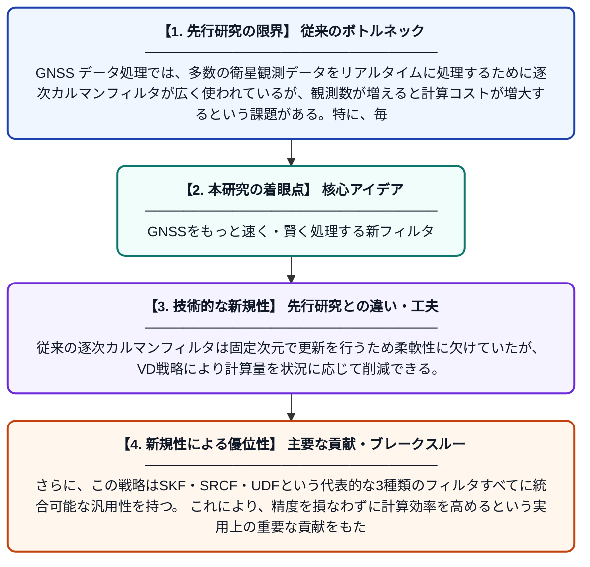

# GNSS データ処理効率を向上させる逐次カルマンフィルタの可変次元更新法

**Original Title**: *A variable-dimension update of sequential Kalman filter for enhancing GNSS data processing efficiency*

> **💡 一言要約**: GNSSをもっと速く・賢く処理する新フィルタ

| 項目 | 内容 |
|---|---|
| **著者** | H Zhong, P Hou, B Zhang |
| **掲載誌** | Journal of Geodesy 2026 |
| **アラートキーワード** | kalman filter |
| **原文リンク** | [https://link.springer.com/article/10.1007/s00190-026-02078-1](https://link.springer.com/article/10.1007/s00190-026-02078-1) |
| **PDF版要約** | [README.pdf](./README.pdf) |

---

## 📊 新規性の図解（先行研究との違いと本研究のブレークスルー）

## 📝 要約

本論文は、GNSS（衛星測位システム）のデータ処理において、逐次カルマンフィルタの更新ステップに「可変次元（VD）更新戦略」を導入することで計算効率を大幅に改善する手法を提案している。この手法は、標準的な逐次カルマンフィルタ（SKF）、平方根共分散フィルタ（SRCF）、UD分解フィルタ（UDF）など、様々なフィルタの変種に統合可能である。これにより、GNSS測位処理の精度を維持しつつ、処理速度と効率の向上が期待される。

## ❓ どんな問題に取り組んだか

GNSS データ処理では、多数の衛星観測データをリアルタイムに処理するために逐次カルマンフィルタが広く使われているが、観測数が増えると計算コストが増大するという課題がある。特に、毎ステップで固定された次元の更新処理を行う従来手法では、計算資源が非効率に消費されやすい。高精度測位を求めるアプリケーションでは、この計算負荷の問題が処理速度のボトルネックとなっている。

## ✨ 何が新しい？何がすごい？（新規性）

本研究の新規性は、更新ステップにおいて処理する観測データの次元を動的に変化させる「可変次元（VD）更新戦略」を提案した点にある。従来の逐次カルマンフィルタは固定次元で更新を行うため柔軟性に欠けていたが、VD戦略により計算量を状況に応じて削減できる。さらに、この戦略はSKF・SRCF・UDFという代表的な3種類のフィルタすべてに統合可能な汎用性を持つ。これにより、精度を損なわずに計算効率を高めるという実用上の重要な貢献をもたらしている。

## 🎓 大学1年生向けの解説

スマートフォンのカーナビや自動運転車は、GPS（より正確にはGNSS）という衛星からの信号を使って位置を計算しています。この位置計算には「カルマンフィルタ」という数学的な仕組みが使われており、たくさんの衛星データを次々と処理しています。しかし衛星の数が増えると、計算が複雑になって処理が遅くなるという問題がありました。この論文では、処理する「データのかたまりの大きさ」を状況に応じて柔軟に変える新しい工夫（可変次元更新）を考案し、計算をより速く・効率的にする方法を提案しています。まるで、荷物を運ぶとき箱の大きさを賢く調整することで、何往復もしなくて済むようにする工夫と似たようなアイデアです。
