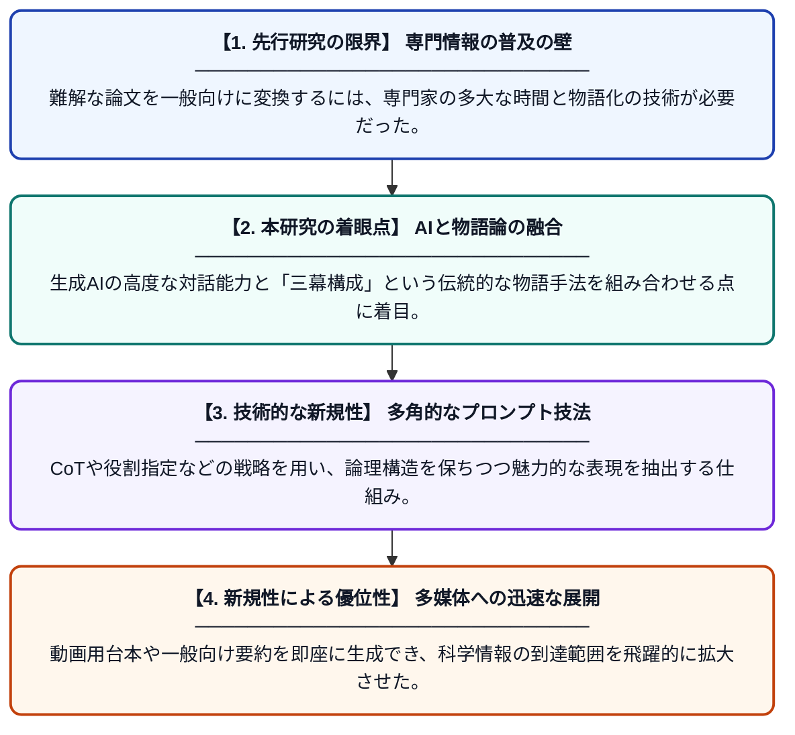

# AI時代のサイエンスコミュニケーション：好奇心、マルチメディア、物語の力

**Original Title**: *Science Communication in the age of AI? Curiosity, Multimedia, Storytelling*

> **💡 一言要約**: AIで論文を「伝わる物語」へ変換する新手法

| 項目 | 内容 |
|---|---|
| **著者** | J Wang |
| **掲載誌** | Microbiology Australia |
| **アラートキーワード** | one shot |
| **原文リンク** | [https://connectsci.au/ma/article-abstract/doi/10.1071/MA26059/279438](https://connectsci.au/ma/article-abstract/doi/10.1071/MA26059/279438) |
| **PDF版要約** | [README.pdf](./README.pdf) |

---

## 📊 新規性の図解（先行研究との違いと本研究のブレークスルー）

## 📝 要約

生成AIを活用して、学術論文から魅力的なタイトルや視覚資料、物語の構成案を抽出する手法を提案する論文です。One-shotプロンプトや思考の連鎖（CoT）などの技術を用いることで、専門的な科学情報を一般向けの動画や要約へと効率的に変換する枠組みを示しています。

## ❓ どんな問題に取り組んだか

専門的な研究成果を一般の人々に分かりやすく伝えることは、多大な労力と物語構築のスキルを必要とします。特に、複雑なデータを魅力的な視覚資料やストーリーに落とし込むための、標準化された効率的なプロセスが不足していました。

## ✨ 何が新しい？何がすごい？（新規性）

本研究は、最新のAIプロンプトエンジニアリングをサイエンスコミュニケーションに直接応用し、「三幕構成」という物語のフレームワークを導入した点が画期的です。単なる情報の要約ではなく、思考の連鎖（CoT）や役割指定を活用することで、科学的妥当性を保ちつつ人々の好奇心を刺激するコンテンツを自動生成する手法を確立しました。

## 🎓 大学1年生向けの解説

難しい科学の研究を、まるで映画のような面白いストーリーとして伝えるための方法を考えた論文です。AIを使って、論文の中から「驚きのポイント」や「物語の構成」を自動で取り出すテクニックを紹介しています。これを使えば、専門外の人でもYouTube動画や分かりやすい記事を通して、最先端の科学を楽しく理解できるようになります。AIが科学者と市民をつなぐ「翻訳者」になる未来を提案しています。
