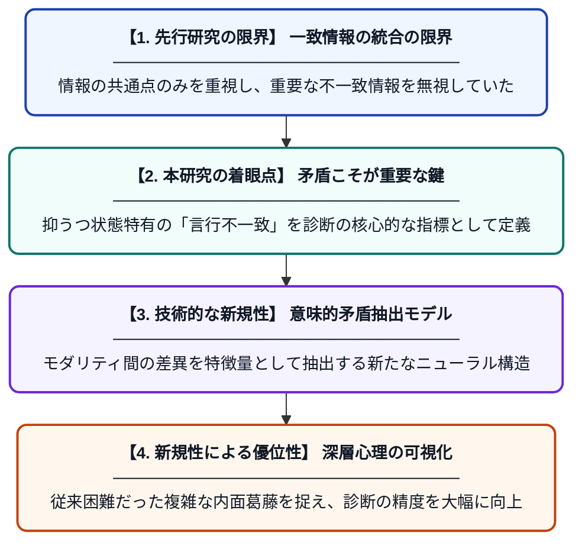

# 意味的矛盾に基づくマルチモーダル感情分析と抑うつ診断

**Original Title**: *Multimodal Sentiment Analysis and Depression Diagnosis Based on Semantic Conflict*

> **💡 一言要約**: 言動の「ズレ」から心の不調を読み解くAI技術

| 項目 | 内容 |
|---|---|
| **著者** | J Liu, Y Li, P Gao, J Ning, L Wei, D Chen |
| **掲載誌** | IEEE Transactions on Affective Computing 2026 |
| **アラートキーワード** | affective computing |
| **原文リンク** | [https://ieeexplore.ieee.org/abstract/document/11802976/](https://ieeexplore.ieee.org/abstract/document/11802976/) |
| **PDF版要約** | [README.pdf](./README.pdf) |

---

## 📊 新規性の図解（先行研究との違いと本研究のブレークスルー）

## 📝 要約

テキスト、音声、映像といった複数のデータ間に生じる「意味的な食い違い」に着目し、感情分析と抑うつ診断の精度を向上させる手法を提案した論文です。抑うつ状態で見られる「言葉と表情の不一致」などの矛盾をモデル化することで、より深い心理状態の把握を可能にしました。

## ❓ どんな問題に取り組んだか

従来のマルチモーダル分析は、異なるデータ間の一致する情報を統合することに重点を置いていました。しかし、抑うつ患者などは感情の表出が複雑で、発言内容と表情が一致しない「意味的矛盾」が生じやすく、従来手法ではこれらを十分に捉えきれないという課題がありました。

## ✨ 何が新しい？何がすごい？（新規性）

本研究の核心は、異なるメディア間の矛盾をノイズとして排除するのではなく、重要な診断情報として積極的にモデル化した点にあります。独自のセマンティック・コンフリクト（意味的矛盾）抽出モジュールを開発し、複数のモダリティから得られる情報の差異を定量化する仕組みを構築しました。これにより、既存の最高水準の手法を上回る精度で、抑うつの兆候や繊細な感情の変化を特定することに成功しています。

## 🎓 大学1年生向けの解説

例えば、悲しい時に無理に笑顔を作っても、どこか違和感がありますよね。この研究は、AIを使ってその「言葉と表情のチグハグさ」を分析する技術です。AIが言葉、声のトーン、顔の動きを別々に読み取り、それらの間にある矛盾（ズレ）を計算することで、心の不調をより正確に見つけ出すことができるようになります。目に見える情報だけでなく、隠れた感情のサインを見逃さないための新しいアプローチです。
