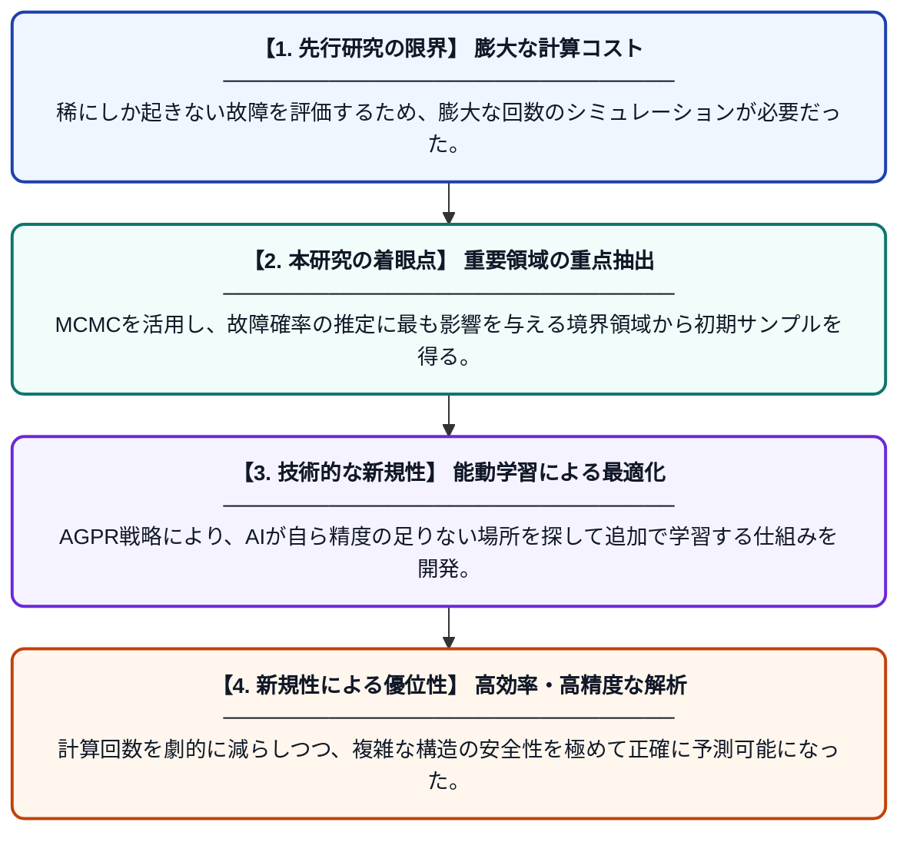

# 能動学習ガウス過程回帰に基づく構造信頼性解析

**Original Title**: *Structural Reliability Analysis Based on Active Learning Gaussian Process Regression*

> **💡 一言要約**: 能動学習とAIで構造物の破壊を賢く、速く予測する

| 項目 | 内容 |
|---|---|
| **著者** | F Li, J Zhao, Y Li, Z Yu, Z Zhang |
| **掲載誌** | Quality and Reliability Engineering International 2026 |
| **アラートキーワード** | MCMC |
| **原文リンク** | [https://onlinelibrary.wiley.com/doi/abs/10.1002/qre.70499](https://onlinelibrary.wiley.com/doi/abs/10.1002/qre.70499) |
| **PDF版要約** | [README.pdf](./README.pdf) |

---

## 📊 新規性の図解（先行研究との違いと本研究のブレークスルー）

## 📝 要約

この論文は、ガウス過程回帰（GPR）に能動学習を組み合わせることで、構造物の信頼性を効率的かつ高精度に評価する手法を提案しています。MCMC（マルコフ連鎖モンテカルロ法）を用いて故障確率の推定に重要な領域から初期サンプルを生成し、計算負荷を大幅に削減しています。

## ❓ どんな問題に取り組んだか

複雑な構造物の安全性を評価する際、従来のシミュレーション手法では膨大な計算時間が必要でした。特に、めったに起きない「故障」の確率を正確に当てるためには、どこを重点的に計算すべきかを判断するのが難しいという課題がありました。

## ✨ 何が新しい？何がすごい？（新規性）

従来のガウス過程回帰にMCMCによる初期サンプリングを導入し、故障の境界付近という「最も重要なデータ」を効率的に収集できる点が画期的です。さらに、提案された能動学習戦略（AGPR）によって、予測精度が低い領域を自動的に特定して学習を繰り返す仕組みを構築しました。これにより、先行研究と比較して極めて少ない試行回数で、複雑な非線形問題に対しても高い信頼性評価を実現しています。

## 🎓 大学1年生向けの解説

巨大な橋やビルが壊れないか計算するのは、実は非常に時間がかかる大変な作業です。この研究では、AIの一種を使って「壊れそうなギリギリの条件」だけを賢く選んでシミュレーションする仕組みを作りました。例えるなら、教科書を全部丸暗記するのではなく、試験に出そうな難しい問題だけをAIが予想して効率よく勉強するようなイメージです。これによって、コンピュータの計算時間を節約しながら、建物の安全性を正確に確かめられるようになりました。
