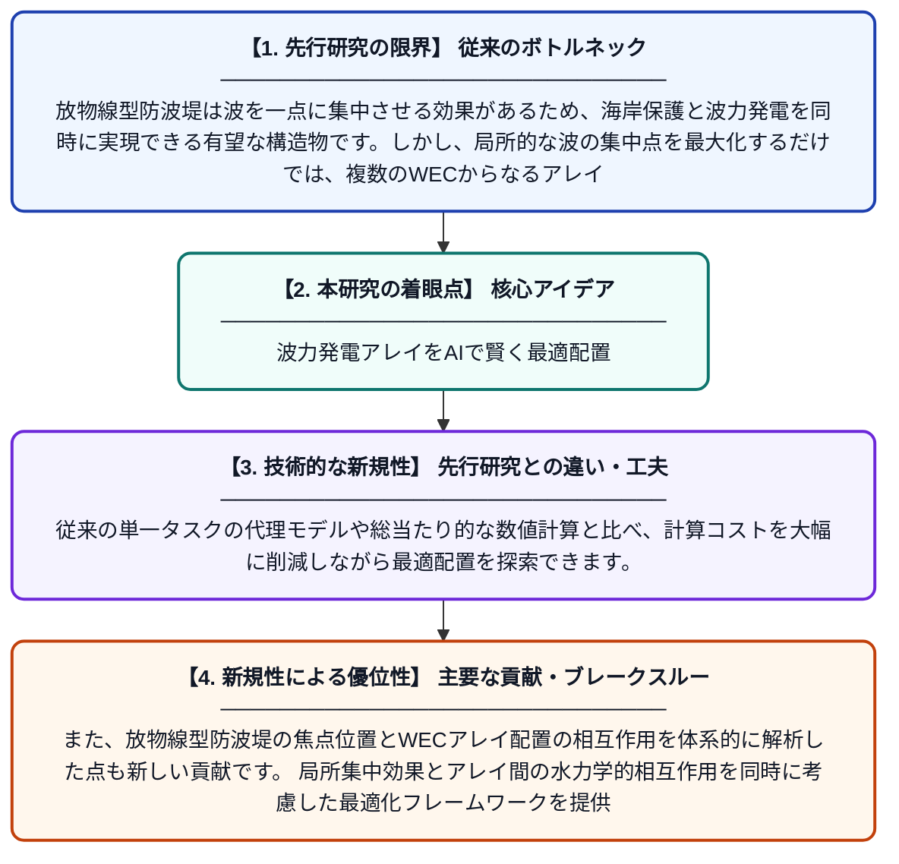

# 放物線型防波堤を備えた固定式WECアレイの規則波下におけるエネルギー吸収最適化：マルチタスクガウス過程回帰アプローチ

**Original Title**: *Energy absorption optimization of a fixed WEC array with a parabolic breakwater under regular waves: A multi-task Gaussian process regression approach*

> **💡 一言要約**: 波力発電アレイをAIで賢く最適配置

| 項目 | 内容 |
|---|---|
| **著者** | L Shao, Y Zhao, L Zhang |
| **掲載誌** | Ocean Engineering 2026 |
| **アラートキーワード** | gaussian process |
| **原文リンク** | [https://www.sciencedirect.com/science/article/pii/S0029801826030374](https://www.sciencedirect.com/science/article/pii/S0029801826030374) |
| **PDF版要約** | [README.pdf](./README.pdf) |

---

## 📊 新規性の図解（先行研究との違いと本研究のブレークスルー）

## 📝 要約

放物線型防波堤と組み合わせた点吸収型波力発電装置（WEC）のアレイ配置を最適化する研究です。局所的な波の集中が必ずしもアレイ全体のエネルギー吸収を最大化しないという問題に対し、マルチタスクガウス過程回帰（MT-GPR）を用いた効率的な最適化手法を提案しています。これにより、複数の波浪条件下での最適なWEC配置を計算コストを大幅に削減しながら探索することが可能になりました。

## ❓ どんな問題に取り組んだか

放物線型防波堤は波を一点に集中させる効果があるため、海岸保護と波力発電を同時に実現できる有望な構造物です。しかし、局所的な波の集中点を最大化するだけでは、複数のWECからなるアレイ全体のエネルギー吸収量が最大にならない場合があります。さらに、多数のWEC配置パターンを数値流体解析で網羅的に評価することは計算コストが膨大となり、現実的ではありませんでした。

## ✨ 何が新しい？何がすごい？（新規性）

本研究では、マルチタスクガウス過程回帰（MT-GPR）をWECアレイ最適化に初めて導入し、異なる波浪条件間で情報を共有することで少ないサンプル数でも高精度な代理モデルを構築することに成功しました。従来の単一タスクの代理モデルや総当たり的な数値計算と比べ、計算コストを大幅に削減しながら最適配置を探索できます。また、放物線型防波堤の焦点位置とWECアレイ配置の相互作用を体系的に解析した点も新しい貢献です。局所集中効果とアレイ間の水力学的相互作用を同時に考慮した最適化フレームワークを提供しています。

## 🎓 大学1年生向けの解説

海の波を使って電気を作る「波力発電」という技術があります。防波堤を放物線の形にすると、波を一点に集めてより多くのエネルギーを取り出せます。ただし、発電装置を複数並べたとき、どこに置けば一番効率がよいかを全パターン試すのは時間がかかりすぎます。そこでこの研究では、少ない実験データから賢く予測する「ガウス過程回帰」というAI技術を使い、素早く最適な配置を見つける方法を開発しました。これにより、海岸を守りながら波力発電の効率も最大化できる、一石二鳥のシステム設計が可能になります。
