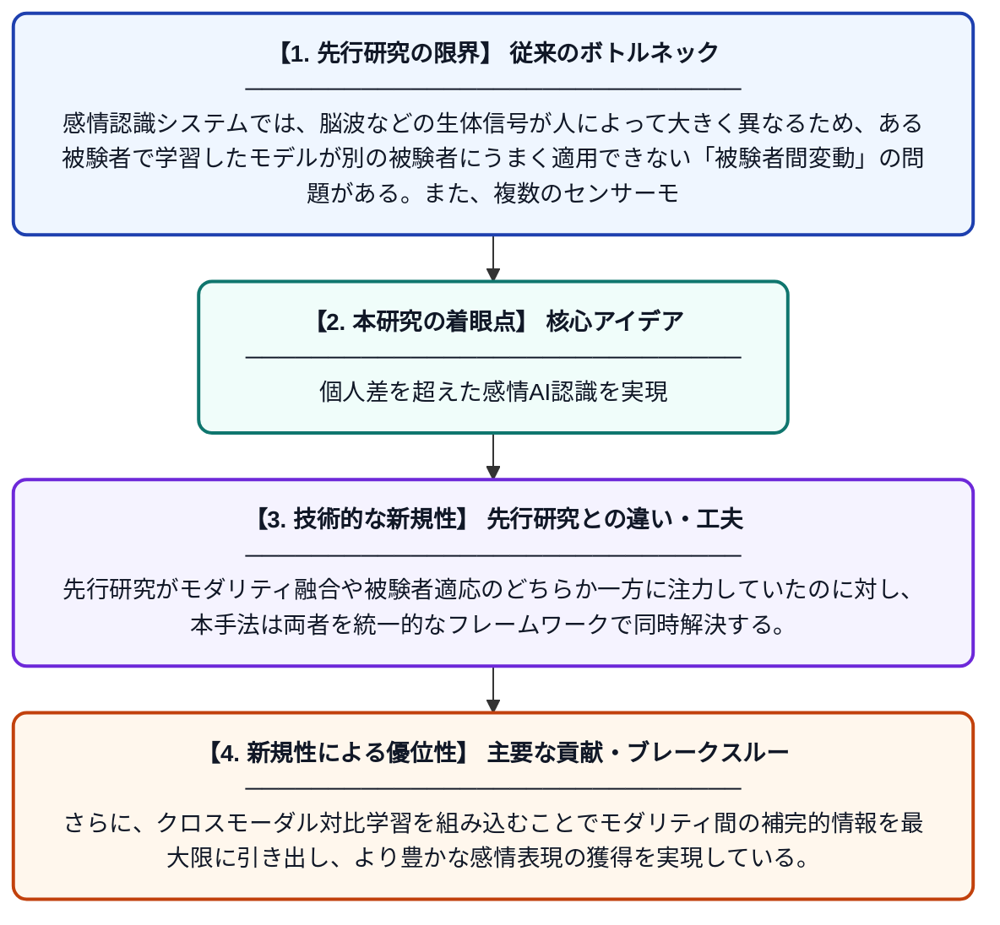

# マスクされたクロスモーダルアライメントによる被験者不変マルチモーダル感情表現学習

**Original Title**: *Subject-Invariant Multimodal Affective Representation Learning Via Masked Cross-Modal Alignment*

> **💡 一言要約**: 個人差を超えた感情AI認識を実現

| 項目 | 内容 |
|---|---|
| **著者** | Z Luo, Q She, P Zhang, G Zhang, Q Liu |
| **掲載誌** | IEEE Transactions on Affective Computing 2026 |
| **アラートキーワード** | representation learning |
| **原文リンク** | [https://ieeexplore.ieee.org/abstract/document/11627395/](https://ieeexplore.ieee.org/abstract/document/11627395/) |
| **PDF版要約** | [README.pdf](./README.pdf) |

---

## 📊 新規性の図解（先行研究との違いと本研究のブレークスルー）

## 📝 要約

本論文は、複数のモダリティ（脳波・視線・生体信号など）を組み合わせて感情を認識する際に、被験者ごとの個人差（被験者間変動）に頑健な表現学習手法を提案する。マスク処理を用いたクロスモーダルアライメントと、クロスモーダル対比学習を組み合わせることで、モダリティ間の補完的情報を効果的に活用する。SEEDシリーズデータセットでの広範な実験により、提案手法の有効性が示されている。

## ❓ どんな問題に取り組んだか

感情認識システムでは、脳波などの生体信号が人によって大きく異なるため、ある被験者で学習したモデルが別の被験者にうまく適用できない「被験者間変動」の問題がある。また、複数のセンサーモダリティを統合する際に、各モダリティ間の情報を効果的に融合することも依然として難しい課題である。

## ✨ 何が新しい？何がすごい？（新規性）

本研究は、マスク処理を活用したクロスモーダルアライメント機構を新たに導入することで、被験者に依存しない汎用的な感情表現を学習できる点が新しい。先行研究がモダリティ融合や被験者適応のどちらか一方に注力していたのに対し、本手法は両者を統一的なフレームワークで同時解決する。さらに、クロスモーダル対比学習を組み込むことでモダリティ間の補完的情報を最大限に引き出し、より豊かな感情表現の獲得を実現している。

## 🎓 大学1年生向けの解説

人間の感情をAIで自動認識するとき、脳の電気信号（脳波）などを使いますが、この信号は人によってパターンが全然違います。そのため、Aさんのデータで学習したAIがBさんには通用しないという問題があります。この研究では、複数種類のセンサーデータを上手に組み合わせ、かつ人ごとの違いを自動的に取り除く技術を開発しました。具体的には、データの一部を意図的に隠して当てさせる「マスク学習」と、異なるセンサーのデータをそろえる「対比学習」を組み合わせています。これにより、誰に対しても精度よく感情を認識できるシステムの実現に一歩近づきました。
