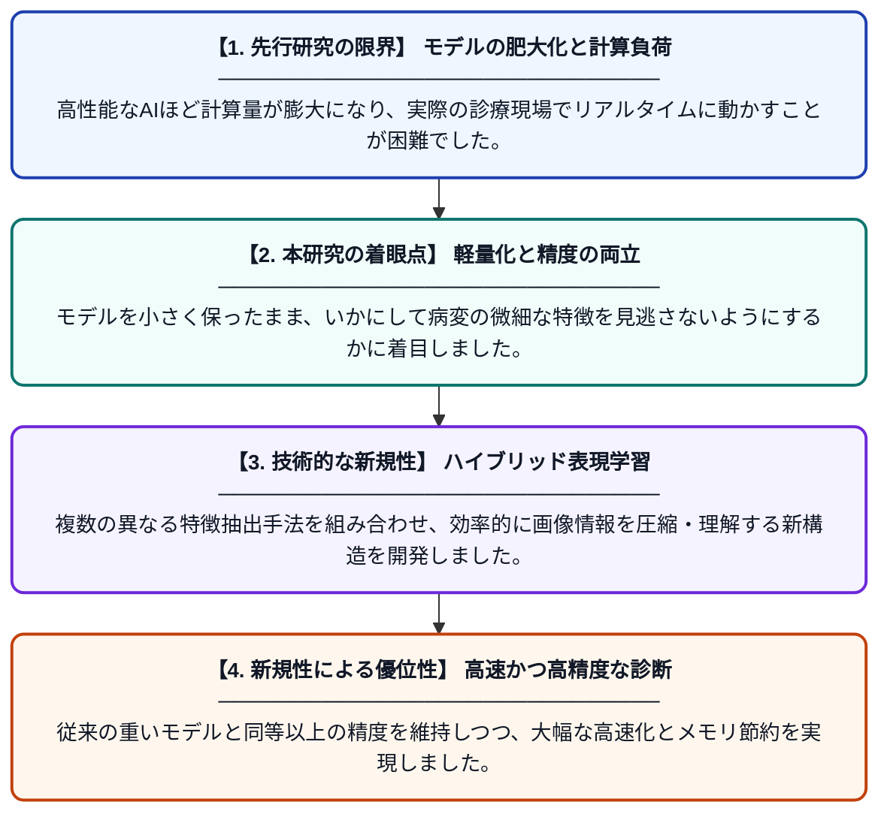

# 大腸内視鏡画像における病変分類のための軽量ハイブリッド表現学習フレームワーク

**Original Title**: *A Lightweight Hybrid Representation Learning Framework for Colorectal Lesion Classification in Colonoscopy Images*

> **💡 一言要約**: 軽量AIで大腸がんの兆候を高速かつ高精度に自動判別

| 項目 | 内容 |
|---|---|
| **著者** | MA Cifci, Y Farhang |
| **掲載誌** | Journal of Imaging 2026 |
| **アラートキーワード** | representation learning |
| **原文リンク** | [https://www.mdpi.com/2313-433X/12/11/575](https://www.mdpi.com/2313-433X/12/11/575) |
| **PDF版要約** | [README.pdf](./README.pdf) |

---

## 📊 新規性の図解（先行研究との違いと本研究のブレークスルー）

## 📝 要約

この研究は、大腸内視鏡画像から病変を正確かつ効率的に分類するための、軽量なハイブリッド表現学習フレームワークを提案しています。複数の特徴抽出手法を組み合わせることで、計算コストを抑えつつ高い診断精度を実現し、医療現場での実用性を高めています。

## ❓ どんな問題に取り組んだか

従来の大腸内視鏡画像解析モデルは、高い精度を得るために膨大な計算資源を必要とし、リアルタイム診断やリソースの限られた医療現場への導入が困難でした。また、複雑な病変の形状やテクスチャを効率的に捉える手法が不足していたことも課題でした。

## ✨ 何が新しい？何がすごい？（新規性）

本研究の核心は、異なる特性を持つ特徴量を効果的に統合する「ハイブリッド表現学習」の導入にあります。軽量なアーキテクチャでありながら、空間的な詳細と広域的な意味情報の両方を抽出する独自の仕組みを構築しました。これにより、先行研究よりも大幅にパラメータ数を削減しつつ、優れた分類性能を達成した点が主要な貢献です。

## 🎓 大学1年生向けの解説

お医者さんが大腸カメラでがんの種（ポリープ）を見つけるのを、AIがサポートする技術の研究です。これまでのAIは頭が良い代わりに動きが非常に重く、診察中にすぐ結果を出すのが大変でした。そこで、AIの構造を工夫して「軽くて速いのに賢い」新しいモデルを作り上げました。これにより、高価な機材がなくても素早く正確に病変を見分けられるようになり、病気の早期発見につながります。
