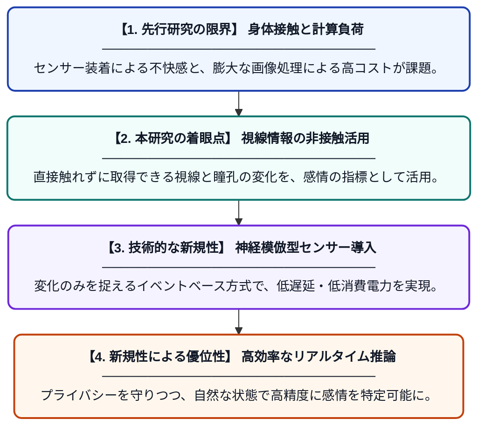

# 視線インタラクションを通じた非接触型ニューロモルフィック感情推定

**Original Title**: *Noncontact Neuromorphic Emotion Inference via Gaze Interaction*

> **💡 一言要約**: 視線だけで心を読み取る非接触・高速AI

| 項目 | 内容 |
|---|---|
| **著者** | J Ko, M Jin, S Jeong, D Lee, H Jeong, Z Xu, S Park… |
| **掲載誌** | ACS Nano |
| **アラートキーワード** | affective computing |
| **原文リンク** | [https://pubs.acs.org/ancac3/article/doi/10.1021/acsnano.6c14473/5472035](https://pubs.acs.org/ancac3/article/doi/10.1021/acsnano.6c14473/5472035) |
| **PDF版要約** | [README.pdf](./README.pdf) |

---

## 📊 新規性の図解（先行研究との違いと本研究のブレークスルー）

## 📝 要約

視線の動きや瞳孔の変化をイベントベースのセンサーで捉え、非接触で人間の感情を読み取るニューロモルフィックシステムを提案しています。脳の仕組みを模した計算手法を用いることで、低消費電力かつリアルタイムでの高精度な感情推論を実現しました。

## ❓ どんな問題に取り組んだか

従来の感情推定技術は、脳波計や心拍計などのセンサーを身体に直接装着する必要があり、ユーザーに拘束感や不快感を与える課題がありました。また、カメラ映像を用いた手法では、膨大なデータ処理による高消費電力やプライバシー保護が大きな壁となっていました。

## ✨ 何が新しい？何がすごい？（新規性）

本研究の最大の特徴は、変化があった画素のみを記録するイベントベースビジョンセンサー（ニューロモルフィックカメラ）を視線解析に導入した点にあります。これにより、従来のフレームベースのカメラに比べてデータ量を劇的に削減しつつ、視線の微細な動きを高速に捉えることが可能になりました。さらに、スパイクニューラルネットワーク（SNN）等の神経模倣アルゴリズムを組み合わせることで、電力効率と推定精度の両立を達成しています。

## 🎓 大学1年生向けの解説

私たちが相手の目を見て「あ、今は楽しそうだな」と感じるように、機械が視線の動きから感情を当てる技術についての研究です。これまでは体にセンサーを付ける必要がありましたが、この技術はカメラで見るだけで良いので、非常に快適です。しかも「イベントベース」という、脳の神経に似た特殊な仕組みを使っているため、普通のカメラよりも素早く、かつ省エネで動きます。将来、身の回りのデバイスが自然にあなたの気持ちを理解してくれるようになるかもしれません。
