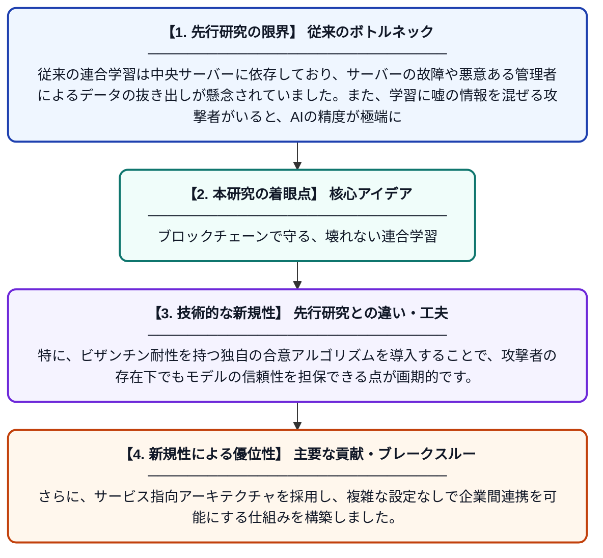

# ブロックチェーンのオーケストレーションとビザンチン耐性合意を用いたサービス指向のセキュア連合学習

**Original Title**: *Service-Oriented Secure Federated Learning via Blockchain Orchestration and Byzantine-Resilient Consensus*

> **💡 一言要約**: ブロックチェーンで守る、壊れない連合学習

| 項目 | 内容 |
|---|---|
| **著者** | J Huang, H Xu, NN Xiong, L Zhang, J Wan |
| **掲載誌** | IEEE Transactions on Services … 2026 |
| **アラートキーワード** | Federated Learning |
| **PDF** | [https://ieeexplore.ieee.org/iel8/4629386/4629387/11749674.pdf](https://ieeexplore.ieee.org/iel8/4629386/4629387/11749674.pdf) |
| **原文リンク** | [https://ieeexplore.ieee.org/iel8/4629386/4629387/11749674.pdf](https://ieeexplore.ieee.org/iel8/4629386/4629387/11749674.pdf) |
| **PDF版要約** | [README.pdf](./README.pdf) |

---

## 📊 新規性の図解（先行研究との違いと本研究のブレークスルー）

## 📝 要約

中央集権的なサーバーに依存せず、ブロックチェーンを用いて連合学習を自律的に制御する新しいフレームワークを提案しています。悪意のある参加者による攻撃（ビザンチン故障）に耐えつつ、組織間での安全かつ高精度なAIモデル学習を可能にしました。

## ❓ どんな問題に取り組んだか

従来の連合学習は中央サーバーに依存しており、サーバーの故障や悪意ある管理者によるデータの抜き出しが懸念されていました。また、学習に嘘の情報を混ぜる攻撃者がいると、AIの精度が極端に悪化する課題がありました。

## ✨ 何が新しい？何がすごい？（新規性）

ブロックチェーンを連合学習のオーケストレーターとして活用し、中央管理者のいない分散型の実行環境を実現しました。特に、ビザンチン耐性を持つ独自の合意アルゴリズムを導入することで、攻撃者の存在下でもモデルの信頼性を担保できる点が画期的です。さらに、サービス指向アーキテクチャを採用し、複雑な設定なしで企業間連携を可能にする仕組みを構築しました。

## 🎓 大学1年生向けの解説

「みんなでデータを持ち寄らずに賢いAIを作る」のが連合学習ですが、今まではリーダー役のサーバーが壊れたり悪さをしたりすると全て台無しになる弱点がありました。この研究では、ブロックチェーンという「みんなで監視する帳簿」を使って、リーダーがいなくても安全に学習が進むようにしました。嘘をつく参加者がいても、それを自動で見抜いて正しいAIを作れるように工夫されています。これにより、プライバシーを完璧に守りながら、多くの企業が協力してAIを育てることができます。
