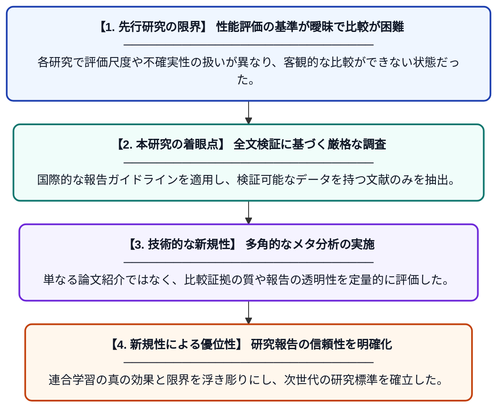

# IoT侵入検知のための連合学習：比較証拠、報告の質、メタ分析に関する全文検証可能なエビデンスレビュー

**Original Title**: *Federated Learning for IoT Intrusion Detection: A Full-Text-Verifiable Accessible-Document Evidence Review of Comparative Evidence, Reporting Quality, and Meta …*

> **💡 一言要約**: 連合学習によるIoT検知の「真の実力」を徹底検証

| 項目 | 内容 |
|---|---|
| **著者** | A Abbasi, DN Hakro, YA Mohamed, A Khanan… |
| **掲載誌** | Information 2026 |
| **アラートキーワード** | Federated Learning |
| **PDF** | [https://www.mdpi.com/2078-2489/17/11/1186/pdf](https://www.mdpi.com/2078-2489/17/11/1186/pdf) |
| **原文リンク** | [https://www.mdpi.com/2078-2489/17/11/1186/pdf](https://www.mdpi.com/2078-2489/17/11/1186/pdf) |
| **PDF版要約** | [README.pdf](./README.pdf) |

---

## 📊 新規性の図解（先行研究との違いと本研究のブレークスルー）

## 📝 要約

IoT機器のセキュリティ向上に期待される連合学習（FL）を用いた侵入検知システムについて、国際的な報告ガイドラインに基づき包括的な検証を行った研究です。既存研究における性能向上の報告が、比較対象や測定方法、不確実性に大きく左右される現状を明らかにしました。

## ❓ どんな問題に取り組んだか

IoTの侵入検知において連合学習は有望視されていますが、各研究の評価基準が統一されておらず、報告される性能向上の根拠が不明確な場合が多いという課題があります。また、既存のレビューは全文アクセス可能な文書に限定した厳密な証拠検証が不足していました。

## ✨ 何が新しい？何がすごい？（新規性）

本研究はPRISMA 2020等の国際基準に従い、全文検証可能な文献のみを対象とした体系的レビューを実施した点が画期的です。手法の紹介に留まらず、比較証拠の質や不確実性をメタ分析の観点から評価し、これまでの研究成果の信頼性を再定義しました。これにより、今後のIoTセキュリティ研究における標準的な報告の在り方を提示しています。

## 🎓 大学1年生向けの解説

スマート家電などのIoT機器をハッカーから守るために、データを一箇所に集めずに学習する「連合学習」という技術が注目されています。しかし、これまでの研究発表には「本当に効果があるのか」を正しく判断するための情報の書き方にバラつきがありました。この論文は、多くの過去の研究を厳しい基準でチェックし、内容がどのくらい信頼できるのかを整理した「研究の研究」です。これからのセキュリティ技術をより正確に評価するためのルールを作ったと言えます。
