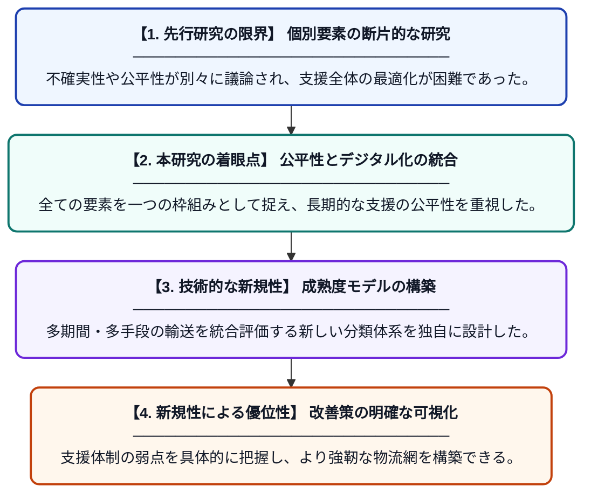

# 公平で強靭な人道支援ロジスティクスに向けて：統合的な多期間・マルチモーダル災害応急対応システムの分類法と成熟度フレームワーク

**Original Title**: *Toward equity-robust humanitarian logistics: A taxonomy and maturity framework for integrated multi-period and multimodal disaster response systems*

> **💡 一言要約**: 公平な災害支援を実現する「組織の診断基準」を確立

| 項目 | 内容 |
|---|---|
| **著者** | SGD Sharma, KP Marimuthu |
| **掲載誌** | Progress in Disaster Science 2026 |
| **アラートキーワード** | logistics |
| **原文リンク** | [https://www.sciencedirect.com/science/article/pii/S2590061726002826](https://www.sciencedirect.com/science/article/pii/S2590061726002826) |
| **PDF版要約** | [README.pdf](./README.pdf) |

---

## 📊 新規性の図解（先行研究との違いと本研究のブレークスルー）

## 📝 要約

本研究は、不確実な状況下でも公平な物資配送を維持するための人道支援ロジスティクスの分類法と成熟度モデルを提案しています。これまで個別に議論されてきた不確実性、公平性、デジタル技術、および多様な輸送手段を統合的に評価する新たな枠組みを構築しました。

## ❓ どんな問題に取り組んだか

災害時の物資支援では、不確実性や公平性、デジタル化といった要素が重要ですが、これらは従来個別に研究されることが多く、統合的な視点が欠けていました。特に、長期間にわたる対応や複数の輸送手段を考慮した上で、どのように公平性を保つべきかの評価基準が明確ではありませんでした。

## ✨ 何が新しい？何がすごい？（新規性）

本研究は、人道支援ロジスティクスにおける「公平性」と「強靭性」を中核に据え、デジタル技術や輸送手段の統合度を評価する包括的な分類法（タクソノミー）を開発しました。先行研究が特定要素の最適化に留まっていたのに対し、複数の期間と輸送モードを跨ぐ一貫した成熟度フレームワークを提示した点が画期的です。これにより、組織が自らの支援体制のレベルを客観的に把握し、改善の道筋を立てることが可能になりました。

## 🎓 大学1年生向けの解説

災害が起きたとき、誰にでも平等に、かつ遅れずに物資を届けるのはとても難しい課題です。この論文は、「どうすれば不公平をなくせるか」や「最新のIT技術をどう使うか」といったバラバラだった考え方を一つにまとめました。自分の組織がどれくらい高いレベルで支援できているかを判定する「診断シート」のようなものを作ったのです。これを使えば、より多くの命を救うための計画が立てやすくなります。
