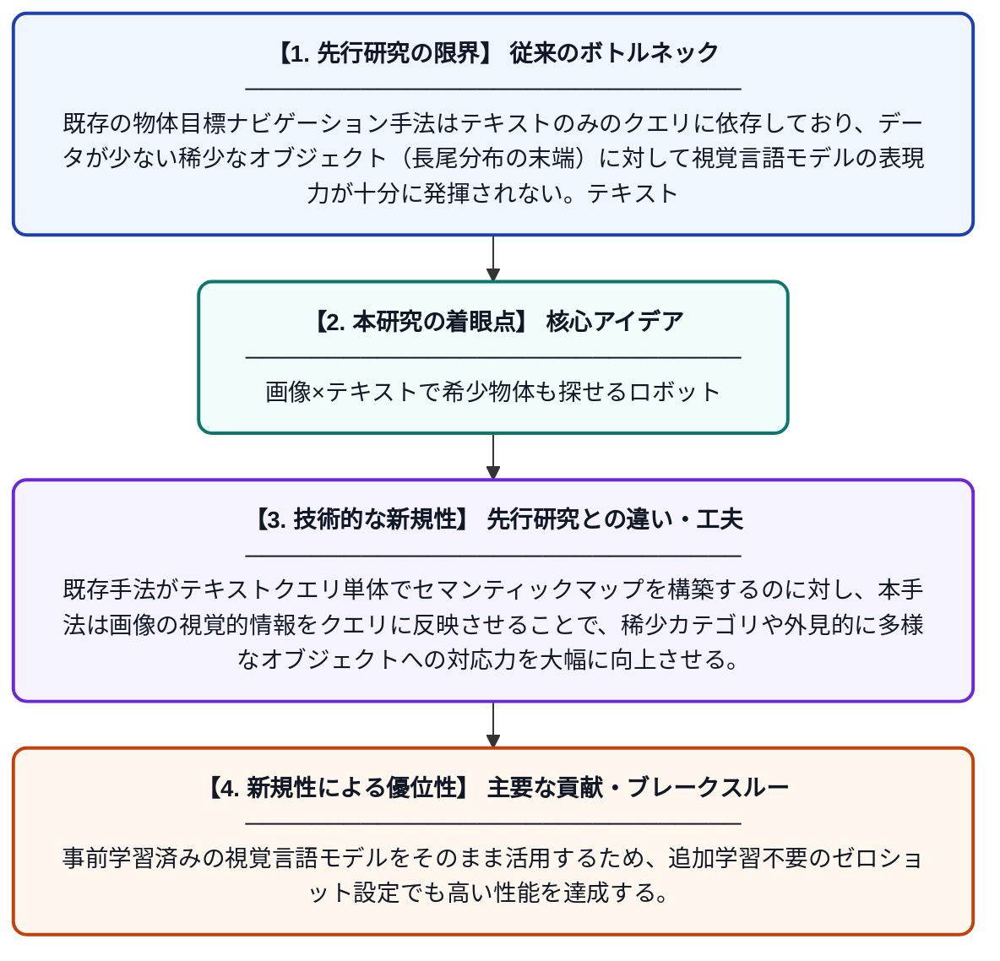

# IMPRINT: 長尾分布オブジェクト目標ナビゲーションのための画像条件付きクエリ強化

**Original Title**: *IMPRINT: Image-Conditioned Query Enrichment for Long-Tail Object Goal Navigation*

> **💡 一言要約**: 画像×テキストで希少物体も探せるロボット

| 項目 | 内容 |
|---|---|
| **著者** | JR Akkara, F Ziliotto, L Serafini, L Ballan, T Campari |
| **掲載誌** | arXiv preprint arXiv:2607.25106 2026 |
| **アラートキーワード** | Open-Vocabulary Object ... |
| **PDF** | [https://arxiv.org/pdf/2607.25106](https://arxiv.org/pdf/2607.25106) |
| **原文リンク** | [https://arxiv.org/pdf/2607.25106](https://arxiv.org/pdf/2607.25106) |
| **PDF版要約** | [README.pdf](./README.pdf) |

---

## 📊 新規性の図解（先行研究との違いと本研究のブレークスルー）

## 📝 要約

本論文は、ロボットが「〇〇を見つけて」という指示を受けて自律的に部屋を探索するタスク（ObjectNav）において、テキストのみのクエリでは稀少・曖昧なオブジェクトへの対応が困難という問題に取り組む。提案手法IMPRINTは、テキストクエリに加えて参照画像を条件として組み合わせることで、長尾分布（レアなカテゴリ）に属するオブジェクトの認識・探索精度を向上させる。視覚言語モデルを活用したクエリ強化により、ゼロショット設定でも頑健なナビゲーションを実現する。

## ❓ どんな問題に取り組んだか

既存の物体目標ナビゲーション手法はテキストのみのクエリに依存しており、データが少ない稀少なオブジェクト（長尾分布の末端）に対して視覚言語モデルの表現力が十分に発揮されない。テキストだけでは曖昧さや多義性を解消できず、特定の見た目を持つオブジェクトを正確に特定することが困難であった。

## ✨ 何が新しい？何がすごい？（新規性）

IMPRINTは、従来のテキストのみのクエリに参照画像を組み合わせる「画像条件付きクエリ強化」という新しいアプローチを提案する点が独自である。既存手法がテキストクエリ単体でセマンティックマップを構築するのに対し、本手法は画像の視覚的情報をクエリに反映させることで、稀少カテゴリや外見的に多様なオブジェクトへの対応力を大幅に向上させる。事前学習済みの視覚言語モデルをそのまま活用するため、追加学習不要のゼロショット設定でも高い性能を達成する。

## 🎓 大学1年生向けの解説

ロボットに「コーヒーカップを持ってきて」とお願いするとき、ロボットはその物体を部屋の中で見つけなければなりません。従来のロボットは「コーヒーカップ」という言葉だけを手がかりに探していましたが、珍しい形や色のカップには対応が難しい問題がありました。この研究では、言葉に加えて「こんな見た目のカップです」という参照写真も一緒に渡すことで、ロボットがより正確に目的の物体を見つけられるようにしました。まるで人間に「これを探して」と写真を見せるのと同じような直感的な仕組みです。
