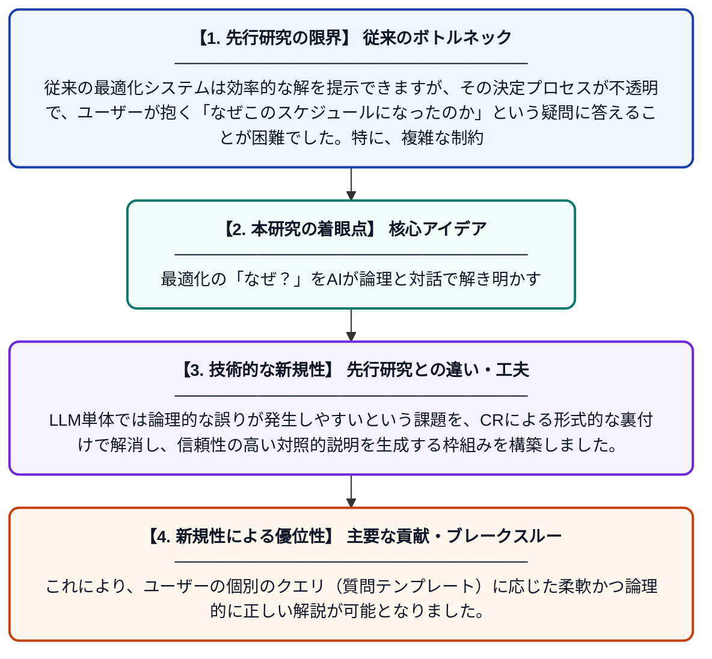

# 制約推論と大規模言語モデルの融合：実世界の最適化アプリケーションにおける対照的説明の提供

**Original Title**: *Constraint Reasoning and Large Language Models Join Forces: Providing Contrastive Explanations for Real-World Optimisation-Based Applications*

> **💡 一言要約**: 最適化の「なぜ？」をAIが論理と対話で解き明かす

| 項目 | 内容 |
|---|---|
| **著者** | RX Lera-Leri, F Bistaffa, A Georgara |
| **掲載誌** | arXiv preprint arXiv 2026 |
| **アラートキーワード** | rcpsp |
| **PDF** | [https://arxiv.org/pdf/2610.31119](https://arxiv.org/pdf/2610.31119) |
| **Git リポジトリ** | [https://github.com/RogerXLera/LLMxMIP.15We](https://github.com/RogerXLera/LLMxMIP.15We) |
| **原文リンク** | [https://scholar.google.com/scholar_url?url=https://arxiv.org/pdf/2610.31119&hl=ja&sa=X&d=1369259649526082511&ei=AOLdas66Esyp6rQP4ry-yQI&scisig=ACTRDVEl3QfcNu2yxZNEi_UI31Ro&oi=scholaralrt&hist=RO4okA8AAAAJ:9393894099638958959:ACTRDVHWdjmFunHWtpz506ZTlT8z&html=&pos=0&folt=kw-top](https://scholar.google.com/scholar_url?url=https://arxiv.org/pdf/2610.31119&hl=ja&sa=X&d=1369259649526082511&ei=AOLdas66Esyp6rQP4ry-yQI&scisig=ACTRDVEl3QfcNu2yxZNEi_UI31Ro&oi=scholaralrt&hist=RO4okA8AAAAJ:9393894099638958959:ACTRDVHWdjmFunHWtpz506ZTlT8z&html=&pos=0&folt=kw-top) |
| **PDF版要約** | [README.pdf](./README.pdf) |

---

## 📊 新規性の図解（先行研究との違いと本研究のブレークスルー）

## 📝 要約

制約推論（CR）と大規模言語モデル（LLM）を組み合わせ、複雑な最適化問題に対して「なぜAではなくBなのか」という対照的な説明を生成する手法を提案しています。リソース制約付きプロジェクトスケジューリング問題（RCPSP）を対象に、厳密な論理推論と自然な言語表現を統合することで、ユーザーの納得感を高めるシステムを実現しました。

## ❓ どんな問題に取り組んだか

従来の最適化システムは効率的な解を提示できますが、その決定プロセスが不透明で、ユーザーが抱く「なぜこのスケジュールになったのか」という疑問に答えることが困難でした。特に、複雑な制約が絡み合う問題では、論理的な正しさを保ちつつ、専門外のユーザーにも分かりやすく説明する手段が不足していました。

## ✨ 何が新しい？何がすごい？（新規性）

本研究の最大の貢献は、数理的な制約推論（CR）の厳密さと、LLMの高い言語生成能力を相補的に統合した点にあります。LLM単体では論理的な誤りが発生しやすいという課題を、CRによる形式的な裏付けで解消し、信頼性の高い対照的説明を生成する枠組みを構築しました。これにより、ユーザーの個別のクエリ（質問テンプレート）に応じた柔軟かつ論理的に正しい解説が可能となりました。

## 🎓 大学1年生向けの解説

限られた人数や時間で仕事を割り振るような難しいパズルを解くとき、これまでのAIは「これがベストです」と結果だけを伝えていました。しかし、この研究のAIは「どうして私の案じゃダメなの？」といった質問に対して、数学的な根拠を使いながら、人間にとって分かりやすい言葉で理由を教えてくれます。論理的な正しさと、話しやすさの両方を兼ね備えた、頼もしい相談相手のようなシステムです。
