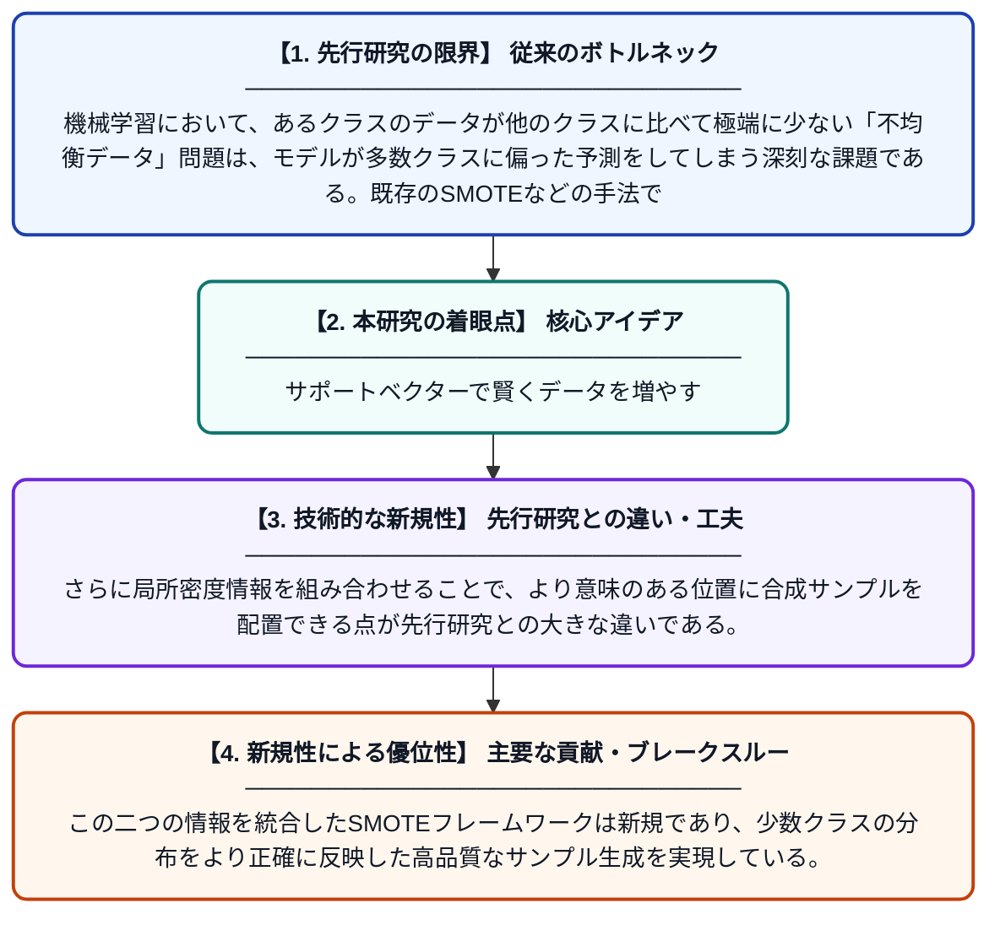

# 不均衡データ分類のためのサポートベクター強化密度SMOTE過剰サンプリング手法（SVED-SMOTE）

**Original Title**: *SVED-SMOTE: support vector enhanced density SMOTE oversampling technique for imbalanced data classification*

> **💡 一言要約**: サポートベクターで賢くデータを増やす

| 項目 | 内容 |
|---|---|
| **著者** | J Wang, N Awang |
| **掲載誌** | International Journal of Machine Learning and Cybernetics 2026 |
| **アラートキーワード** | SMOTE |
| **原文リンク** | [https://link.springer.com/article/10.1007/s13042-026-03240-z](https://link.springer.com/article/10.1007/s13042-026-03240-z) |
| **PDF版要約** | [README.pdf](./README.pdf) |

---

## 📊 新規性の図解（先行研究との違いと本研究のブレークスルー）

## 📝 要約

本論文は、クラス間のデータ数に大きな偏りがある「不均衡データ」分類問題に対処するため、SVED-SMOTEという新しい過剰サンプリング手法を提案している。サポートベクターと局所密度情報を組み合わせることで、合成サンプルの生成方向を動的に選択し、より品質の高い少数クラスデータを生成する。これにより、従来手法と比較して分類性能の大幅な向上を実証的に検証している。

## ❓ どんな問題に取り組んだか

機械学習において、あるクラスのデータが他のクラスに比べて極端に少ない「不均衡データ」問題は、モデルが多数クラスに偏った予測をしてしまう深刻な課題である。既存のSMOTEなどの手法では、少数クラスの合成サンプルをランダムに生成するため、ノイズや境界付近の曖昧なサンプルが混入しやすいという問題があった。

## ✨ 何が新しい？何がすごい？（新規性）

SVED-SMOTEは、サポートベクター（分類境界を定義する重要なデータ点）を活用して補間方向を動的に決定するという独自のアプローチを採用している。さらに局所密度情報を組み合わせることで、より意味のある位置に合成サンプルを配置できる点が先行研究との大きな違いである。この二つの情報を統合したSMOTEフレームワークは新規であり、少数クラスの分布をより正確に反映した高品質なサンプル生成を実現している。

## 🎓 大学1年生向けの解説

例えば、1000枚の写真のうち猫が950枚、犬が50枚しかないデータでAIを学習させると、AIは何でも「猫」と予測するようになってしまいます。これを解決するには少数派（犬）のデータを増やす必要がありますが、ただコピーするだけでは意味がありません。SVED-SMOTEは、AIが「分類の境界線を引くときに重要だと判断したデータ点」を手がかりにして、自然に見える新しい犬のデータを賢く作り出す手法です。さらに、データが密集している場所と疎な場所を考慮しながらサンプルを生成するため、より現実に近いデータ分布を再現できます。
