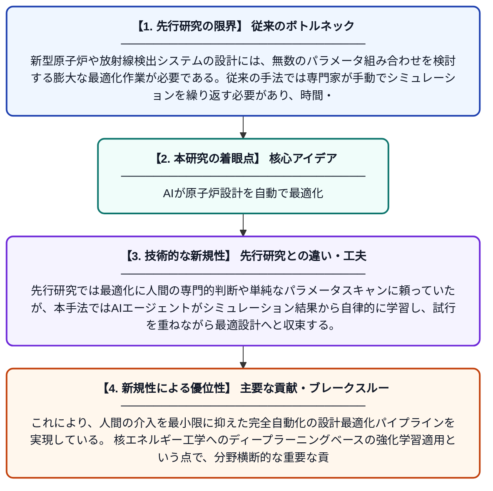

# 核エネルギー応用におけるモンテカルロシミュレーションのAI駆動型自動最適化

**Original Title**: *AI-Driven Automated Optimization in Monte Carlo Simulations for Nuclear Energy Applications*

> **💡 一言要約**: AIが原子炉設計を自動で最適化

| 項目 | 内容 |
|---|---|
| **著者** | MR Abdelnour, J Liu, AM Wajid, Z Liu |
| **掲載誌** | Energy and AI 2026 |
| **アラートキーワード** | optimization |
| **原文リンク** | [https://www.sciencedirect.com/science/article/pii/S266654682600162X](https://www.sciencedirect.com/science/article/pii/S266654682600162X) |
| **PDF版要約** | [README.pdf](./README.pdf) |

---

## 📊 新規性の図解（先行研究との違いと本研究のブレークスルー）

## 📝 要約

本研究では、原子炉や放射線検出システムの設計最適化を自動化するため、FLUKAモンテカルロシミュレーションと深層Q学習（DQL）を組み合わせた最適化フレームワークを提案している。新型原子炉技術の開発には膨大な設計最適化が必要であり、従来の手動による試行錯誤では時間とコストがかかりすぎるという問題に対応している。AIが自律的にシミュレーションを繰り返しながら最適な設計パラメータを探索することで、効率的かつ高精度な設計最適化を実現する。

## ❓ どんな問題に取り組んだか

新型原子炉や放射線検出システムの設計には、無数のパラメータ組み合わせを検討する膨大な最適化作業が必要である。従来の手法では専門家が手動でシミュレーションを繰り返す必要があり、時間・コスト・人的リソースの観点から非常に非効率であった。特に複雑な核反応を扱うシミュレーションは計算コストが高く、最適解の探索が困難であった。

## ✨ 何が新しい？何がすごい？（新規性）

本研究の新規性は、高精度な核物理シミュレーションツールであるFLUKAと、強化学習の一手法である深層Q学習（DQL）を初めて本格的に統合した点にある。先行研究では最適化に人間の専門的判断や単純なパラメータスキャンに頼っていたが、本手法ではAIエージェントがシミュレーション結果から自律的に学習し、試行を重ねながら最適設計へと収束する。これにより、人間の介入を最小限に抑えた完全自動化の設計最適化パイプラインを実現している。核エネルギー工学へのディープラーニングベースの強化学習適用という点で、分野横断的な重要な貢献をもたらしている。

## 🎓 大学1年生向けの解説

モンテカルロシミュレーションとは、乱数を使って粒子の動きなどを何万回も計算機でシミュレートする手法で、原子炉の安全性や効率を評価するために使われます。原子炉をより良く設計するには、たくさんのパラメータ（材料の厚さや配置など）を変えながら最適な組み合わせを探す必要がありますが、これを人間が手作業でやるととても時間がかかります。この研究では、ゲームのAIにも使われる「強化学習」という技術を使って、AIが自分でシミュレーションを何度も試しながら、より良い設計を自動的に学習・発見できるようにしました。まるでAIがゲームの攻略法を自分で考え出すように、原子炉の最適な設計を見つけ出すイメージです。これにより、設計開発の時間とコストを大幅に削減できる可能性があります。
