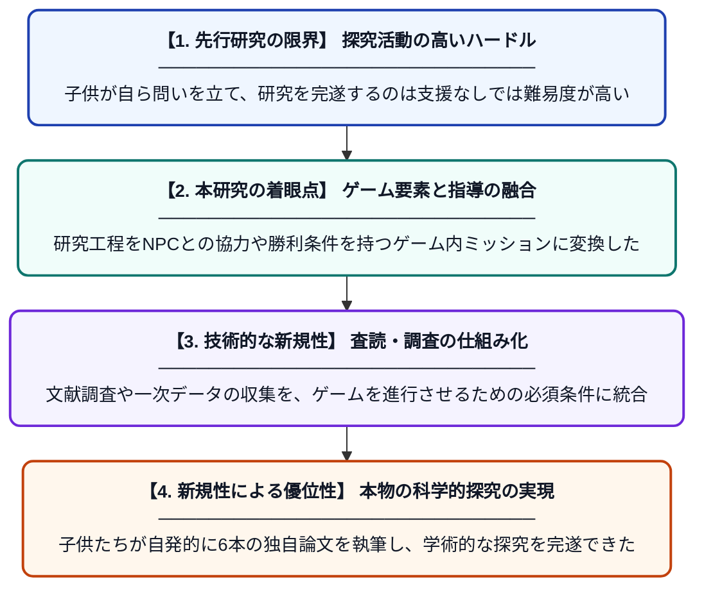

# メンターシップが子供たちの主体的な探究活動を可能にする

**Original Title**: *Mentorship Enables Children's Authentic Inquiry*

> **💡 一言要約**: ゲームの力で子供を「本物の研究者」へと変える

| 項目 | 内容 |
|---|---|
| **著者** | K Saito, R Tajika, M Minami¹, T Akiba |
| **掲載誌** | Serious Games: 12th Joint International Conference … |
| **アラートキーワード** | affective computing |
| **原文リンク** | [https://books.google.com/books?hl=ja&lr=lang_ja|lang_en&id=4VooEgAAQBAJ&oi=fnd&pg=PA174&dq="affective+computing"&ots=uToGOWq35Q&sig=L6Nfboa8xffZtO_4QwEJHvloAWE](https://books.google.com/books?hl=ja&lr=lang_ja|lang_en&id=4VooEgAAQBAJ&oi=fnd&pg=PA174&dq="affective+computing"&ots=uToGOWq35Q&sig=L6Nfboa8xffZtO_4QwEJHvloAWE) |
| **PDF版要約** | [README.pdf](./README.pdf) |

---

## 📊 新規性の図解（先行研究との違いと本研究のブレークスルー）

## 📝 要約

NPCの仲間や査読ミッション、勝利条件を備えたシリアスゲームを活用し、子供たちが自ら問いを立てて論文を執筆する支援手法を開発しました。その結果、子供たちは都市生態学から感情科学まで多岐にわたる分野で、一次データや文献に基づいた6本の独自論文を完成させました。

## ❓ どんな問題に取り組んだか

従来の教育現場では、子供が自発的に「問い」を立て、データ収集から論文執筆までの一連の学術的プロセスを完遂することは非常に困難でした。特に、専門的な研究活動に対するモチベーションの維持と、適切な指導（メンターシップ）の提供が大きな課題となっていました。

## ✨ 何が新しい？何がすごい？（新規性）

本研究は、研究プロセスをNPCとの協力や査読ミッションを含む「ゲーム」として再定義した点が画期的です。単なる疑似体験ではなく、実際の文献調査や一次データ収集をゲームの勝利条件に組み込むことで、子供たちの主体性を引き出しました。結果として、プロの研究者に匹敵する探究プロセスを子供が自律的に実行できることを実証した点が最大の貢献です。

## 🎓 大学1年生向けの解説

この研究は、ゲームの仕組みを使って子供たちに「本物の科学者」になってもらうプロジェクトです。ゲームの中にアドバイスをくれる仲間を登場させたり、論文の審査を受けるようなミッションを用意したりすることで、研究という難しい作業を楽しく進められるようにしました。その結果、子供たちは自分たちで調べたいことを見つけ、データを集め、大人が驚くような立派な論文を書き上げることができました。
