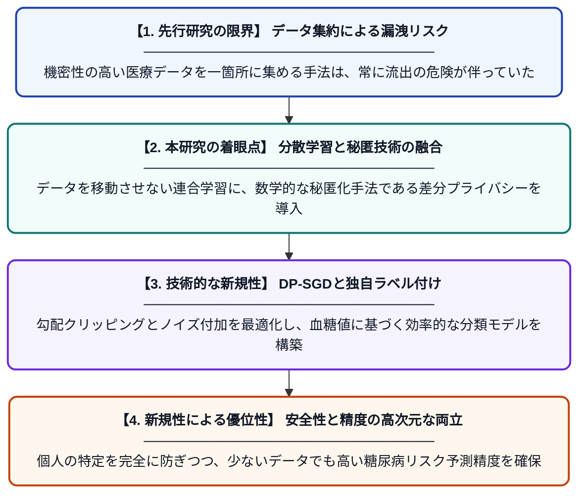

# 血糖値ベースのラベル付けを用いた糖尿病リスク分類のためのプライバシー保護連合学習アプローチ

**Original Title**: *A Privacy-Preserving Federated Learning Approach for Diabetes Risk Classification using Glucose-Level based Labeling*

> **💡 一言要約**: 機密を守りつつ糖尿病を予測する連合学習の新手法

| 項目 | 内容 |
|---|---|
| **著者** | A Baboo, SS Panda, BK Mohanta |
| **掲載誌** | 10th International Conference on I-SMAC … 2026 |
| **アラートキーワード** | differential privacy |
| **原文リンク** | [https://ieeexplore.ieee.org/abstract/document/11747787/](https://ieeexplore.ieee.org/abstract/document/11747787/) |
| **PDF版要約** | [README.pdf](./README.pdf) |

---

## 📊 新規性の図解（先行研究との違いと本研究のブレークスルー）

## 📝 要約

この研究は、患者の機密データを一箇所に集めることなく、複数の拠点間で協力して糖尿病リスクを分類する連合学習フレームワークを提案しています。差分プライバシー（DP-SGD）を導入することで、学習プロセスにおける個人の特定を防ぎつつ、血糖値に基づいた精度の高い分類を実現しました。

## ❓ どんな問題に取り組んだか

医療データの活用には厳格なプライバシー保護が求められますが、従来の集中管理型のAI学習ではデータ漏洩のリスクが避けられませんでした。また、小規模な医療機関単体では十分な学習データが確保できず、予測精度が向上しにくいという課題がありました。

## ✨ 何が新しい？何がすごい？（新規性）

本研究の核心は、連合学習にDP-SGD（差分プライバシーを適用した確率的勾配降下法）を統合し、ガウスノイズと勾配クリッピングを用いて、数学的に情報の秘匿性を保証した点にあります。先行研究とは異なり、血糖値に基づく効率的なラベル付け手法を組み合わせることで、ノイズによる精度低下を抑えながら高い分類性能を達成しました。シミュレーションデータを用いて、プライバシー保護と診断精度の両立が可能であることを具体的に実証しています。

## 🎓 大学1年生向けの解説

病院にある患者さんの大切なデータを外に出さずに、AIを賢くする「連合学習」という技術についての研究です。各病院でAIを少しずつ学習させ、その『学習結果』だけを共有して合体させることで、個人の名前や詳細なデータを守りながら優秀な診断AIを作ります。この研究ではさらに、データに特殊な「ノイズ」を混ぜることで、万が一データが盗まれても元の患者さんが誰か分からないように工夫しています。これにより、プライバシーを守ることと、糖尿病のリスクを正しく判定することを同時に実現しました。
