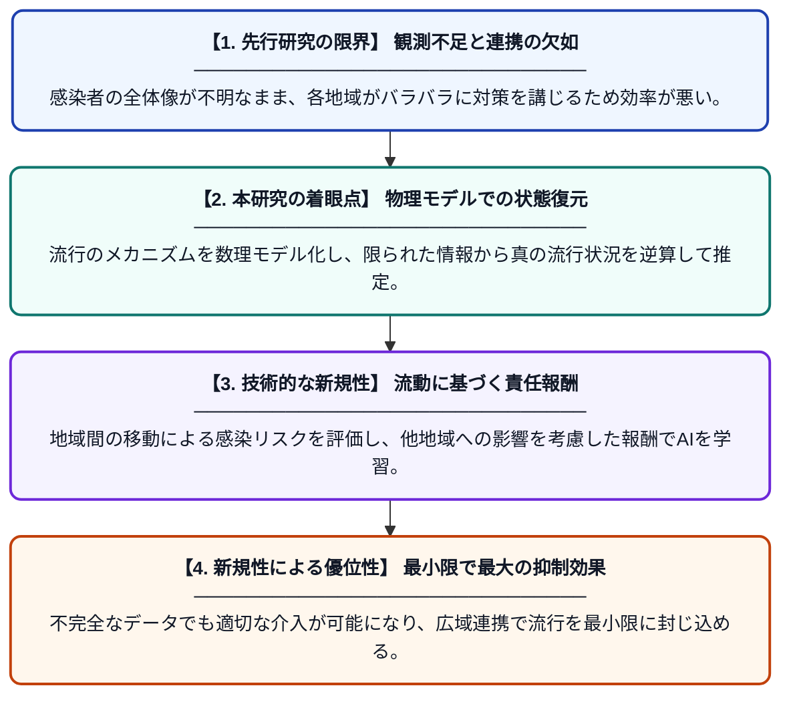

# 不完全な観測下におけるメカニズムの状態復元とマルチエージェント学習を通じた感染症制御

**Original Title**: *Epidemic control under incomplete observations through mechanistic state reconstruction and multi-agent learning*

> **💡 一言要約**: AIが隠れた流行を予測し、地域連携で感染を抑え込む

| 項目 | 内容 |
|---|---|
| **著者** | S Wang, Y Luo, Y Cui, M Zhang, M Kang, L Yin |
| **掲載誌** | PLOS Computational Biology 2026 |
| **アラートキーワード** | multi agent |
| **原文リンク** | [https://journals.plos.org/ploscompbiol/article?id=10.1371/journal.pcbi.1014955](https://journals.plos.org/ploscompbiol/article?id=10.1371/journal.pcbi.1014955) |
| **PDF版要約** | [README.pdf](./README.pdf) |

---

## 📊 新規性の図解（先行研究との違いと本研究のブレークスルー）

## 📝 要約

感染症の流行データが不完全な状況下で、物理的メカニズムを用いて真の感染状態を復元し、マルチエージェント強化学習によって最適な検査・隔離戦略を導き出す手法を提案しました。地域間の人流に基づき感染拡大の責任を報酬に反映させることで、広域での効果的な協調制御を実現しています。

## ❓ どんな問題に取り組んだか

実際のパンデミックでは、全ての感染者をリアルタイムで把握することは困難であり、不完全なデータに基づく対策は精度が低くなる課題があります。また、地域を跨ぐ移動がある場合、どの地域の対策が不十分で感染が広がったのかという責任の所在が曖昧になり、広域的な協調が難しいという問題もありました。

## ✨ 何が新しい？何がすごい？（新規性）

感染症の伝播モデルに基づく状態復元手法を導入し、不完全な観測データから潜在的な流行状況を精度高く推定可能にしました。さらに、地域間の移動フローに着目した「責任感のある報酬（responsibility-aware reward）」を設計したマルチエージェント強化学習を提案した点が革新的です。これにより、単なる個別の地域最適化ではなく、社会全体のコストを抑えつつ感染拡大を防ぐ協調的な介入戦略を確立しました。

## 🎓 大学1年生向けの解説

感染症が流行しているとき、検査を受けていない隠れた感染者がたくさんいます。この研究は、数学的な仕組みを使って「今どこにどれくらい感染者がいるか」を正確に予測するAIを開発しました。さらに、AIたちが「自分たちの地域から他に病気を広めないように」と協力し合って検査や隔離のタイミングを決める仕組みを作りました。これによって、限られた検査キットを賢く使いながら、効率的に流行を抑えることができるようになります。
