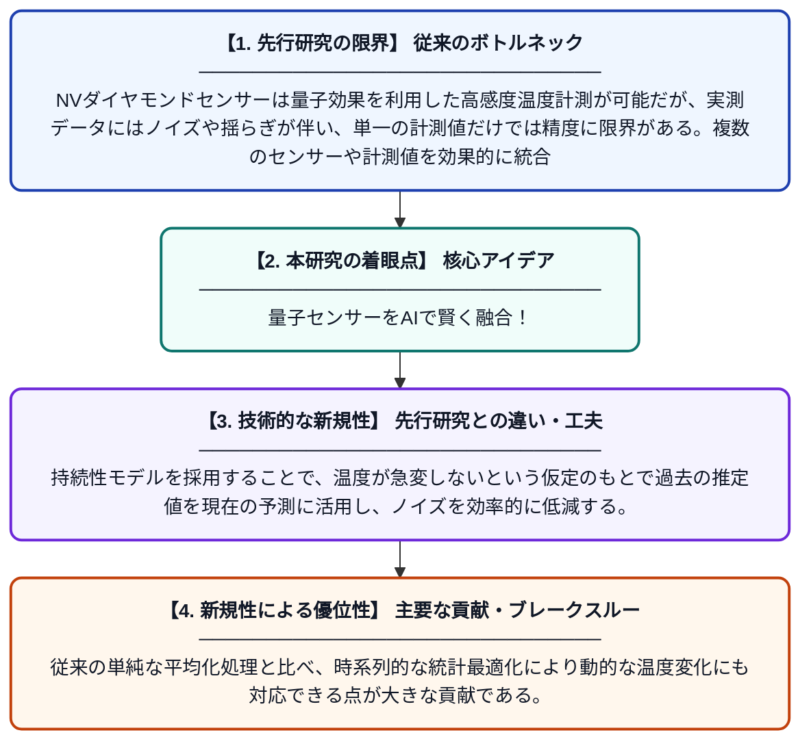

# カルマンフィルタを用いたNVダイヤモンドデータ融合による温度センシング精度の向上

**Original Title**: *A Kalman Filter Based Approach to NV Diamond Data Fusion For Improved Temperature Sensing*

> **💡 一言要約**: 量子センサーをAIで賢く融合！

| 項目 | 内容 |
|---|---|
| **著者** | S Rajpal, Q Guo, BA McCullian, T Berry, Z Ahmed |
| **掲載誌** | arXiv preprint arXiv:2607.22410 2026 |
| **アラートキーワード** | kalman filter |
| **PDF** | [https://arxiv.org/pdf/2607.22410](https://arxiv.org/pdf/2607.22410) |
| **原文リンク** | [https://arxiv.org/pdf/2607.22410](https://arxiv.org/pdf/2607.22410) |
| **PDF版要約** | [README.pdf](./README.pdf) |

---

## 📊 新規性の図解（先行研究との違いと本研究のブレークスルー）

## 📝 要約

本論文では、窒素空孔（NV）中心を持つダイヤモンドを用いた量子温度センサーの計測精度を向上させるため、カルマンフィルタによるデータ融合手法を提案している。持続性モデルを採用したカルマンフィルタにより、複数の計測データを統計的に最適統合し、ノイズを低減した温度推定を実現している。この手法により、従来の単純平均化に比べてより高精度かつリアルタイムな温度計測が可能となる。

## ❓ どんな問題に取り組んだか

NVダイヤモンドセンサーは量子効果を利用した高感度温度計測が可能だが、実測データにはノイズや揺らぎが伴い、単一の計測値だけでは精度に限界がある。複数のセンサーや計測値を効果的に統合し、ノイズを抑制しながらリアルタイムで高精度な温度推定を行う手法が求められていた。

## ✨ 何が新しい？何がすごい？（新規性）

本研究は、量子温度センサーであるNVダイヤモンドの計測データにカルマンフィルタを初めて体系的に適用したデータ融合フレームワークを提案している。持続性モデルを採用することで、温度が急変しないという仮定のもとで過去の推定値を現在の予測に活用し、ノイズを効率的に低減する。従来の単純な平均化処理と比べ、時系列的な統計最適化により動的な温度変化にも対応できる点が大きな貢献である。

## 🎓 大学1年生向けの解説

ダイヤモンドの中に窒素原子を入れると、温度を量子レベルで非常に精密に測れるセンサーになります。しかし、どんなセンサーも測定のたびに少しずつ誤差（ノイズ）が生じます。カルマンフィルタとは、過去の測定結果と現在の測定結果をうまく組み合わせて、本当の値に近い推定を行う数学的な手法です。例えるなら、複数人の「ちょっとあやふやな証言」を賢くまとめて「真実に近い答え」を導くようなイメージです。この論文では、そのカルマンフィルタをダイヤモン温度センサーに応用し、より正確な温度計測を実現しました。
