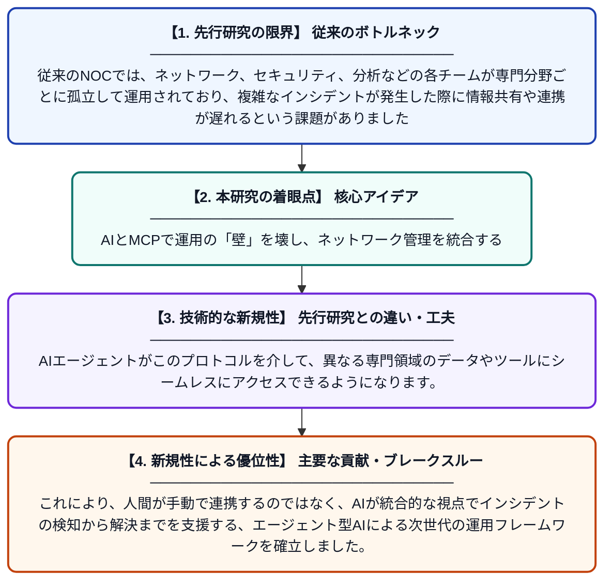

# AI拡張型ネットワーク管理：ユニバーサル統合レイヤーとしてのモデル・コンテキスト・プロトコル (MCP)

**Original Title**: *AI-Augmented Network Management: The Model Context Protocol As a Universal Integration Layer*

> **💡 一言要約**: AIとMCPで運用の「壁」を壊し、ネットワーク管理を統合する

| 項目 | 内容 |
|---|---|
| **著者** | A Singh |
| **掲載誌** | Agentic AI for Cybersecurity: Foundations, Frameworks … 2026 |
| **アラートキーワード** | Secure Computing |
| **原文リンク** | [https://link.springer.com/chapter/10.1007/979-8-8688-3237-6_6](https://link.springer.com/chapter/10.1007/979-8-8688-3237-6_6) |
| **PDF版要約** | [README.pdf](./README.pdf) |

---

## 📊 新規性の図解（先行研究との違いと本研究のブレークスルー）

## 📝 要約

ネットワーク運用センター（NOC）における部門間の分断を解消するため、AIを活用した新しい管理手法を提案する論文です。モデル・コンテキスト・プロトコル（MCP）を導入することで、ネットワーク、セキュリティ、コンピューティングなどの異なるドメインを統合し、インシデント対応の自動化と効率化を図ります。

## ❓ どんな問題に取り組んだか

従来のNOCでは、ネットワーク、セキュリティ、分析などの各チームが専門分野ごとに孤立して運用されており、複雑なインシデントが発生した際に情報共有や連携が遅れるという課題がありました。それぞれのチームが異なるツールやデータ形式を使用しているため、システム全体の状況を即座に把握することが困難でした。

## ✨ 何が新しい？何がすごい？（新規性）

本研究は、これまで分断されていた各管理ドメインを「モデル・コンテキスト・プロトコル（MCP）」という共通のインターフェースで接続した点が革新的です。AIエージェントがこのプロトコルを介して、異なる専門領域のデータやツールにシームレスにアクセスできるようになります。これにより、人間が手動で連携するのではなく、AIが統合的な視点でインシデントの検知から解決までを支援する、エージェント型AIによる次世代の運用フレームワークを確立しました。

## 🎓 大学1年生向けの解説

インターネットを支える大きな施設（NOC）では、通信の担当、セキュリティの担当、サーバーの担当といった具合に、チームがバラバラに分かれて活動しています。何かトラブルが起きたとき、これまでは各チームがわざわざ集まって話し合う必要があり、解決に時間がかかっていました。この研究では、AIがすべてのチームの情報を一度に理解できる「共通の言葉（MCP）」を作りました。これにより、AIが賢い秘書のように、バラバラだった情報をまとめて複雑なトラブルを素早く解決してくれます。
